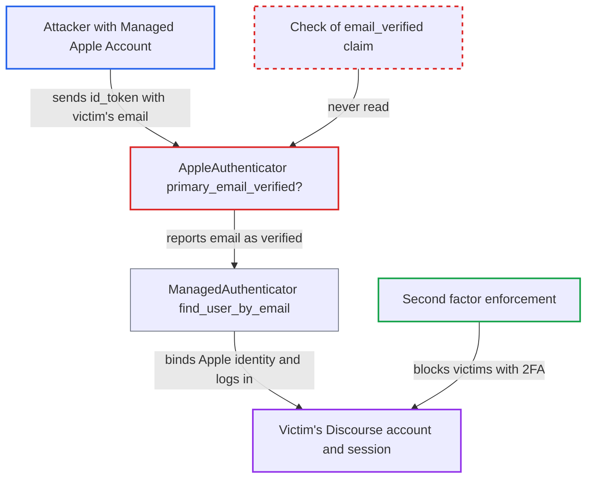

# Apple login trusts unverified id_token email, enabling account takeover by email match

| Field | Value |
|---|---|
| ID | `find_01Gt3aANJ5p8rxqVvDmr5r5v` |
| Severity | **Critical** |
| Status | open |
| CWE | CWE-287 — Improper Authentication |
| Created | 2026-10-27T21:46:53.604067Z |
| Claude Security | https://claude.ai/security/findings/find_01Gt3aANJ5p8rxqVvDmr5r5v |

## Description

An attacker who runs a Managed Apple Account can log in as any Discourse user who has no second factor, including staff, by using that user's email address. This needs Apple to issue an `id_token` with an unverified email, and the site must have the Apple login plugin enabled (default off). The cause is `AppleAuthenticator#primary_email_verified?`, which always returns `true` and never reads the `email_verified` claim.

1. **Attacker** sets the email of a Managed Apple Account to the victim's Discourse address. Apple may mark such an email `email_verified: false` because it does not check it for Sign in with Apple at Work \& School accounts.
2. **Attacker** clicks the Apple login button on the Discourse site. The callback `/auth/apple/callback` receives an `id_token` with the victim's email.
3. **Apple strategy in `omniauth_apple.rb`** copies `email` from the `id_token` into `info[:email]`. The whole payload, including `email_verified`, is kept under `extra.raw_info.id_token_info`, but nothing reads that claim. ([`plugins/discourse-apple-auth/lib/omniauth_apple.rb:28-39`](https://github.com/cx-benchmark/discourse/blob/e08ed05b4b1ef773b2de7948a8f88a7c182a3520/plugins/discourse-apple-auth/lib/omniauth_apple.rb#L28-L39))
4. **`AppleAuthenticator#primary_email_verified?`** returns the constant `true`. The code assumes Apple always verifies emails, so the unverified address passes as proven. ([`plugins/discourse-apple-auth/plugin.rb:61-65`](https://github.com/cx-benchmark/discourse/blob/e08ed05b4b1ef773b2de7948a8f88a7c182a3520/plugins/discourse-apple-auth/plugin.rb#L61-L65))
5. **`after_authenticate` and `find_user_by_email`** find the victim by email and bind the attacker's Apple `sub` to that account. Because `match_by_email` is `true`, the lookup uses `User.find_by_email`, which also matches secondary emails. The victim's earlier Apple associations are deleted. ([`lib/auth/managed_authenticator.rb:131-134`](https://github.com/cx-benchmark/discourse/blob/e08ed05b4b1ef773b2de7948a8f88a7c182a3520/lib/auth/managed_authenticator.rb#L131-L134))
6. **`ManagedAuthenticator`** sets `result.email_valid` to `true`. It takes the value from the same constant, so the controller treats the address as proven. ([`lib/auth/managed_authenticator.rb:107`](https://github.com/cx-benchmark/discourse/blob/e08ed05b4b1ef773b2de7948a8f88a7c182a3520/lib/auth/managed_authenticator.rb#L107))
7. **`user_found` and `handle_account_activation`** activate the account if needed and call `log_on_user` for the victim. No password or email round trip is needed. Only a victim with a second factor (`enforce_second_factor_on_external_auth`, default true) or a staged account stops this. ([`app/controllers/users/omniauth_callbacks_controller.rb:167-214`](https://github.com/cx-benchmark/discourse/blob/e08ed05b4b1ef773b2de7948a8f88a7c182a3520/app/controllers/users/omniauth_callbacks_controller.rb#L167-L214))

## Assessment

The attacker administers a Managed Apple Account (Apple Business or School Manager) whose email is set to the victim's Discourse address. The site operator must have enabled the Apple login plugin, which is off by default. The victim must have no second factor and must not be a staged user. This also depends on Apple actually issuing such a token. The report cannot prove this from the repository and assumes Apple behaves as its documentation says. If Apple only puts addresses from the organisation's own verified domains in that claim, the gain shrinks to addresses the attacker could already receive mail for. Separately, when no user matches the email, the same `email_valid` lets a new account be created and activated with the unverified address.

Impact: The attacker gets a full session as the victim. For staff or admins without a second factor, that includes reading private messages and restricted categories and acting as them. The attacker's Apple identity stays linked to the victim account for later logins. Victims with a second factor are blocked, and availability is not affected.

## Recommendation

`AppleAuthenticator#primary_email_verified?` always returns `true` instead of reading the `email_verified` claim Apple puts in the `id_token`. An unverified address is therefore treated as proof of mailbox ownership for email matching, account activation and login.

Fix criteria: An Apple `id_token` whose `email_verified` is `false`, "false" or absent gives `email_valid == false`. It is not matched to an existing account by email, and it does not activate or log in an account. Only `true` or "true" counts as verified. A test with a stubbed `id_token` carrying a victim's email and `email_verified: false` must not log in as the victim or link to their account.

## Evidence

**https://github.com/cx-benchmark/discourse**

- [`plugins/discourse-apple-auth/plugin.rb:61-65`](https://github.com/cx-benchmark/discourse/blob/e08ed05b4b1ef773b2de7948a8f88a7c182a3520/plugins/discourse-apple-auth/plugin.rb#L61-L65)
- [`plugins/discourse-apple-auth/lib/omniauth_apple.rb:28-39`](https://github.com/cx-benchmark/discourse/blob/e08ed05b4b1ef773b2de7948a8f88a7c182a3520/plugins/discourse-apple-auth/lib/omniauth_apple.rb#L28-L39)
- [`lib/auth/managed_authenticator.rb:71-75`](https://github.com/cx-benchmark/discourse/blob/e08ed05b4b1ef773b2de7948a8f88a7c182a3520/lib/auth/managed_authenticator.rb#L71-L75)
- [`lib/auth/managed_authenticator.rb:131-134`](https://github.com/cx-benchmark/discourse/blob/e08ed05b4b1ef773b2de7948a8f88a7c182a3520/lib/auth/managed_authenticator.rb#L131-L134)
- [`lib/auth/managed_authenticator.rb:107`](https://github.com/cx-benchmark/discourse/blob/e08ed05b4b1ef773b2de7948a8f88a7c182a3520/lib/auth/managed_authenticator.rb#L107)
- [`app/controllers/users/omniauth_callbacks_controller.rb:167-214`](https://github.com/cx-benchmark/discourse/blob/e08ed05b4b1ef773b2de7948a8f88a7c182a3520/app/controllers/users/omniauth_callbacks_controller.rb#L167-L214)

