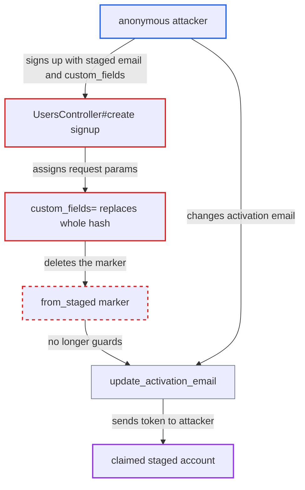

# Signup custom_fields mass assignment deletes from_staged guard, allowing staged account takeover

| Field | Value |
|---|---|
| ID | `find_01Tj86eRLjQX27tjpQRyjyHr` |
| Severity | **Critical** |
| Status | open |
| CWE | CWE-915 — Mass assignment |
| Created | 2026-10-27T22:49:26.809202Z |
| Claude Security | https://claude.ai/security/findings/find_01Tj86eRLjQX27tjpQRyjyHr |

## Description

An anonymous attacker who knows a staged user's email can take over that staged account. The attacker ends up with the account's email-in posts and its PMs and group-inbox topics. The attack only works on sites where the bundled `discourse-assign` or `discourse-events` plugin is enabled (both off by default). Signup replaces the whole custom-field hash, which deletes the `from_staged` marker that `update_activation_email` relies on.

1. **attacker** sends a signup request with the staged user's email and a `custom_fields` payload. The request is `POST /u` with any username and password and `custom_fields[remind_assigns_frequency]=1`, which is allowed only because an enabled plugin registered that field as self-editable. ([`app/controllers/users_controller.rb:2223-2224`](https://github.com/cx-benchmark/discourse/blob/e08ed05b4b1ef773b2de7948a8f88a7c182a3520/app/controllers/users_controller.rb#L2223-L2224))
2. **the handler `UsersController#create`** calls `unstage!` and then assigns `new_user_params` to the user. `unstage!` writes the `from_staged` marker, and the next line `user.attributes = new_user_params` assigns the request's `custom_fields` to the same user before `user.save`. ([`app/controllers/users_controller.rb:770-778`](https://github.com/cx-benchmark/discourse/blob/e08ed05b4b1ef773b2de7948a8f88a7c182a3520/app/controllers/users_controller.rb#L770-L778))
3. **the setter `custom_fields=`** replaces the whole custom-field hash. It calls `custom_fields.replace(data)` instead of merging, so the in-memory hash no longer has the `from_staged` key. ([`app/models/concerns/has_custom_fields.rb:258-260`](https://github.com/cx-benchmark/discourse/blob/e08ed05b4b1ef773b2de7948a8f88a7c182a3520/app/models/concerns/has_custom_fields.rb#L258-L260))
4. **the `after_save` hook in `HasCustomFields`** destroys the `from_staged` row when the user is saved. Every key that is stored in the database but missing from the new hash counts as `nil`, and its row is deleted. ([`app/models/concerns/has_custom_fields.rb:289-313`](https://github.com/cx-benchmark/discourse/blob/e08ed05b4b1ef773b2de7948a8f88a7c182a3520/app/models/concerns/has_custom_fields.rb#L289-L313))
5. **attacker** sends `PUT /u/update-activation-email` with the attacker's own email from the same session. The signup response bound `session[ACTIVATE_USER_KEY]` to the account. `from_staged?` now returns `nil`, so the guard at `:1253` passes. The primary email is replaced and a signup token is mailed to the attacker. ([`app/controllers/users_controller.rb:1235-1270`](https://github.com/cx-benchmark/discourse/blob/e08ed05b4b1ef773b2de7948a8f88a7c182a3520/app/controllers/users_controller.rb#L1235-L1270))
6. **attacker** redeems the emailed token and is logged in as the former staged user. `EmailToken.confirm` sets the account's email to the attacker's address and marks it active. Creating the new token also expired the one sent to the real owner. ([`app/models/email_token.rb:51-72`](https://github.com/cx-benchmark/discourse/blob/e08ed05b4b1ef773b2de7948a8f88a7c182a3520/app/models/email_token.rb#L51-L72))

## Assessment

The attacker is anonymous and needs only a staged user's email address. The site must have the `discourse-assign` plugin (field `remind_assigns_frequency`) or the `discourse-events` plugin (field `holidays-region`) enabled, and both are off by default. The attacker first fetches the honeypot and challenge values for signup. After the signup request, the attacker reuses the same session for `PUT /u/update-activation-email` and then redeems the emailed token. The real owner does not have to do anything.

Impact: The attacker takes over the chosen staged identity. That gives access to every PM and group-inbox topic the user is party to, plus future replies, and lets the attacker post and correspond as that person. The real owner loses the account and can no longer email in as it. The loss is limited to that one user.

## Recommendation

(1) The `from_staged` marker lives in the custom-field hash. Signup replaces that hash wholesale through `user.attributes = new_user_params` and `custom_fields=`, so the request it is meant to constrain can delete it.

Fix criteria: Request parameters can no longer remove or change the fact that an account was claimed from a staged user. Signup merges permitted custom fields instead of replacing the hash, or the marker is stored where request data cannot reach it. A `POST /u` with a staged email and any `custom_fields` payload leaves `from_staged` set. `PUT /u/update-activation-email` then returns 403 for that session.

(2) `update_activation_email` lets the session that created an inactive account redirect its activation to any mailbox. The only thing that excludes pre-existing staged accounts is a custom field that can be deleted.

Fix criteria: No request from the claimant's session can change which mailbox receives the activation token of an account that existed before the signup request. After an anonymous claim of a staged account, attempts to change the activation email are refused whatever custom fields were sent.

## Evidence

**https://github.com/cx-benchmark/discourse**

- [`app/controllers/users_controller.rb:770-778`](https://github.com/cx-benchmark/discourse/blob/e08ed05b4b1ef773b2de7948a8f88a7c182a3520/app/controllers/users_controller.rb#L770-L778)
- [`app/models/concerns/has_custom_fields.rb:258-260`](https://github.com/cx-benchmark/discourse/blob/e08ed05b4b1ef773b2de7948a8f88a7c182a3520/app/models/concerns/has_custom_fields.rb#L258-L260)
- [`app/models/concerns/has_custom_fields.rb:289-313`](https://github.com/cx-benchmark/discourse/blob/e08ed05b4b1ef773b2de7948a8f88a7c182a3520/app/models/concerns/has_custom_fields.rb#L289-L313)
- [`app/controllers/users_controller.rb:2223-2224`](https://github.com/cx-benchmark/discourse/blob/e08ed05b4b1ef773b2de7948a8f88a7c182a3520/app/controllers/users_controller.rb#L2223-L2224)
- [`plugins/discourse-assign/plugin.rb:66-67`](https://github.com/cx-benchmark/discourse/blob/e08ed05b4b1ef773b2de7948a8f88a7c182a3520/plugins/discourse-assign/plugin.rb#L66-L67)
- [`app/controllers/users_controller.rb:1235-1270`](https://github.com/cx-benchmark/discourse/blob/e08ed05b4b1ef773b2de7948a8f88a7c182a3520/app/controllers/users_controller.rb#L1235-L1270)
- [`app/models/user.rb:1908-1910`](https://github.com/cx-benchmark/discourse/blob/e08ed05b4b1ef773b2de7948a8f88a7c182a3520/app/models/user.rb#L1908-L1910)
- [`app/models/email_token.rb:51-72`](https://github.com/cx-benchmark/discourse/blob/e08ed05b4b1ef773b2de7948a8f88a7c182a3520/app/models/email_token.rb#L51-L72)

