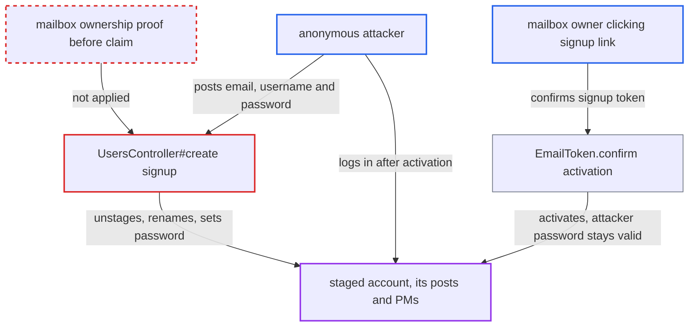

# Anonymous signup claims a staged account and plants a password before email verification

| Field | Value |
|---|---|
| ID | `find_01ETqu4oDJunt7zAUPGpfnhs` |
| Severity | **High** |
| Status | open |
| CWE | CWE-306 — Missing authentication |
| Created | 2026-10-27T22:52:21.267129Z |
| Claude Security | https://claude.ai/security/findings/find_01ETqu4oDJunt7zAUPGpfnhs |

## Description

An anonymous visitor who knows the email address of a staged account can take over that identity. They can rename it and cut the owner off from email at once. If the owner later clicks the activation link, the attacker can also log in as the owner. Only staged accounts are affected, never staff. The cause is `UsersController#create`, which unstages the account and saves the requester's password before anyone proves they control the mailbox.

1. **attacker** posts a signup request for a staged user's email. The attacker fetches `/session/hp.json`, then sends POST `/u` with the victim's email and a username, name and password of their choice, and needs no login. ([`app/controllers/users_controller.rb:770-778`](https://github.com/cx-benchmark/discourse/blob/e08ed05b4b1ef773b2de7948a8f88a7c182a3520/app/controllers/users_controller.rb#L770-L778))
2. **`UsersController#create`** finds the staged user by email, marks it inactive and calls `User#unstage!`. `unstage!` sets `staged` to false, destroys the account's notifications and commits in its own transaction, before any proof that the requester owns the email. ([`app/models/user.rb:540-551`](https://github.com/cx-benchmark/discourse/blob/e08ed05b4b1ef773b2de7948a8f88a7c182a3520/app/models/user.rb#L540-L551))
3. **`UsersController#create`** overwrites the account with the requester's attributes and saves. `user.save` stores the requester's `username`, `name` and `password`, and only afterwards does `activation.finish` mail a signup token to the real owner. ([`app/controllers/users_controller.rb:823-834`](https://github.com/cx-benchmark/discourse/blob/e08ed05b4b1ef773b2de7948a8f88a7c182a3520/app/controllers/users_controller.rb#L823-L834))
4. **`Email::Receiver` and `NotificationEmailer`** stop serving the owner because the account is no longer staged or active. The owner's inbound mail is rejected with `InactiveUserError`, and notification emails are skipped. ([`lib/email/receiver.rb:293-297`](https://github.com/cx-benchmark/discourse/blob/e08ed05b4b1ef773b2de7948a8f88a7c182a3520/lib/email/receiver.rb#L293-L297))
5. **mailbox owner** clicks the signup link that the inactive-user bounce tells them to use. `EmailToken.confirm` only sets `active = true`, and `perform_account_activation` logs the owner in without asking for a password. The attacker's password stays valid. ([`app/models/email_token.rb:51-63`](https://github.com/cx-benchmark/discourse/blob/e08ed05b4b1ef773b2de7948a8f88a7c182a3520/app/models/email_token.rb#L51-L63))
6. **attacker** logs in at `/session` with the planted password. `SessionController#create` accepts the password once the account is active and the email is confirmed, which gives the attacker the account and its PMs. ([`app/controllers/session_controller.rb:370-410`](https://github.com/cx-benchmark/discourse/blob/e08ed05b4b1ef773b2de7948a8f88a7c182a3520/app/controllers/session_controller.rb#L370-L410))

## Assessment

The attacker is an anonymous internet user with no login. They need the email address of an account the forum holds as staged. Such accounts are created by `Email::Receiver` for inbound senders and CC'd addresses, and by `TopicCreator#find_or_create_user` when staff or TL4 users send a PM to an email address. The rename, the email cut-off and the stored password need no victim action. Full takeover needs the owner to click the signup link the product mails them and activate. Only staged accounts are affected, never staff, and each address can be claimed once.

Impact: Without any victim action, the attacker can change the username and name shown on the owner's existing posts and PMs. An owner whose account is older than `username_change_period` cannot undo this. The owner also stops getting inbound and notification email. After the owner activates, the attacker can read every PM and group-inbox topic of the account, and post and act as the owner.

## Recommendation

(1) The staged-to-registered change and the overwrite of username, name and password happen on the unverified signup request in `users_controller.rb`. Whoever knows the email gets control of an identity that owns content.

Fix criteria: A staged account's `staged` flag, username, name, password and other attributes do not change until the signup token sent to that address is confirmed. POST `/u` with a staged user's email leaves that user `staged: true` and unchanged, and still able to send and receive email-in. Only confirming the token applies the claim.

(2) `User#unstage!` commits in its own transaction before `user.save`. A signup that fails validation still leaves the account unstaged and inactive, with no activation email.

Fix criteria: The unstage and the attribute save are atomic. A failed signup leaves the staged account exactly as it was. POST `/u` with a staged email and an invalid password or taken username leaves the user `staged: true`.

(3) Signup-token activation logs in whoever clicks, while a password chosen by an unverified party stays valid. The owner's own activation click hands the attacker a working login.

Fix criteria: Activating a claimed staged account does not leave a credential that the mailbox owner did not set. After an anonymous claim and the owner's activation, `SessionController#create` rejects the claimant's password.

## Evidence

**https://github.com/cx-benchmark/discourse**

- [`app/controllers/users_controller.rb:770-778`](https://github.com/cx-benchmark/discourse/blob/e08ed05b4b1ef773b2de7948a8f88a7c182a3520/app/controllers/users_controller.rb#L770-L778)
- [`app/controllers/users_controller.rb:823-834`](https://github.com/cx-benchmark/discourse/blob/e08ed05b4b1ef773b2de7948a8f88a7c182a3520/app/controllers/users_controller.rb#L823-L834)
- [`app/models/user.rb:540-551`](https://github.com/cx-benchmark/discourse/blob/e08ed05b4b1ef773b2de7948a8f88a7c182a3520/app/models/user.rb#L540-L551)
- [`app/models/email_token.rb:51-63`](https://github.com/cx-benchmark/discourse/blob/e08ed05b4b1ef773b2de7948a8f88a7c182a3520/app/models/email_token.rb#L51-L63)
- [`app/controllers/users_controller.rb:1189-1197`](https://github.com/cx-benchmark/discourse/blob/e08ed05b4b1ef773b2de7948a8f88a7c182a3520/app/controllers/users_controller.rb#L1189-L1197)
- [`app/controllers/session_controller.rb:370-410`](https://github.com/cx-benchmark/discourse/blob/e08ed05b4b1ef773b2de7948a8f88a7c182a3520/app/controllers/session_controller.rb#L370-L410)
- [`lib/email/receiver.rb:293-297`](https://github.com/cx-benchmark/discourse/blob/e08ed05b4b1ef773b2de7948a8f88a7c182a3520/lib/email/receiver.rb#L293-L297)
- [`app/services/notification_emailer.rb:99-102`](https://github.com/cx-benchmark/discourse/blob/e08ed05b4b1ef773b2de7948a8f88a7c182a3520/app/services/notification_emailer.rb#L99-L102)
- [`lib/guardian/user_guardian.rb:64-70`](https://github.com/cx-benchmark/discourse/blob/e08ed05b4b1ef773b2de7948a8f88a7c182a3520/lib/guardian/user_guardian.rb#L64-L70)
- [`app/services/user/action/create_from_verified_email.rb:12-17`](https://github.com/cx-benchmark/discourse/blob/e08ed05b4b1ef773b2de7948a8f88a7c182a3520/app/services/user/action/create_from_verified_email.rb#L12-L17)
- [`app/models/user.rb:449-461`](https://github.com/cx-benchmark/discourse/blob/e08ed05b4b1ef773b2de7948a8f88a7c182a3520/app/models/user.rb#L449-L461)

