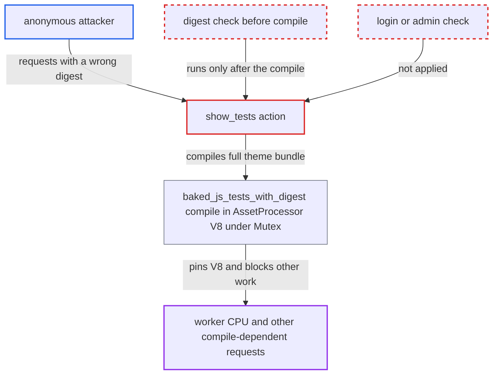

# Anonymous theme test-JS endpoint compiles full theme bundle before validating digest

| Field | Value |
|---|---|
| ID | `find_01KQRzitLP8sdVyF8wy1RedV` |
| Severity | **High** |
| Status | open |
| CWE | CWE-400 — Uncontrolled Resource Consumption |
| Created | 2026-10-27T21:33:45.097396Z |
| Claude Security | https://claude.ai/security/findings/find_01KQRzitLP8sdVyF8wy1RedV |

## Description

Anyone on the internet, without an account, can make a Discourse server spend seconds of CPU per request compiling a theme's JavaScript. This can slow down or block the forum. The only precondition is a theme with test files, and the bundled Horizon theme (id `-2`) has them on a default install. The cause is `ThemeJavascriptsController#show_tests`: it compiles the full bundle before it checks the supplied digest.

1. **Anonymous attacker** sends a GET request to the test-bundle route with a made-up digest. The request is `GET /theme-javascripts/tests/-2-<any 40 hex chars>.js`. The route places no constraint on `theme_id`, and the action needs no login. ([`config/routes.rb:1195`](https://github.com/cx-benchmark/discourse/blob/e08ed05b4b1ef773b2de7948a8f88a7c182a3520/config/routes.rb#L1195))
2. **the action `show_tests`** accepts the request from an anonymous client. It skips `redirect_to_login_if_required` and has no `requires_login`. `is_asset_path` sends the request to the asset rate limiter, which allows 200 requests per 10 seconds per IP by default. ([`app/controllers/theme_javascripts_controller.rb:6-16`](https://github.com/cx-benchmark/discourse/blob/e08ed05b4b1ef773b2de7948a8f88a7c182a3520/app/controllers/theme_javascripts_controller.rb#L6-L16))
3. **the action `show_tests`** calls `theme.baked_js_tests_with_digest` before looking at the digest. The digest is compared only after this call returns, at the next line. The disk cache is read only after the digest matches, so even valid requests recompile. ([`app/controllers/theme_javascripts_controller.rb:48-63`](https://github.com/cx-benchmark/discourse/blob/e08ed05b4b1ef773b2de7948a8f88a7c182a3520/app/controllers/theme_javascripts_controller.rb#L48-L63))
4. **the method `baked_js_tests_with_digest`** builds a compiler over all `extra_js`, `migrations` and `tests_js` fields and asks for the content. Nothing is reused between requests. Each call does a full rollup and Babel compile and then hashes the output. ([`app/models/theme.rb:1097-1123`](https://github.com/cx-benchmark/discourse/blob/e08ed05b4b1ef773b2de7948a8f88a7c182a3520/app/models/theme.rb#L1097-L1123))
5. **the class `AssetProcessor`** runs the compile in the single `MiniRacer` V8 context under a process-wide `Mutex`. Each compile can run up to the 15 s script timeout. Other work that needs the compiler in that worker waits for it. ([`lib/asset_processor.rb:133-143`](https://github.com/cx-benchmark/discourse/blob/e08ed05b4b1ef773b2de7948a8f88a7c182a3520/lib/asset_processor.rb#L133-L143))
6. **the action `show_tests`** finds that the digest does not match and returns `404`. The expensive work has already been done by then. The attacker repeats the request to keep the compiler busy. ([`app/controllers/theme_javascripts_controller.rb:48-63`](https://github.com/cx-benchmark/discourse/blob/e08ed05b4b1ef773b2de7948a8f88a7c182a3520/app/controllers/theme_javascripts_controller.rb#L48-L63))

## Assessment

The attacker is any anonymous internet user. No account, special setting or user interaction is needed. A theme with `tests_js` fields must exist. That holds on every default install, because the bundled Horizon theme (id `-2`) has a `test/` directory that is imported as `tests_js` fields. Any other theme id that has test files also works. The attacker can stay within the 200-per-10-seconds asset limit from one IP, or use several IPs. Because all compiles in a worker share one mutex, a handful of concurrent requests per Unicorn worker keeps V8 busy. That starves other work that needs the compiler, such as admin theme saves and stylesheet `post_css`. Each request costs far more than an ordinary one, but the rate limiter treats it like a static asset fetch.

Impact: The attacker can degrade or deny service for the forum by using up CPU and memory and blocking compile-dependent requests. The report says no data is read or modified.

## Recommendation

(1) `show_tests` runs the costly compile in `baked_js_tests_with_digest` before it checks the request's digest and before it reads the disk cache. Unauthenticated requests with arbitrary digests can therefore trigger unbounded compiles.

Fix criteria: An unauthenticated request whose digest does not match an already-compiled artefact is rejected without calling `ThemeJavascriptCompiler` or `AssetProcessor`. For example, the endpoint serves only from the disk cache or a stored digest, or the compile happens where the digest is generated (the admin QUnit page), or a per-theme cache keyed by field content is used. Repeated requests with random 40-hex digests cause no `AssetProcessor.v8_call` invocations.

(2) The endpoint has no authorization and no dedicated rate limiting, although its only legitimate consumer is the admin-only `/theme-qunit` page.

Fix criteria: Access to the test bundle requires the same privilege as `QunitController#theme` (admin in production), or it is rate limited per IP or per theme well below the asset limiter. Anonymous clients can then no longer trigger the compile freely.

## Evidence

**https://github.com/cx-benchmark/discourse**

- [`app/controllers/theme_javascripts_controller.rb:48-63`](https://github.com/cx-benchmark/discourse/blob/e08ed05b4b1ef773b2de7948a8f88a7c182a3520/app/controllers/theme_javascripts_controller.rb#L48-L63)
- [`app/controllers/theme_javascripts_controller.rb:6-16`](https://github.com/cx-benchmark/discourse/blob/e08ed05b4b1ef773b2de7948a8f88a7c182a3520/app/controllers/theme_javascripts_controller.rb#L6-L16)
- [`app/models/theme.rb:1097-1123`](https://github.com/cx-benchmark/discourse/blob/e08ed05b4b1ef773b2de7948a8f88a7c182a3520/app/models/theme.rb#L1097-L1123)
- [`lib/theme_javascript_compiler.rb:25-56`](https://github.com/cx-benchmark/discourse/blob/e08ed05b4b1ef773b2de7948a8f88a7c182a3520/lib/theme_javascript_compiler.rb#L25-L56)
- [`lib/asset_processor.rb:133-143`](https://github.com/cx-benchmark/discourse/blob/e08ed05b4b1ef773b2de7948a8f88a7c182a3520/lib/asset_processor.rb#L133-L143)
- [`lib/system_themes_manager.rb:4-29`](https://github.com/cx-benchmark/discourse/blob/e08ed05b4b1ef773b2de7948a8f88a7c182a3520/lib/system_themes_manager.rb#L4-L29)
- [`config/routes.rb:1195`](https://github.com/cx-benchmark/discourse/blob/e08ed05b4b1ef773b2de7948a8f88a7c182a3520/config/routes.rb#L1195)

