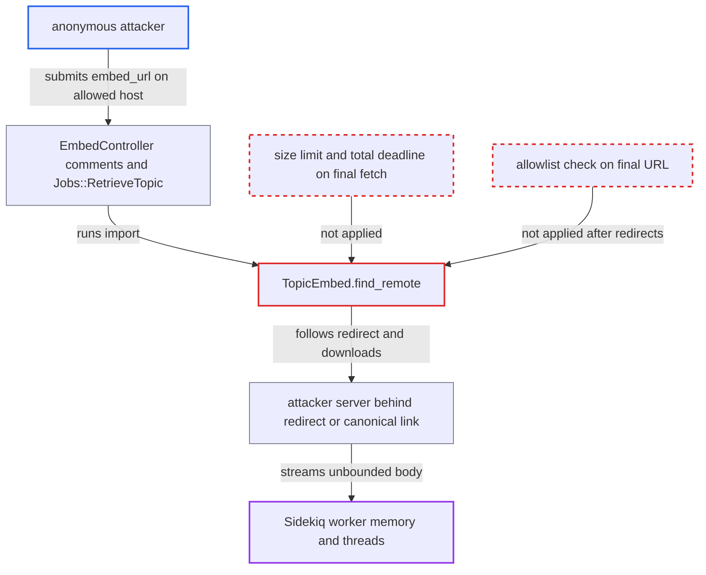

# Embed topic import buffers entire remote page body with no size limit

| Field | Value |
|---|---|
| ID | `find_01UpxaRa2qs4p4TZuS3zC7oc` |
| Severity | **High** |
| Status | open |
| CWE | CWE-400 — Uncontrolled resource consumption |
| Created | 2026-10-27T22:00:28.201679Z |
| Claude Security | https://claude.ai/security/findings/find_01UpxaRa2qs4p4TZuS3zC7oc |

## Description

An anonymous internet user can hang or exhaust the memory of the site's background job workers, which stops emails, notifications and post cooking until the process is restarted. No data is disclosed or changed. The attacker needs an allowed embeddable host that redirects, or links via canonical, to a server they control. The cause is `TopicEmbed.find_remote`, which downloads the final page with `FinalDestination::HTTP.get_response` and no size or time limit.

1. **attacker** requests the embed comments endpoint with a URL on an allowed host. The `embed_url` host matches an `EmbeddableHost` row. The URL redirects, or names a canonical link, to the attacker's server. No topic exists yet for the URL, so a fresh path is used each time. ([`app/controllers/embed_controller.rb:79-131`](https://github.com/cx-benchmark/discourse/blob/e08ed05b4b1ef773b2de7948a8f88a7c182a3520/app/controllers/embed_controller.rb#L79-L131))
2. **`EmbedController#comments`** enqueues `Jobs::RetrieveTopic` with the attacker's `embed_url`. The job is queued for any `embed_url` whose host is allowed and which has no topic yet. ([`app/controllers/embed_controller.rb:79-131`](https://github.com/cx-benchmark/discourse/blob/e08ed05b4b1ef773b2de7948a8f88a7c182a3520/app/controllers/embed_controller.rb#L79-L131))
3. **`TopicRetriever`** calls `TopicEmbed.import_remote`, which calls `find_remote`. It checks only the submitted host with `EmbeddableHost.url_allowed?`. It limits non-staff to one import per 60 seconds site-wide. ([`lib/topic_retriever.rb:9-42`](https://github.com/cx-benchmark/discourse/blob/e08ed05b4b1ef773b2de7948a8f88a7c182a3520/lib/topic_retriever.rb#L9-L42))
4. **`FinalDestination#resolve`** follows up to 5 redirects and the canonical link to any host. Its own GET is capped at `MAX_REQUEST_SIZE_BYTES` (5 MiB) and a time limit. `find_remote` then throws that bounded body away. ([`lib/final_destination.rb:255-265`](https://github.com/cx-benchmark/discourse/blob/e08ed05b4b1ef773b2de7948a8f88a7c182a3520/lib/final_destination.rb#L255-L265))
5. **`TopicEmbed.find_remote`** re-fetches the final URI with `FinalDestination::HTTP.get_response(uri)`. This reads the whole body into one in-memory string with no byte cap and no overall deadline. Only the default 60 s per-read timeout applies. A gzip body is also inflated in memory. ([`app/models/topic_embed.rb:186-201`](https://github.com/cx-benchmark/discourse/blob/e08ed05b4b1ef773b2de7948a8f88a7c182a3520/app/models/topic_embed.rb#L186-L201))
6. **attacker's server** streams a huge body, a gzip bomb or a slow drip. The Sidekiq worker thread stays busy and its memory grows. The body then goes to `Nokogiri.HTML5` twice and to `Readability::Document`. ([`app/models/topic_embed.rb:186-201`](https://github.com/cx-benchmark/discourse/blob/e08ed05b4b1ef773b2de7948a8f88a7c182a3520/app/models/topic_embed.rb#L186-L201))

## Assessment

The attacker is an anonymous internet user with no login. The embed endpoint is an anonymous entry point. They need an allowed embeddable host that has an open redirect, or a page on it whose `<link rel=canonical>` points at their server. They request `/embed/comments` with a fresh path each time so that no topic exists yet. A non-staff import is throttled to one per 60 seconds site-wide, so the attack is repeated at that rate. A second way in is `PostsController#expand_embed`, which reaches the same `find_remote` through `content_for_expansion` for legacy embeds with no cached content.

Impact: Each triggered import holds a Sidekiq worker thread and grows one in-memory string without bound, and gzip inflation makes it worse. A few repetitions exhaust worker memory or hang all worker threads, so background processing stops until the process is killed and restarted. No data is disclosed or modified.

## Recommendation

(1) `TopicEmbed.find_remote` reads the remote page with `Net::HTTP.get_response`. This buffers the whole body, including gzip-inflated data, with no size cap or overall deadline. Other `FinalDestination` body readers in core do cap their buffers.

Fix criteria: The import stops reading once the body passes a fixed limit, such as the 5 MiB bound `FinalDestination#resolve` uses or one scaled from `EMBED_CONTENT_CACHE_MAX_LENGTH`. It also stops when a total request deadline passes, before any HTML parsing. A response that streams more than the limit, or inflates past it, is abandoned. To verify, point an allowed embed URL via redirect at a server that streams an unbounded body. Confirm the job exits with bounded memory and time.

(2) The host allowlist is checked only on the submitted URL. `find_remote` then follows redirects and canonical links to any host, so the downloaded content need not come from an allowed host.

Fix criteria: The final URI after redirects and canonical resolution is re-checked against `EmbeddableHost.url_allowed?`, or redirects are restricted to the same host, before the body is fetched. An open redirect on an allowed host can then no longer make the importer fetch attacker-hosted content.

## Evidence

**https://github.com/cx-benchmark/discourse**

- [`app/models/topic_embed.rb:186-201`](https://github.com/cx-benchmark/discourse/blob/e08ed05b4b1ef773b2de7948a8f88a7c182a3520/app/models/topic_embed.rb#L186-L201)
- [`app/controllers/embed_controller.rb:79-131`](https://github.com/cx-benchmark/discourse/blob/e08ed05b4b1ef773b2de7948a8f88a7c182a3520/app/controllers/embed_controller.rb#L79-L131)
- [`lib/topic_retriever.rb:9-42`](https://github.com/cx-benchmark/discourse/blob/e08ed05b4b1ef773b2de7948a8f88a7c182a3520/lib/topic_retriever.rb#L9-L42)
- [`lib/final_destination.rb:255-265`](https://github.com/cx-benchmark/discourse/blob/e08ed05b4b1ef773b2de7948a8f88a7c182a3520/lib/final_destination.rb#L255-L265)
- [`app/controllers/posts_controller.rb:369-373`](https://github.com/cx-benchmark/discourse/blob/e08ed05b4b1ef773b2de7948a8f88a7c182a3520/app/controllers/posts_controller.rb#L369-L373)

