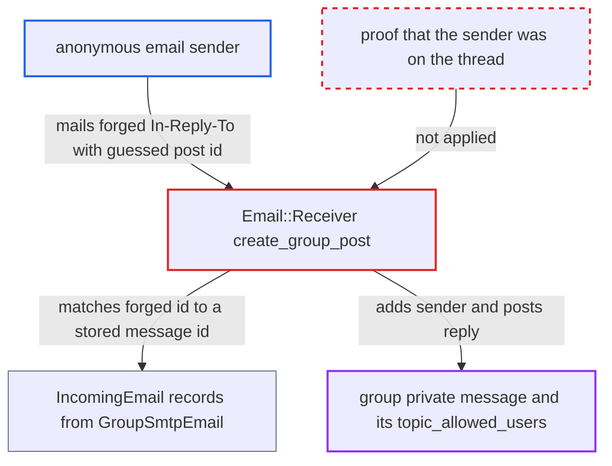

# Forged In-Reply-To with predictable Message-ID lets unknown senders join group inbox PMs

| Field | Value |
|---|---|
| ID | `find_011oj5AoptMWdt5U4pbsvyNw` |
| Severity | **High** |
| Status | open |
| CWE | CWE-639 — Authorization bypass |
| Created | 2026-10-27T21:23:42.156782Z |
| Claude Security | https://claude.ai/security/findings/find_011oj5AoptMWdt5U4pbsvyNw |

## Description

An anonymous email sender can join private messages in a group's inbox, read the whole conversation and post replies that go out from the group's address. This needs `email_in`, group SMTP and the non-default group setting `allow_unknown_sender_topic_replies`. `Email::Receiver#create_group_post` accepts a forged `In-Reply-To` or `References` id as proof of belonging to the thread. Discourse-generated Message-IDs are predictable.

1. **attacker** works out a current post id. Post ids are sequential, and the host in the Message-ID is the forum's own. The attacker can read the id range from public posts or from a staff reply to their own support email. ([`lib/email/message_id_service.rb:54-58`](https://github.com/cx-benchmark/discourse/blob/e08ed05b4b1ef773b2de7948a8f88a7c182a3520/lib/email/message_id_service.rb#L54-L58))
2. **attacker** emails the group inbox address from an address they control, with forged `In-Reply-To`/`References` headers. The headers carry up to five ids of the form `<discourse/post/N@host>`, and the receiver takes them from the sender's mail. ([`lib/email/receiver.rb:948`](https://github.com/cx-benchmark/discourse/blob/e08ed05b4b1ef773b2de7948a8f88a7c182a3520/lib/email/receiver.rb#L948))
3. **the receiver `create_group_post`** matches a forged id to a stored `IncomingEmail` and selects that private message as the thread. `Jobs::GroupSmtpEmail` stored a record with that Message-ID for each group SMTP email it sent. The receiver skips the `addressed_to_user` check that would tie the sender to the thread. ([`lib/email/receiver.rb:954-958`](https://github.com/cx-benchmark/discourse/blob/e08ed05b4b1ef773b2de7948a8f88a7c182a3520/lib/email/receiver.rb#L954-L958))
4. **the receiver `create_group_post`** adds the sender to `topic_allowed_users` and posts their body as a reply. If the sender is unknown, a staged account is created for them first. ([`lib/email/receiver.rb:994-1007`](https://github.com/cx-benchmark/discourse/blob/e08ed05b4b1ef773b2de7948a8f88a7c182a3520/lib/email/receiver.rb#L994-L1007))
5. **the post alerter** sends every later group SMTP email in the thread to the attacker as To/CC. The attacker is now one of `topic_allowed_users`. ([`app/services/post_alerter.rb:950-965`](https://github.com/cx-benchmark/discourse/blob/e08ed05b4b1ef773b2de7948a8f88a7c182a3520/app/services/post_alerter.rb#L950-L965))
6. **attacker** signs up on the forum with the same email address. Signing up unstages the staged account, and it keeps its membership in the thread. ([`app/controllers/users_controller.rb:770-775`](https://github.com/cx-benchmark/discourse/blob/e08ed05b4b1ef773b2de7948a8f88a7c182a3520/app/controllers/users_controller.rb#L770-L775))
7. **`TopicGuardian#can_see_topic?`** lets the attacker read the whole private message. Visibility depends only on membership in `all_allowed_users`. ([`lib/guardian/topic_guardian.rb:254-256`](https://github.com/cx-benchmark/discourse/blob/e08ed05b4b1ef773b2de7948a8f88a7c182a3520/lib/guardian/topic_guardian.rb#L254-L256))

## Assessment

The attacker is an anonymous sender on the internet and needs no account. The site must have `email_in` and a group inbox with group SMTP. That group must have `allow_unknown_sender_topic_replies` turned on, which is not the default. The target private message must have had a group SMTP email sent within `disallow_reply_by_email_after_days` (default 90). If a guessed id matches nothing, the mail only opens a new topic. To read the conversation, the attacker signs up with the same address.

Impact: The attacker becomes a participant in group inbox private messages. After signing up, they can read the full history, including customer support content and participants' addresses, and they get every later reply by email. They can also post into these conversations, and the group's own address relays their text to the customer. Reach is limited to group private messages with a recorded group SMTP email, and no other privilege is gained.

## Recommendation

With `allow_unknown_sender_topic_replies` on, `create_group_post` treats knowing a thread's Message-ID as permission to join a group private message. Discourse-generated ids of the form `discourse/post/<id>@host` are predictable, and `Jobs::GroupSmtpEmail` stores them as `IncomingEmail.message_id`, so any sender can forge them.

Fix criteria: An unknown sender can be added to an existing group private message only on proof that cannot be derived from public data. Examples are a thread identifier with an unguessable part, or a reference matching a message actually delivered to an address tied to the sender. To verify, mail the group inbox from an unrelated address with `In-Reply-To: <discourse/post/N@host>` for a post N that was sent by group SMTP. This must create a new topic and must not add the sender to that private message. A genuine reply that carries the real thread Message-ID must still thread correctly.

## Evidence

**https://github.com/cx-benchmark/discourse**

- [`lib/email/receiver.rb:954-958`](https://github.com/cx-benchmark/discourse/blob/e08ed05b4b1ef773b2de7948a8f88a7c182a3520/lib/email/receiver.rb#L954-L958)
- [`lib/email/receiver.rb:994-1007`](https://github.com/cx-benchmark/discourse/blob/e08ed05b4b1ef773b2de7948a8f88a7c182a3520/lib/email/receiver.rb#L994-L1007)
- [`lib/email/receiver.rb:948`](https://github.com/cx-benchmark/discourse/blob/e08ed05b4b1ef773b2de7948a8f88a7c182a3520/lib/email/receiver.rb#L948)
- [`app/jobs/regular/group_smtp_email.rb:81-92`](https://github.com/cx-benchmark/discourse/blob/e08ed05b4b1ef773b2de7948a8f88a7c182a3520/app/jobs/regular/group_smtp_email.rb#L81-L92)
- [`lib/email/sender.rb:607-610`](https://github.com/cx-benchmark/discourse/blob/e08ed05b4b1ef773b2de7948a8f88a7c182a3520/lib/email/sender.rb#L607-L610)
- [`lib/email/message_id_service.rb:54-58`](https://github.com/cx-benchmark/discourse/blob/e08ed05b4b1ef773b2de7948a8f88a7c182a3520/lib/email/message_id_service.rb#L54-L58)
- [`app/services/post_alerter.rb:950-965`](https://github.com/cx-benchmark/discourse/blob/e08ed05b4b1ef773b2de7948a8f88a7c182a3520/app/services/post_alerter.rb#L950-L965)
- [`lib/guardian/topic_guardian.rb:254-256`](https://github.com/cx-benchmark/discourse/blob/e08ed05b4b1ef773b2de7948a8f88a7c182a3520/lib/guardian/topic_guardian.rb#L254-L256)
- [`app/controllers/users_controller.rb:770-775`](https://github.com/cx-benchmark/discourse/blob/e08ed05b4b1ef773b2de7948a8f88a7c182a3520/app/controllers/users_controller.rb#L770-L775)

