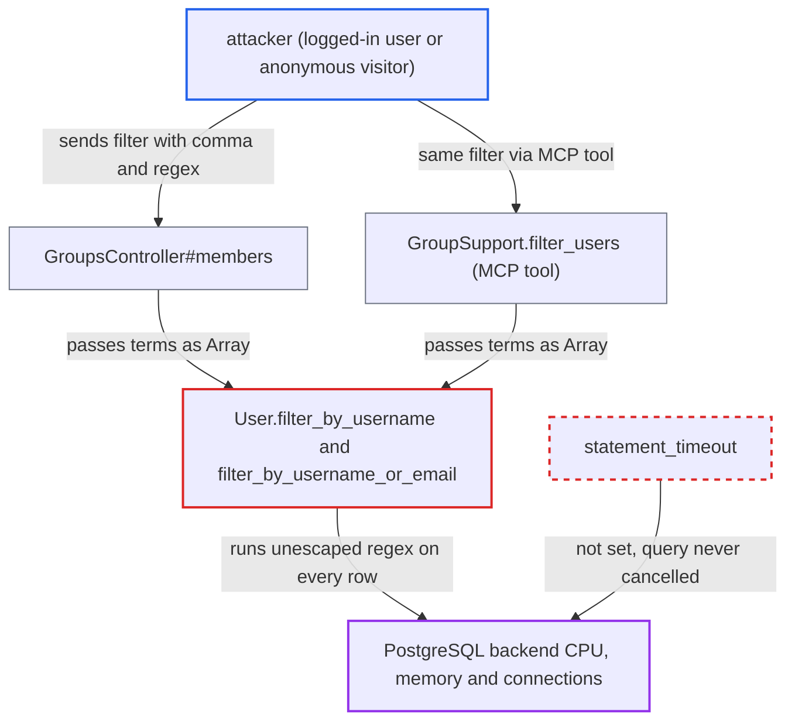

# Group members filter passes unescaped user input as PostgreSQL regex (regex DoS)

| Field | Value |
|---|---|
| ID | `find_01JPGZRAu9NArvnzWfuZsWbP` |
| Severity | **High** |
| Status | open |
| CWE | CWE-1333 — Regular Expression Denial of Service |
| Created | 2026-10-27T22:16:51.550195Z |
| Claude Security | https://claude.ai/security/findings/find_01JPGZRAu9NArvnzWfuZsWbP |

## Description

Any logged-in user can keep the site's PostgreSQL database busy, and anonymous visitors can do the same for public custom groups. They send a group-members request whose `filter` contains a comma and a hostile regular expression. `User.filter_by_username` and `User.filter_by_username_or_email` join the terms with `|` and run them as a regex with no escaping. No `statement_timeout` stops the query.

1. **attacker** requests the group members list with a comma in `filter`. The request is `GET /groups/trust_level_0/members.json?filter=x,<pattern>`. A logged-in user passes the group check for automatic groups such as `trust_level_0`, and anonymous visitors pass it for public custom groups. ([`lib/guardian.rb:308-315`](https://github.com/cx-benchmark/discourse/blob/e08ed05b4b1ef773b2de7948a8f88a7c182a3520/lib/guardian.rb#L308-L315))
2. **the handler `GroupsController#members`** splits `params[:filter]` on commas and passes an Array to the user filter. The comma switches the code from the substring (ILIKE) filter to the regex branch. The same split happens for requesters and in the MCP helper `GroupSupport.filter_users`. ([`app/controllers/groups_controller.rb:266-292`](https://github.com/cx-benchmark/discourse/blob/e08ed05b4b1ef773b2de7948a8f88a7c182a3520/app/controllers/groups_controller.rb#L266-L292))
3. **the method `User.filter_by_username`** joins the terms with `|` and evaluates them with `username_lower ~* ?`. The value is a bound parameter, so this is not SQL injection. The attacker's text is still regex syntax to PostgreSQL, because nothing is escaped. ([`app/models/user.rb:338-345`](https://github.com/cx-benchmark/discourse/blob/e08ed05b4b1ef773b2de7948a8f88a7c182a3520/app/models/user.rb#L338-L345))
4. **PostgreSQL** compiles the attacker's pattern and runs it against every row of `group.listed_users`. This happens in both the `members` query and the `owners` query. A contrived pattern can take arbitrary time and memory per row. ([`app/controllers/groups_controller.rb:266-292`](https://github.com/cx-benchmark/discourse/blob/e08ed05b4b1ef773b2de7948a8f88a7c182a3520/app/controllers/groups_controller.rb#L266-L292))
5. **the web server** kills the web worker after 30 seconds. The PostgreSQL backend is not cancelled and keeps running the query. ([`config/pitchfork.conf.rb:34-37`](https://github.com/cx-benchmark/discourse/blob/e08ed05b4b1ef773b2de7948a8f88a7c182a3520/config/pitchfork.conf.rb#L34-L37))
6. **the database configuration** applies no `statement_timeout` by default. Session variables are set only from operator-supplied settings, and `config/discourse_defaults.conf` sets none, so nothing bounds the backend's run time. ([`app/models/global_setting.rb:162-173`](https://github.com/cx-benchmark/discourse/blob/e08ed05b4b1ef773b2de7948a8f88a7c182a3520/app/models/global_setting.rb#L162-L173))

## Assessment

A registered user (trust level 0 is enough) sends `GET /groups/trust_level_0/members.json?filter=x,<pattern>`. An anonymous visitor can do the same against any admin-created group left at the default public visibilities. A second way in is the MCP tool `discourse_list_group_members`, and also `discourse_list_group_membership_requests`, for MCP/OAuth clients. The requesters branch of the controller has the same split-and-regex pattern. Any pattern works, because commas become `|`, and only request size limits it. The attacker can also register a username shaped to the pattern. Repeating requests within the default per-IP limit of 50 requests per 10 seconds keeps many backends busy. The report assumes PostgreSQL 15 or later with its stock regex engine.

Impact: The attacker can make PostgreSQL spend CPU and memory on a request for as long as the pattern and the group size dictate. Sustained requests exhaust database CPU and connection slots, so the whole site is denied service while the attack lasts. No data is disclosed or changed, because the regex only widens a filter over members the caller may already list.

## Recommendation

(1) `User.filter_by_username` and `User.filter_by_username_or_email` put caller-supplied terms into a PostgreSQL `~*` pattern (and a `SIMILAR TO` pattern for admins) without escaping. Request input is therefore read as regex syntax by the database.

Fix criteria: Comma-separated filter terms are matched literally, for example with `username_lower = ANY(?)`, or `ILIKE ANY(ARRAY[...])` with LIKE wildcards escaped, or by escaping each term before joining. `GET /groups/<group>/members.json?filter=a,.*` and `filter=a,(x{200}){200}` return only members whose username literally contains `a`, `.*` or the pattern text. PostgreSQL compiles no regex for these requests.

(2) No default `statement_timeout` bounds the SQL of web requests. A slow regex, or any expensive query, keeps a PostgreSQL backend busy after the web worker has abandoned the request.

Fix criteria: Web-request database sessions carry a bounded `statement_timeout`, which the existing `unicorn_worker_db_variables_*` mechanism can supply by default. A deliberately slow query is cancelled by the backend when the limit elapses.

## Evidence

**https://github.com/cx-benchmark/discourse**

- [`app/models/user.rb:338-345`](https://github.com/cx-benchmark/discourse/blob/e08ed05b4b1ef773b2de7948a8f88a7c182a3520/app/models/user.rb#L338-L345)
- [`app/models/user.rb:347-368`](https://github.com/cx-benchmark/discourse/blob/e08ed05b4b1ef773b2de7948a8f88a7c182a3520/app/models/user.rb#L347-L368)
- [`app/controllers/groups_controller.rb:266-292`](https://github.com/cx-benchmark/discourse/blob/e08ed05b4b1ef773b2de7948a8f88a7c182a3520/app/controllers/groups_controller.rb#L266-L292)
- [`lib/guardian.rb:308-315`](https://github.com/cx-benchmark/discourse/blob/e08ed05b4b1ef773b2de7948a8f88a7c182a3520/lib/guardian.rb#L308-L315)
- [`app/controllers/groups_controller.rb:216-226`](https://github.com/cx-benchmark/discourse/blob/e08ed05b4b1ef773b2de7948a8f88a7c182a3520/app/controllers/groups_controller.rb#L216-L226)
- [`lib/discourse_mcp/tools/groups.rb:131-140`](https://github.com/cx-benchmark/discourse/blob/e08ed05b4b1ef773b2de7948a8f88a7c182a3520/lib/discourse_mcp/tools/groups.rb#L131-L140)
- [`app/models/global_setting.rb:162-173`](https://github.com/cx-benchmark/discourse/blob/e08ed05b4b1ef773b2de7948a8f88a7c182a3520/app/models/global_setting.rb#L162-L173)
- [`config/pitchfork.conf.rb:34-37`](https://github.com/cx-benchmark/discourse/blob/e08ed05b4b1ef773b2de7948a8f88a7c182a3520/config/pitchfork.conf.rb#L34-L37)

