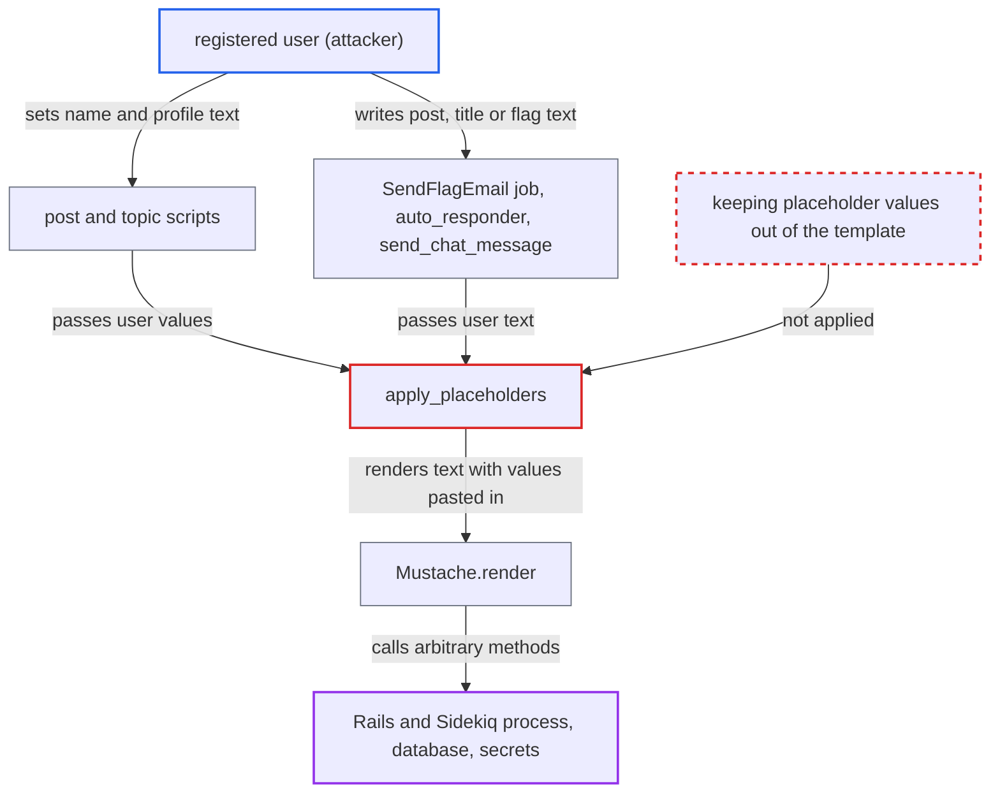

# Mustache template injection via automation placeholders lets users run arbitrary Ruby methods

| Field | Value |
|---|---|
| ID | `find_01MLSRfS9exs5SRYfsZMrZn8` |
| Severity | **High** |
| Status | open |
| CWE | CWE-1336 — Server-side template injection |
| Created | 2026-10-27T21:48:26.079533Z |
| Claude Security | https://claude.ai/security/findings/find_01MLSRfS9exs5SRYfsZMrZn8 |

## Description

Any registered user can make the server run arbitrary Ruby methods. This can lead to code execution, deleted files and database rows, leaked secrets, or a killed process. It works only where an admin has set up an automation whose template uses the legacy `%%NAME%%` placeholders (or `%%REPORT=...%%`). The cause is `apply_placeholders`, which pastes user text into the template before `Mustache.render` compiles it.

1. **attacker with a registered account** stores template syntax in their own profile. They set their full name to `Psych` and put a Mustache section chain that ends in `unsafe_load` into a field such as location or bio. ([`plugins/automation/lib/discourse_automation/scripts/post.rb:42-58`](https://github.com/cx-benchmark/discourse/blob/e08ed05b4b1ef773b2de7948a8f88a7c182a3520/plugins/automation/lib/discourse_automation/scripts/post.rb#L42-L58))
2. **attacker** saves the profile. `handle_user_updated` runs on every `:user_updated` event and triggers the automation synchronously inside the web request, with the user's name, profile attributes and custom fields. ([`plugins/automation/lib/discourse_automation/event_handlers.rb:132-206`](https://github.com/cx-benchmark/discourse/blob/e08ed05b4b1ef773b2de7948a8f88a7c182a3520/plugins/automation/lib/discourse_automation/event_handlers.rb#L132-L206))
3. **the `post` script** puts the user's values into the placeholder map and calls `apply_placeholders`. The `topic` script does the same for the topic body and title. ([`plugins/automation/lib/discourse_automation/scripts/post.rb:42-58`](https://github.com/cx-benchmark/discourse/blob/e08ed05b4b1ef773b2de7948a8f88a7c182a3520/plugins/automation/lib/discourse_automation/scripts/post.rb#L42-L58))
4. **`apply_placeholders`** replaces each `%%KEY%%` token in the admin's template with the raw value. It uses `gsub` with no escaping, so the attacker's `{{...}}` text now sits inside the template string. ([`plugins/automation/lib/discourse_automation/scriptable.rb:192-201`](https://github.com/cx-benchmark/discourse/blob/e08ed05b4b1ef773b2de7948a8f88a7c182a3520/plugins/automation/lib/discourse_automation/scriptable.rb#L192-L201))
5. **`Mustache.render`** compiles the substituted string and runs the attacker's tags. The attacker's `name` string becomes a section frame, and `constantize` turns it into any Ruby constant, here `Psych`. ([`plugins/automation/lib/discourse_automation/scriptable.rb:192-201`](https://github.com/cx-benchmark/discourse/blob/e08ed05b4b1ef773b2de7948a8f88a7c182a3520/plugins/automation/lib/discourse_automation/scriptable.rb#L192-L201))
6. **Mustache 1.1.3 `Context#find`** calls methods on the non-Hash objects the tags name. It calls zero-arity methods directly. For arity-1 methods it returns a Proc that is called with the raw section body, so `Psych.unsafe_load` gets the attacker's payload. ([`Gemfile.lock:386`](https://github.com/cx-benchmark/discourse/blob/e08ed05b4b1ef773b2de7948a8f88a7c182a3520/Gemfile.lock#L386))

## Assessment

The attacker needs only a registered account (any trust level). The site needs an admin-made automation whose template uses a legacy `%%NAME%%` placeholder, or `%%REPORT=...%%`, whose table cells hold user-supplied data such as search terms. The main route is a `post` or `topic` automation on the `user_updated` trigger, where the attacker's own profile fields are the payload. No victim action is needed. Other routes reach the same sink: the flag e-mail job `Jobs::DiscourseAutomation::SendFlagEmail` (runs in Sidekiq) renders the flagged topic's title and post excerpt, so a post author plus any flagger can trigger it. `auto_responder` renders the part of the user's post that the admin's regex matches, which the attacker fully controls if the regex is permissive. The chat `send_chat_message` script renders `topic_title` and the full raw post as `post_quote`. The report notes that the Mustache behaviour described is an assumption about version 1.1.3.

Impact: The attacker can call arbitrary Ruby methods inside the Rails or Sidekiq process, and the report says nothing in the code limits which constants or methods are reachable. This allows remote code execution through `Psych.unsafe_load` or `Kernel.require`, deletion of files and database tables, and disclosure of every user's email, `password_hash` and `salt` plus `SiteSetting`, `GlobalSetting`, `ENV` and `secret_key_base`. The leaked DiscourseConnect secret would allow admin impersonation. The attacker can also halt the web or Sidekiq process with `exit!` or `sleep`.

Subsequent-system impact: The leaked secrets include S3 access keys, SMTP credentials and Redis and database passwords. The attacker can read them back from the generated post or PM. They can then use them against the object store, the mail relay and the data stores the forum depends on.

## Recommendation

(1) `apply_placeholders` pastes untrusted placeholder values into the string that `Mustache.render` then compiles, so user data becomes template code (`scriptable.rb:198-200`).

Fix criteria: Placeholder values are never parsed as template syntax. Either the Mustache template is rendered first and `%%KEY%%` substitution is done on the output, or `%%KEY%%` is replaced with inert text, such as a variable reference like `{{key}}` resolved from the map. Check: a user named `Psych` with location `{{#name}}{{#constantize}}{{#unsafe_load}}--- 1{{/unsafe_load}}{{/constantize}}{{/name}}` triggers the automation, and that literal text appears in the post with no method call.

(2) `Mustache.render` runs with a context where tags can resolve to arbitrary Ruby methods on a String and from there any constant, because `Mustache::Context#find` calls `obj.method(key)` on non-Hash frames.

Fix criteria: Rendering uses a context limited to plain data. Values are strings or hashes only, and the engine does not invoke methods on them, for example by wrapping values, by a Mustache subclass with method lookup disabled, or by a renderer limited to Hash lookup. Check: `{{#site_title}}{{#class}}{{#ancestors}}{{exit!}}{{/ancestors}}{{/class}}{{/site_title}}` in any template renders as inert text and does not terminate the process.

(3) The `%%REPORT=...%%` expansion inlines report table cells, such as user-supplied search terms, titles and usernames, into the template before Mustache compiles it (`scriptable.rb:196,204-230`).

Fix criteria: Report output is inserted as data after the template is compiled, or the Mustache delimiters are escaped so cell contents cannot form tags. Check: a trending search term of `{{#site_title}}{{class}}{{/site_title}}` appears literally in a post generated with `%%REPORT=trending_search%%`.

## Evidence

**https://github.com/cx-benchmark/discourse**

- [`plugins/automation/lib/discourse_automation/scriptable.rb:192-201`](https://github.com/cx-benchmark/discourse/blob/e08ed05b4b1ef773b2de7948a8f88a7c182a3520/plugins/automation/lib/discourse_automation/scriptable.rb#L192-L201)
- [`plugins/automation/lib/discourse_automation/scripts/post.rb:42-58`](https://github.com/cx-benchmark/discourse/blob/e08ed05b4b1ef773b2de7948a8f88a7c182a3520/plugins/automation/lib/discourse_automation/scripts/post.rb#L42-L58)
- [`plugins/automation/lib/discourse_automation/scripts/topic.rb:27-47`](https://github.com/cx-benchmark/discourse/blob/e08ed05b4b1ef773b2de7948a8f88a7c182a3520/plugins/automation/lib/discourse_automation/scripts/topic.rb#L27-L47)
- [`plugins/automation/lib/discourse_automation/event_handlers.rb:132-206`](https://github.com/cx-benchmark/discourse/blob/e08ed05b4b1ef773b2de7948a8f88a7c182a3520/plugins/automation/lib/discourse_automation/event_handlers.rb#L132-L206)
- [`plugins/automation/app/jobs/regular/discourse_automation/send_flag_email.rb:27-61`](https://github.com/cx-benchmark/discourse/blob/e08ed05b4b1ef773b2de7948a8f88a7c182a3520/plugins/automation/app/jobs/regular/discourse_automation/send_flag_email.rb#L27-L61)
- [`plugins/automation/lib/discourse_automation/scripts/auto_responder.rb:38-69`](https://github.com/cx-benchmark/discourse/blob/e08ed05b4b1ef773b2de7948a8f88a7c182a3520/plugins/automation/lib/discourse_automation/scripts/auto_responder.rb#L38-L69)
- [`plugins/chat/plugin.rb:614-628`](https://github.com/cx-benchmark/discourse/blob/e08ed05b4b1ef773b2de7948a8f88a7c182a3520/plugins/chat/plugin.rb#L614-L628)
- [`Gemfile.lock:386`](https://github.com/cx-benchmark/discourse/blob/e08ed05b4b1ef773b2de7948a8f88a7c182a3520/Gemfile.lock#L386)

