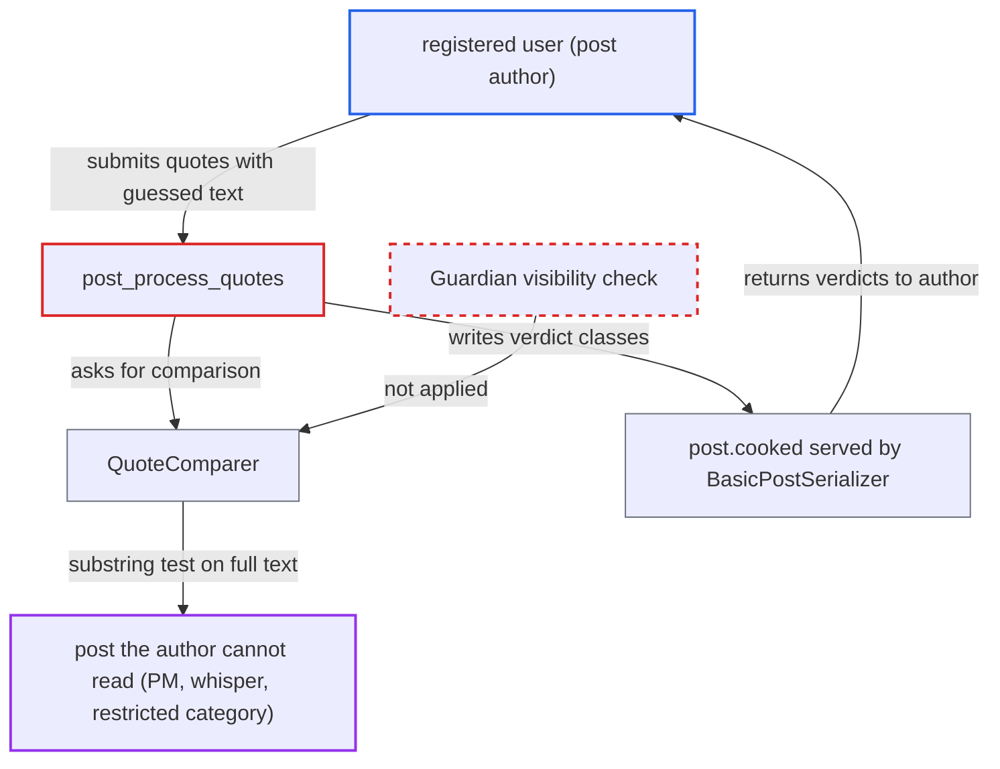

# Quote post-processing exposes substring oracle on posts the author cannot read

| Field | Value |
|---|---|
| ID | `find_01VNQN3wBi2PuWLSaBPtaYUW` |
| Severity | **High** |
| Status | open |
| CWE | CWE-204 — Observable response discrepancy |
| Created | 2026-10-27T21:23:31.475123Z |
| Claude Security | https://claude.ai/security/findings/find_01VNQN3wBi2PuWLSaBPtaYUW |

## Description

Any registered user who can create or edit a post can learn the text of posts they are not allowed to read. This covers private messages, whispers and restricted categories, and works one yes/no guess at a time. The cause is `post_process_quotes`, which runs `QuoteComparer` against any post the author names, without checking that the author may see it. It then writes the result into the author's own post.

1. **attacker** writes quote blocks that point at a post they cannot read. The attacker uses `[quote="x, post:N, topic:M"]guess[/quote]` or raw HTML `<aside class="quote" data-topic="M" data-post="N"><blockquote>guess</blockquote></aside>`, which the allowlist keeps. ([`frontend/pretty-text/addon/allow-lister.js:138-139`](https://github.com/cx-benchmark/discourse/blob/e08ed05b4b1ef773b2de7948a8f88a7c182a3520/frontend/pretty-text/addon/allow-lister.js#L138-L139))
2. **the job `Jobs::ProcessPost`** runs the post processor when the post is created or edited. It saves the processed HTML in `post.cooked` and publishes the change to clients. ([`app/jobs/regular/process_post.rb:26-44`](https://github.com/cx-benchmark/discourse/blob/e08ed05b4b1ef773b2de7948a8f88a7c182a3520/app/jobs/regular/process_post.rb#L26-L44))
3. **the method `post_process_quotes`** builds a `QuoteComparer` for each quote from the author-supplied `data-topic` and `data-post`. The quote's blockquote text is passed in as the guess, and nothing checks that the author can see the target post. ([`lib/cooked_post_processor.rb:70-83`](https://github.com/cx-benchmark/discourse/blob/e08ed05b4b1ef773b2de7948a8f88a7c182a3520/lib/cooked_post_processor.rb#L70-L83))
4. **the class `QuoteComparer`** loads the target post and tests the guess against its text. It loads the post with no `Guardian` check. `missing?` shows whether the post exists, and `modified?` returns `!parent_text.include?(text)`, a case-sensitive substring test against the target's full cooked text with whitespace removed. ([`lib/quote_comparer.rb:8-32`](https://github.com/cx-benchmark/discourse/blob/e08ed05b4b1ef773b2de7948a8f88a7c182a3520/lib/quote_comparer.rb#L8-L32))
5. **the method `post_process_quotes`** writes the verdict into the attacker's own post. The classes `quote-post-not-found` and `quote-modified` are added to each aside. ([`lib/cooked_post_processor.rb:70-83`](https://github.com/cx-benchmark/discourse/blob/e08ed05b4b1ef773b2de7948a8f88a7c182a3520/lib/cooked_post_processor.rb#L70-L83))
6. **the serializer `BasicPostSerializer`** returns the stored `cooked` to the attacker. The attacker reads the classes from `/posts/:id.json` or the rendered topic. An aside without `quote-modified` means the guess appears in the target post. ([`app/serializers/basic_post_serializer.rb:29-40`](https://github.com/cx-benchmark/discourse/blob/e08ed05b4b1ef773b2de7948a8f88a7c182a3520/app/serializers/basic_post_serializer.rb#L29-L40))
7. **attacker** extends the guess one character at a time over successive posts or edits. Each confirmed substring is lengthened, which rebuilds the target post's text.

## Assessment

The attacker is any registered user who can create or edit a post. A TL0 user can reply in public topics, and a PM to themselves also works from TL1. The attacker aims quote blocks at a topic they cannot read, using up to 50 BBCode quotes per post or more as raw-HTML asides. No victim action and no non-default setting are needed. The `max_quotes_per_post` setting (default 50) counts only `[quote` BBCode in the raw text, so raw-HTML asides are not limited by it. The post rate limits only slow the attack down.

Impact: The attacker can recover, one character at a time, the text of any post they pick but are not allowed to read. This includes staff or user PMs, whispers, and restricted or group-only categories. The `quote-post-not-found` flag also shows which topic and post ids exist. The report finds no integrity or availability impact.

## Recommendation

`post_process_quotes` compares author-supplied quote text against any post the author names by id, with no authorization check. It stores a per-quote yes/no result about that post's content where the author can read it.

Fix criteria: The comparison runs, and `quote-modified` / `quote-post-not-found` are emitted, only when the post's author (`Guardian.new(post.user)`) can see the quoted post. Otherwise the aside is left unmarked, the same as for a missing post or with no marker at all. A post quoting a PM or restricted-category post by id gets the same classes whatever the guessed text. Quoting a visible post still gets the correct markers.

## Evidence

**https://github.com/cx-benchmark/discourse**

- [`lib/cooked_post_processor.rb:70-83`](https://github.com/cx-benchmark/discourse/blob/e08ed05b4b1ef773b2de7948a8f88a7c182a3520/lib/cooked_post_processor.rb#L70-L83)
- [`lib/quote_comparer.rb:8-32`](https://github.com/cx-benchmark/discourse/blob/e08ed05b4b1ef773b2de7948a8f88a7c182a3520/lib/quote_comparer.rb#L8-L32)
- [`app/jobs/regular/process_post.rb:26-44`](https://github.com/cx-benchmark/discourse/blob/e08ed05b4b1ef773b2de7948a8f88a7c182a3520/app/jobs/regular/process_post.rb#L26-L44)
- [`app/serializers/basic_post_serializer.rb:29-40`](https://github.com/cx-benchmark/discourse/blob/e08ed05b4b1ef773b2de7948a8f88a7c182a3520/app/serializers/basic_post_serializer.rb#L29-L40)
- [`frontend/pretty-text/addon/allow-lister.js:138-139`](https://github.com/cx-benchmark/discourse/blob/e08ed05b4b1ef773b2de7948a8f88a7c182a3520/frontend/pretty-text/addon/allow-lister.js#L138-L139)
- [`lib/validators/post_validator.rb:154-160`](https://github.com/cx-benchmark/discourse/blob/e08ed05b4b1ef773b2de7948a8f88a7c182a3520/lib/validators/post_validator.rb#L154-L160)

