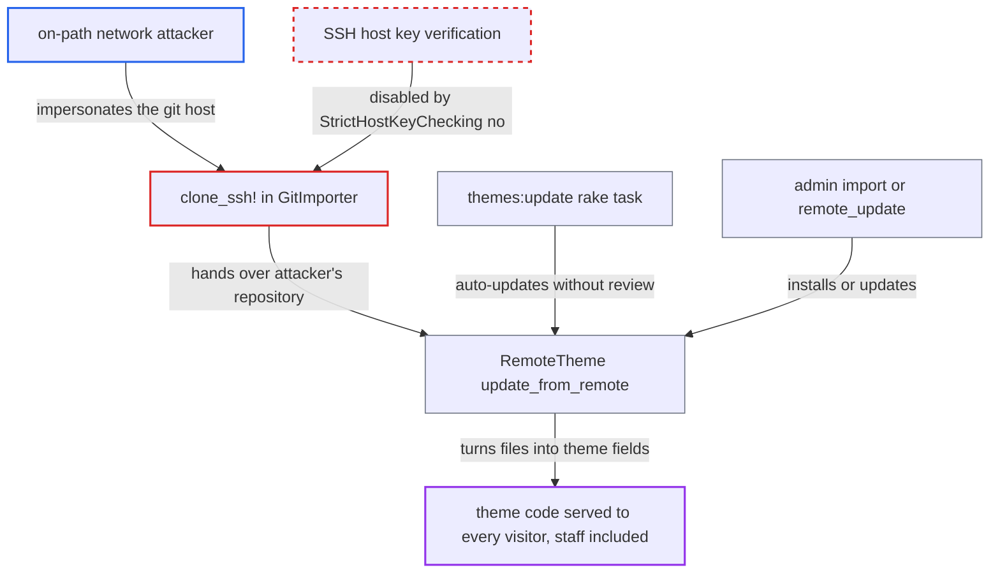

# SSH theme import disables host key verification, enabling MITM theme code injection

| Field | Value |
|---|---|
| ID | `find_01SZgn1FNgCdFcDfMMEmMdLR` |
| Severity | **High** |
| Status | open |
| CWE | CWE-322 — Key exchange without entity authentication |
| Created | 2026-10-27T21:17:25.707526Z |
| Claude Security | https://claude.ai/security/findings/find_01SZgn1FNgCdFcDfMMEmMdLR |

## Description

A network attacker who can impersonate a theme's git server can make a Discourse site install the attacker's theme code. That code runs on every page for all visitors, including admins, and can lead to staff account takeover. It needs a theme installed over SSH and an on-path network position, but no credentials. `clone_ssh!` sets `StrictHostKeyChecking=no`, so the git server is never authenticated.

1. **network attacker** impersonates the git host when Discourse connects over SSH. The attacker sits on the network path between the Discourse server and the git host, for example through a DNS or BGP hijack, and presents its own host key. ([`lib/theme_store/git_importer.rb:159-176`](https://github.com/cx-benchmark/discourse/blob/e08ed05b4b1ef773b2de7948a8f88a7c182a3520/lib/theme_store/git_importer.rb#L159-L176))
2. **the method `clone_ssh!`** accepts the attacker's host key and clones the attacker's repository. `GIT_SSH_COMMAND` contains `-o StrictHostKeyChecking=no`, so an unknown or changed host key is accepted, public-key authentication still proceeds, and git fetches whatever the peer serves. ([`lib/theme_store/git_importer.rb:159-176`](https://github.com/cx-benchmark/discourse/blob/e08ed05b4b1ef773b2de7948a8f88a7c182a3520/lib/theme_store/git_importer.rb#L159-L176))
3. **admin or the `themes:update` task** triggers the install or update of the SSH theme. An admin install (`import`) or `remote_update` does it, or `themes:update` does it with no admin review for enabled themes with `auto_update` (default true) whose remote version differs. ([`lib/tasks/themes.rake:286-317`](https://github.com/cx-benchmark/discourse/blob/e08ed05b4b1ef773b2de7948a8f88a7c182a3520/lib/tasks/themes.rake#L286-L317))
4. **the method `update_from_remote`** turns the cloned files into `ThemeField` records and saves the theme. Every matching file is converted, including `javascripts/*`, `common/head_tag.html`, `body_tag`, SCSS, `settings.yml`, assets and `about.json` with `modifiers` and child `components`. ([`app/models/remote_theme.rb:245-322`](https://github.com/cx-benchmark/discourse/blob/e08ed05b4b1ef773b2de7948a8f88a7c182a3520/app/models/remote_theme.rb#L245-L322))
5. **Discourse** serves the attacker's theme code to every visitor. The fields are compiled into the JS and CSS of every page, staff pages included, and `about.json` modifiers can widen the CSP.

## Assessment

The attacker needs an on-path position between the Discourse server and the git host of a theme installed over SSH, for example through a DNS or BGP hijack or a compromised hosting network. No credentials are needed. The site must use an SSH theme (`ssh://git@host/...`, or `git@host:org/repo`, which `GitUrl.normalize` rewrites). The content is installed in one of three ways. An admin installs a new SSH theme (`import`). An admin presses Update (`remote_update`). Or the `themes:update` rake task auto-updates an enabled theme with `auto_update` when its remote version differs. The daily `Jobs::CheckOutOfDateThemes` job and the admin `remote_check` action open the same unauthenticated connection, but they only record version data (`remote_version`, `commits_behind`). The HTTPS path (`clone_http!`) is not affected, because it keeps TLS certificate verification and pins the resolved addresses.

Impact: The attacker can run arbitrary JavaScript and HTML on every page of the site, staff pages included. The code can read and change anything the visiting admin's session can reach, which leads to staff account takeover. Broken theme code can also degrade page rendering until an admin removes it.

## Recommendation

`clone_ssh!` turns off SSH host key verification with `StrictHostKeyChecking=no`. The identity of the git server that supplies theme code is never checked, so any on-path peer can substitute the repository content.

Fix criteria: Theme git clones over SSH authenticate the server, and an unknown or changed host key aborts the import. One way is trust-on-first-use, with the key recorded per `RemoteTheme` and `StrictHostKeyChecking=yes` or `accept-new` checked against that record. Another is admin-provided host fingerprints. To verify, point a remote theme at an SSH server whose host key differs from the recorded one. Then confirm that `import!` and `update_remote_version` fail with an authentication error instead of importing the content.

## Evidence

**https://github.com/cx-benchmark/discourse**

- [`lib/theme_store/git_importer.rb:159-176`](https://github.com/cx-benchmark/discourse/blob/e08ed05b4b1ef773b2de7948a8f88a7c182a3520/lib/theme_store/git_importer.rb#L159-L176)
- [`app/models/remote_theme.rb:245-322`](https://github.com/cx-benchmark/discourse/blob/e08ed05b4b1ef773b2de7948a8f88a7c182a3520/app/models/remote_theme.rb#L245-L322)
- [`lib/tasks/themes.rake:286-317`](https://github.com/cx-benchmark/discourse/blob/e08ed05b4b1ef773b2de7948a8f88a7c182a3520/lib/tasks/themes.rake#L286-L317)
- [`app/controllers/admin/themes_controller.rb:212-219`](https://github.com/cx-benchmark/discourse/blob/e08ed05b4b1ef773b2de7948a8f88a7c182a3520/app/controllers/admin/themes_controller.rb#L212-L219)
- [`app/models/remote_theme.rb:223-243`](https://github.com/cx-benchmark/discourse/blob/e08ed05b4b1ef773b2de7948a8f88a7c182a3520/app/models/remote_theme.rb#L223-L243)

