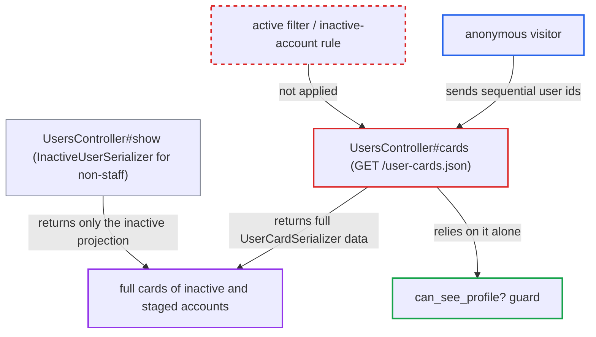

# /user-cards.json returns full profile cards for inactive and staged accounts

| Field | Value |
|---|---|
| ID | `find_01UutXCsPJKBpTRMU84XafHK` |
| Severity | **Medium** |
| Status | open |
| CWE | CWE-863 — Incorrect Authorization |
| Created | 2026-10-27T22:07:08.454715Z |
| Claude Security | https://claude.ai/security/findings/find_01UutXCsPJKBpTRMU84XafHK |

## Description

Anyone on the internet, with no login, can list accounts that Discourse hides from non-staff and read their profile cards. These are staged (email-created) users, deactivated users and unactivated signups. The attack works with default settings. The cause is `UsersController#cards`, which loads users with no `active` filter and checks only `can_see_profile?`, which ignores `active`.

1. **anonymous visitor** requests `GET /user-cards.json?user_ids=1,2,…,50`. The route can be reached without logging in and accepts up to 50 ids per request, and account ids are sequential. ([`app/controllers/users_controller.rb:179-206`](https://github.com/cx-benchmark/discourse/blob/e08ed05b4b1ef773b2de7948a8f88a7c182a3520/app/controllers/users_controller.rb#L179-L206))
2. **the action `UsersController#cards`** loads the users with `User.where(id: user_ids)`. The query has no `active` condition, so inactive, deactivated and staged accounts are loaded along with active ones. ([`app/controllers/users_controller.rb:179-206`](https://github.com/cx-benchmark/discourse/blob/e08ed05b4b1ef773b2de7948a8f88a7c182a3520/app/controllers/users_controller.rb#L179-L206))
3. **the guard `can_see_profile?`** lets staged and some inactive users through. It never looks at `active`, and staged users skip the `hide_new_user_profiles` gate because `has_trust_level?` returns true for them. ([`lib/guardian/user_guardian.rb:205-227`](https://github.com/cx-benchmark/discourse/blob/e08ed05b4b1ef773b2de7948a8f88a7c182a3520/lib/guardian/user_guardian.rb#L205-L227))
4. **the action `UsersController#cards`** renders every remaining user with `UserCardSerializer`. The full card is returned, not the short `InactiveUserSerializer` output that `UsersController#show` gives non-staff for the same accounts. ([`app/serializers/user_card_serializer.rb:46-85`](https://github.com/cx-benchmark/discourse/blob/e08ed05b4b1ef773b2de7948a8f88a7c182a3520/app/serializers/user_card_serializer.rb#L46-L85))
5. **anonymous visitor** repeats the request over the whole id range. Each sweep lists every staged, deactivated or unactivated account that passes the guard, with names, usernames and card data.

## Assessment

The attacker is an anonymous visitor to a public route and needs no login and no victim action. Default settings are enough, because `show_inactive_accounts` defaults to `false` and does not affect `/user-cards.json`. Staged users are returned to anonymous callers. Deactivated accounts at TL1 or above are also returned to anonymous callers. Unactivated TL0 signups are returned to TL2 and higher members. Sequential account ids let the attacker sweep the whole id space.

Impact: The attacker can enumerate accounts the project hides from every other listing path. For each one they get the name and username, plus `created_at`, `last_seen_at`, `last_posted_at`, `trust_level`, `title`, `badge_count`, read time, group and flair, `featured_topic`, `timezone`, user status and public custom fields. Unless the viewer is anonymous and the target is TL0, they also get `bio_excerpt`, `website`, `location` and profile-visible `user_fields`. Staged usernames and names come from the sender's email address or display name. Email addresses stay staff-only, and the report names no private posts or credentials exposed. There is no write or availability impact.

## Recommendation

`UsersController#cards` treats `can_see_profile?` as the whole visibility test. It leaves out the inactive-account rule that `show`/`show_card`, `fetch_user_from_params` and `UserSearch` apply. `can_see_profile?` itself ignores `active` and `staged`.

Fix criteria: For a non-staff caller with `show_inactive_accounts` off, `/user-cards.json` returns no more about an account with `active = false` (staged ones included) than `/u/<name>/card.json` does. It either omits the account or returns only the inactive projection. To check, request the ids of a staged user, an unactivated signup and a deactivated user, first as an anonymous visitor and then as a TL2 member. No card-only attributes (`created_at`, `last_seen_at`, `trust_level`, `bio_excerpt`, `user_fields` and the like) come back. An id sweep no longer lists those accounts.

## Evidence

**https://github.com/cx-benchmark/discourse**

- [`app/controllers/users_controller.rb:179-206`](https://github.com/cx-benchmark/discourse/blob/e08ed05b4b1ef773b2de7948a8f88a7c182a3520/app/controllers/users_controller.rb#L179-L206)
- [`app/controllers/users_controller.rb:134-152`](https://github.com/cx-benchmark/discourse/blob/e08ed05b4b1ef773b2de7948a8f88a7c182a3520/app/controllers/users_controller.rb#L134-L152)
- [`app/controllers/application_controller.rb:556`](https://github.com/cx-benchmark/discourse/blob/e08ed05b4b1ef773b2de7948a8f88a7c182a3520/app/controllers/application_controller.rb#L556)
- [`lib/guardian/user_guardian.rb:205-227`](https://github.com/cx-benchmark/discourse/blob/e08ed05b4b1ef773b2de7948a8f88a7c182a3520/lib/guardian/user_guardian.rb#L205-L227)
- [`app/models/user.rb:1516-1520`](https://github.com/cx-benchmark/discourse/blob/e08ed05b4b1ef773b2de7948a8f88a7c182a3520/app/models/user.rb#L1516-L1520)
- [`app/models/user_search.rb:37-40`](https://github.com/cx-benchmark/discourse/blob/e08ed05b4b1ef773b2de7948a8f88a7c182a3520/app/models/user_search.rb#L37-L40)
- [`config/site_settings.yml:1212-1214`](https://github.com/cx-benchmark/discourse/blob/e08ed05b4b1ef773b2de7948a8f88a7c182a3520/config/site_settings.yml#L1212-L1214)
- [`app/serializers/user_card_serializer.rb:46-85`](https://github.com/cx-benchmark/discourse/blob/e08ed05b4b1ef773b2de7948a8f88a7c182a3520/app/serializers/user_card_serializer.rb#L46-L85)

