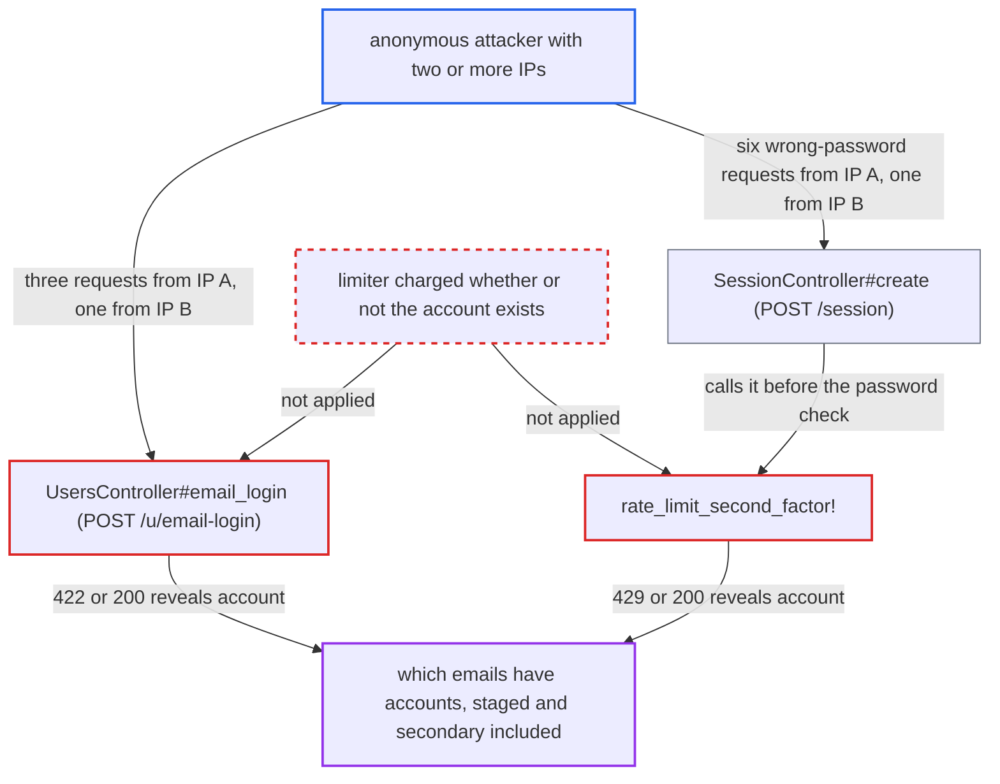

# Account-keyed login rate limiters run only for existing accounts, revealing registered emails

| Field | Value |
|---|---|
| ID | `find_01554gaWKJyEaPVraepcxuae` |
| Severity | **Medium** |
| Status | open |
| CWE | CWE-204 — Observable Response Discrepancy |
| Created | 2026-10-27T22:06:21.021637Z |
| Claude Security | https://claude.ai/security/findings/find_01554gaWKJyEaPVraepcxuae |

## Description

An anonymous attacker can learn whether any email address belongs to a forum account, including staged accounts and secondary emails. This defeats `hide_email_address_taken`, which is on by default. The attacker needs two or more source IPs. The cause is that `email_login` and `rate_limit_second_factor!` charge an account-keyed rate limiter only when the login matches an account, and the limiter's failure reaches the client.

1. **attacker** gets a CSRF token from `/session/csrf` on each of two or more source IPs. No login is needed, so any anonymous client can do this.
2. **attacker** sends three `POST /u/email-login.json` requests for the target address from IP A. These fill the per-IP buckets `email-login-min-<ip>` (3/min) and `email-login-hour-<ip>` (6/h). If the address matches an account, they also fill `email-login-min-<user.id>` and `email-login-hour-<user.id>`, which have the same ceilings and are shared by all IPs. ([`app/controllers/users_controller.rb:1100-1107`](https://github.com/cx-benchmark/discourse/blob/e08ed05b4b1ef773b2de7948a8f88a7c182a3520/app/controllers/users_controller.rb#L1100-L1107))
3. **attacker** sends a fourth `POST /u/email-login.json` for the same address from IP B within the minute. IP B's own buckets are still open, but a registered address's account bucket is already full. An unregistered address has no account bucket, so the request passes. ([`app/controllers/users_controller.rb:1100-1107`](https://github.com/cx-benchmark/discourse/blob/e08ed05b4b1ef773b2de7948a8f88a7c182a3520/app/controllers/users_controller.rb#L1100-L1107))
4. **the handler `email_login`** answers differently depending on whether the account exists. A registered address gets 422 `slow_down` from the action's own rescue. An unregistered address gets 200 `{success:"OK", hide_taken:true}`, and `user_found` is left out of the body. ([`app/controllers/users_controller.rb:1126-1131`](https://github.com/cx-benchmark/discourse/blob/e08ed05b4b1ef773b2de7948a8f88a7c182a3520/app/controllers/users_controller.rb#L1126-L1131))
5. **attacker** sends six wrong-password `POST /session.json` requests from IP A with `second_factor_token=1`, then a seventh from IP B. `SessionController#create` calls `rate_limit_second_factor!` before any password check whenever `second_factor_token` is non-blank. ([`app/controllers/session_controller.rb:358-368`](https://github.com/cx-benchmark/discourse/blob/e08ed05b4b1ef773b2de7948a8f88a7c182a3520/app/controllers/session_controller.rb#L358-L368))
6. **the method `rate_limit_second_factor!`** charges `second-factor-min-<username>` only if a user was found. The per-IP 6/min bucket and the per-username 6/min bucket have the same ceiling. IP B's first request therefore hits a per-username bucket that is already full for a registered account. ([`app/controllers/application_controller.rb:612-616`](https://github.com/cx-benchmark/discourse/blob/e08ed05b4b1ef773b2de7948a8f88a7c182a3520/app/controllers/application_controller.rb#L612-L616))
7. **the `rescue_from` handler in `ApplicationController`** returns 429 `rate_limit` for a registered login. An unknown login gets 200 `incorrect_username_email_or_password`. The attacker reads the last response to learn whether the account exists. ([`app/controllers/application_controller.rb:200-219`](https://github.com/cx-benchmark/discourse/blob/e08ed05b4b1ef773b2de7948a8f88a7c182a3520/app/controllers/application_controller.rb#L200-L219))

## Assessment

The attacker is anonymous and needs no victim action. They need at least two source IPs, such as proxies or an IPv6 range, and a CSRF token from `/session/csrf` on each. With a single IP the per-IP buckets always trip first, because the ceilings are equal and the IP check runs first. The default settings are enough: `hide_email_address_taken`, `enable_local_logins_via_email` and `enable_local_logins` all default to `true`. There are two routes: `POST /u/email-login` (three requests from IP A, one from IP B within a minute) and `POST /session` with a wrong password and `second_factor_token` (six from IP A, one from IP B). The `POST /session` route is also limited by `rate_limit_login`, which allows each IP `max_logins_per_ip_per_minute`, default 6. Each address takes about one probe per minute per pair of IPs.

Impact: The attacker learns whether an arbitrary email address belongs to an account on the forum, staged and secondary addresses included. The result is deterministic. Nothing is modified and service is not degraded. The email-login probe of a real, non-staged account sends that user three email-login links, which makes it noticeable. Staged accounts get no mail, so they are probed silently. The `POST /session` variant sends no email to the victim.

## Recommendation

`email_login` and `rate_limit_second_factor!` charge identity-keyed limiters only when the submitted login resolves to an account, and they report those limiters' failures to the client. The rate-limit outcome therefore depends on whether the account exists, across source IPs.

Fix criteria: For anonymous callers with `hide_email_address_taken` on, the status and body of `POST /u/email-login` and `POST /session` for a given login string are the same whether or not an account exists, even after any limiter has been spent. To check, send 3+1 email-login probes and 6+1 session probes with `second_factor_token` from two IPs, once for a registered email and once for an unregistered one. The responses must be identical.

## Evidence

**https://github.com/cx-benchmark/discourse**

- [`app/controllers/users_controller.rb:1100-1107`](https://github.com/cx-benchmark/discourse/blob/e08ed05b4b1ef773b2de7948a8f88a7c182a3520/app/controllers/users_controller.rb#L1100-L1107)
- [`app/controllers/users_controller.rb:1126-1131`](https://github.com/cx-benchmark/discourse/blob/e08ed05b4b1ef773b2de7948a8f88a7c182a3520/app/controllers/users_controller.rb#L1126-L1131)
- [`app/controllers/application_controller.rb:612-616`](https://github.com/cx-benchmark/discourse/blob/e08ed05b4b1ef773b2de7948a8f88a7c182a3520/app/controllers/application_controller.rb#L612-L616)
- [`app/controllers/session_controller.rb:358-368`](https://github.com/cx-benchmark/discourse/blob/e08ed05b4b1ef773b2de7948a8f88a7c182a3520/app/controllers/session_controller.rb#L358-L368)
- [`app/controllers/session_controller.rb:1508-1522`](https://github.com/cx-benchmark/discourse/blob/e08ed05b4b1ef773b2de7948a8f88a7c182a3520/app/controllers/session_controller.rb#L1508-L1522)
- [`app/controllers/application_controller.rb:200-219`](https://github.com/cx-benchmark/discourse/blob/e08ed05b4b1ef773b2de7948a8f88a7c182a3520/app/controllers/application_controller.rb#L200-L219)
- [`config/site_settings.yml:995-998`](https://github.com/cx-benchmark/discourse/blob/e08ed05b4b1ef773b2de7948a8f88a7c182a3520/config/site_settings.yml#L995-L998)

