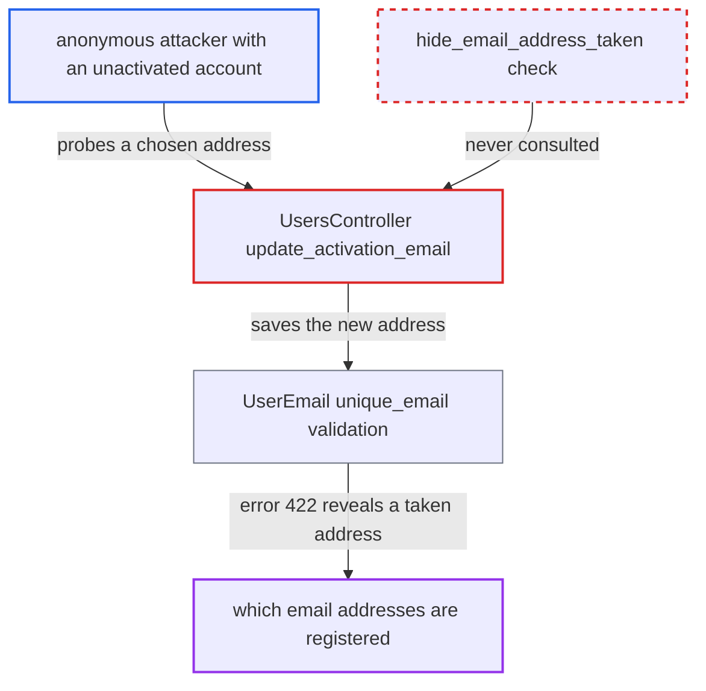

# Activation-email change returns 'taken' error, bypassing hide_email_address_taken

| Field | Value |
|---|---|
| ID | `find_013Rx7Q1GJV5z2dBCHuBung2` |
| Severity | **Medium** |
| Status | open |
| CWE | CWE-204 — User enumeration |
| Created | 2026-10-27T21:20:06.272546Z |
| Claude Security | https://claude.ai/security/findings/find_013Rx7Q1GJV5z2dBCHuBung2 |

## Description

An anonymous visitor who has created one unactivated account can find out whether a chosen email address is registered on the forum. This defeats the `hide_email_address_taken` privacy setting, which is on by default. The handler `UsersController#update_activation_email` returns the model's "Email has already been taken" error with HTTP 422 and never checks that setting. Probes are limited to 5 requests per hour per IP.

1. **attacker** registers a throw-away account with their own email. Open signup stores the new inactive user's id in `session[SessionController::ACTIVATE_USER_KEY]`, which gives the attacker the position the next endpoint requires. ([`app/controllers/users_controller.rb:832-856`](https://github.com/cx-benchmark/discourse/blob/e08ed05b4b1ef773b2de7948a8f88a7c182a3520/app/controllers/users_controller.rb#L832-L856))
2. **attacker** sends `PUT /u/update-activation-email.json` with their username, password and the victim's address as `email`. The action skips `redirect_to_login_if_required` and is not in `requires_login`. It identifies the caller by the session key or by the username or email plus password of an inactive, non-staged account. ([`app/controllers/users_controller.rb:1235-1255`](https://github.com/cx-benchmark/discourse/blob/e08ed05b4b1ef773b2de7948a8f88a7c182a3520/app/controllers/users_controller.rb#L1235-L1255))
3. **the handler `update_activation_email`** assigns the supplied address to the account's primary `UserEmail` and calls `save`. It writes `params[:email]` directly and never consults `SiteSetting.hide_email_address_taken`. ([`app/controllers/users_controller.rb:1257-1274`](https://github.com/cx-benchmark/discourse/blob/e08ed05b4b1ef773b2de7948a8f88a7c182a3520/app/controllers/users_controller.rb#L1257-L1274))
4. **the validation `UserEmail#unique_email`** adds `Email has already been taken` when the address is registered. It compares the address, and its normalized form when `normalize_emails` is on (the default), with every other `user_emails` row. That covers primary and secondary addresses and active, inactive and staged accounts. ([`app/models/user_email.rb:86-102`](https://github.com/cx-benchmark/discourse/blob/e08ed05b4b1ef773b2de7948a8f88a7c182a3520/app/models/user_email.rb#L86-L102))
5. **the handler `update_activation_email`** returns the error message with HTTP 422 through `render_json_error`. The message reaches the client word for word. A free address gives HTTP 200 instead, so the attacker can tell the two cases apart. ([`lib/json_error.rb:16-24`](https://github.com/cx-benchmark/discourse/blob/e08ed05b4b1ef773b2de7948a8f88a7c182a3520/lib/json_error.rb#L16-L24))

## Assessment

The attacker is anonymous and needs no victim interaction or special deployment state. They first sign up with their own email and a password, fetching the honeypot fields from `/session/hp`, and leave the account inactive. They then call `PUT /u/update-activation-email.json` with that username and password, or with the session from signup, and the address to test. A 422 with `Email has already been taken` means the address is registered. A 200 means it is free. The limits are 5 requests per hour per IP and 5 per hour per username key or session key. These slow bulk enumeration but do not stop targeted checks. A probe of a registered address changes nothing and sends no mail. A probe of an unregistered address sends an activation mail to it and moves the attacker's own account onto it.

Impact: The attacker learns whether a given email address is registered, including secondary addresses, addresses of staged or inactive accounts, and Gmail-style aliases when normalization is on. No other account's data or state changes. The only writes are to the attacker's own throw-away account.

## Recommendation

`update_activation_email` passes the `UserEmail` uniqueness validation message to an anonymous caller without honouring `SiteSetting.hide_email_address_taken`. This makes the activation-email change an oracle for whether an address is registered.

Fix criteria: With `hide_email_address_taken` enabled, a request naming an already-registered address gives the same status and body as one naming a free address, for example the generic success message. An `account_exists` notice may optionally be sent to the existing owner, as `EmailUpdater#change_to` does. To check this, probe a known and an unknown address from an unactivated account and confirm the responses are identical. Also confirm the account's primary email is unchanged when the address is taken.

## Evidence

**https://github.com/cx-benchmark/discourse**

- [`app/controllers/users_controller.rb:1257-1274`](https://github.com/cx-benchmark/discourse/blob/e08ed05b4b1ef773b2de7948a8f88a7c182a3520/app/controllers/users_controller.rb#L1257-L1274)
- [`app/controllers/users_controller.rb:1235-1255`](https://github.com/cx-benchmark/discourse/blob/e08ed05b4b1ef773b2de7948a8f88a7c182a3520/app/controllers/users_controller.rb#L1235-L1255)
- [`app/controllers/users_controller.rb:832-856`](https://github.com/cx-benchmark/discourse/blob/e08ed05b4b1ef773b2de7948a8f88a7c182a3520/app/controllers/users_controller.rb#L832-L856)
- [`app/models/user_email.rb:86-102`](https://github.com/cx-benchmark/discourse/blob/e08ed05b4b1ef773b2de7948a8f88a7c182a3520/app/models/user_email.rb#L86-L102)
- [`lib/json_error.rb:16-24`](https://github.com/cx-benchmark/discourse/blob/e08ed05b4b1ef773b2de7948a8f88a7c182a3520/lib/json_error.rb#L16-L24)
- [`config/site_settings.yml:995-998`](https://github.com/cx-benchmark/discourse/blob/e08ed05b4b1ef773b2de7948a8f88a7c182a3520/config/site_settings.yml#L995-L998)

