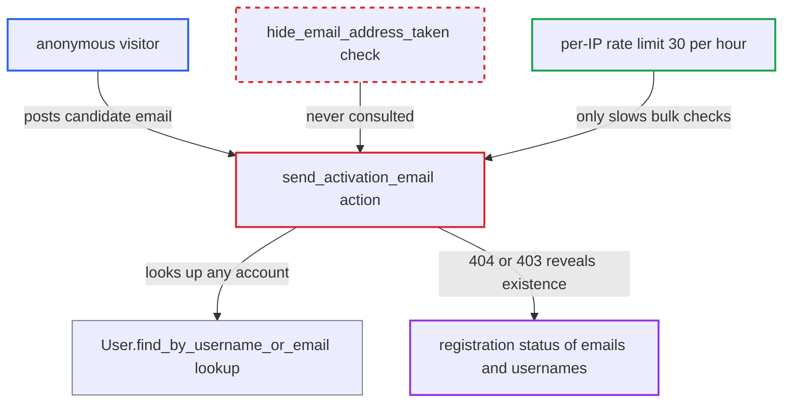

# Activation-email resend leaks account existence by email despite hide_email_address_taken

| Field | Value |
|---|---|
| ID | `find_01CSSae9ym5GAy5N6QX62w5f` |
| Severity | **Medium** |
| Status | open |
| CWE | CWE-204 — User enumeration |
| Created | 2026-10-27T21:19:05.856005Z |
| Claude Security | https://claude.ai/security/findings/find_01CSSae9ym5GAy5N6QX62w5f |

## Description

An anonymous visitor can find out whether an email address is registered on the forum. This includes inactive and staged accounts and secondary addresses. On login-required sites the same works for usernames. The action `send_activation_email` looks up the account before it checks the session, and it fails with a different error for each case. It also ignores `hide_email_address_taken`.

1. **anonymous attacker** sends a POST to `/u/action/send_activation_email.json` with a candidate email in `username`. No login is needed, and the CSRF token for anonymous requests can be fetched from `/session/csrf`. ([`app/controllers/users_controller.rb:98-116`](https://github.com/cx-benchmark/discourse/blob/e08ed05b4b1ef773b2de7948a8f88a7c182a3520/app/controllers/users_controller.rb#L98-L116))
2. **the action `send_activation_email`** passes the only guards for non-staff callers. The only guards before the lookup are the per-IP rate limits (30/hour, 6/minute) and `must_approve_users`, which defaults to false. ([`app/controllers/users_controller.rb:1278-1283`](https://github.com/cx-benchmark/discourse/blob/e08ed05b4b1ef773b2de7948a8f88a7c182a3520/app/controllers/users_controller.rb#L1278-L1283))
3. **the method `User.find_by_username_or_email`** looks up the account by the supplied value. Input containing `@` goes to `find_by_email`, which matches every primary and secondary email row with no `active` or `staged` filter. ([`app/models/user.rb:558-572`](https://github.com/cx-benchmark/discourse/blob/e08ed05b4b1ef773b2de7948a8f88a7c182a3520/app/models/user.rb#L558-L572))
4. **the action `send_activation_email`** raises `Discourse::NotFound` if nothing matches, and only afterwards raises `Discourse::InvalidAccess` if the account is not `session[ACTIVATE_USER_KEY]`. The session-binding check runs after the lookup, and nothing consults `SiteSetting.hide_email_address_taken`. ([`app/controllers/users_controller.rb:1285-1291`](https://github.com/cx-benchmark/discourse/blob/e08ed05b4b1ef773b2de7948a8f88a7c182a3520/app/controllers/users_controller.rb#L1285-L1291))
5. **`ApplicationController`** renders the two errors differently. `Discourse::NotFound` gives 404 with `error_type: not_found`, and `Discourse::InvalidAccess` gives 403 with `error_type: invalid_access`. ([`app/controllers/application_controller.rb:239-260`](https://github.com/cx-benchmark/discourse/blob/e08ed05b4b1ef773b2de7948a8f88a7c182a3520/app/controllers/application_controller.rb#L239-L260))
6. **anonymous attacker** reads the status code to learn whether the address is registered. A 404 means no account has the address, and a 403 means some account has it.

## Assessment

The attacker is an anonymous internet user with no session. The action is reachable even on login-required sites, because it skips `redirect_to_login_if_required` and is not in `requires_login`. The attacker sends one request per address or username to test. The per-IP rate limit (30/hour, 6/minute) slows bulk enumeration but does not stop a targeted check of one address.

Impact: The attacker learns whether a given email address has an account, including staged and inactive accounts and secondary addresses. On login-required sites the attacker can also learn whether a username exists. No data is changed and no service is degraded. The leak is limited to registration status and defeats the `hide_email_address_taken` privacy setting.

## Recommendation

`send_activation_email` looks up the account before the authorization check. It returns a 404 for unknown accounts and a 403 for known ones, and it ignores `SiteSetting.hide_email_address_taken`. This makes the endpoint an oracle for whether an email is registered.

Fix criteria: For non-staff callers the response is identical, in status, body and error type, whether or not the supplied username or email resolves to an account that is not the caller's own. This can be done by resolving the account only from `session[ACTIVATE_USER_KEY]` for anonymous callers. It can also be done by returning the same generic error for both branches when `hide_email_address_taken` is enabled. The work done on both branches should not reveal the difference through timing. To verify, submit a known and an unknown email anonymously and confirm both give the same status and `error_type`.

## Evidence

**https://github.com/cx-benchmark/discourse**

- [`app/controllers/users_controller.rb:1285-1291`](https://github.com/cx-benchmark/discourse/blob/e08ed05b4b1ef773b2de7948a8f88a7c182a3520/app/controllers/users_controller.rb#L1285-L1291)
- [`app/controllers/users_controller.rb:98-116`](https://github.com/cx-benchmark/discourse/blob/e08ed05b4b1ef773b2de7948a8f88a7c182a3520/app/controllers/users_controller.rb#L98-L116)
- [`app/controllers/users_controller.rb:1278-1283`](https://github.com/cx-benchmark/discourse/blob/e08ed05b4b1ef773b2de7948a8f88a7c182a3520/app/controllers/users_controller.rb#L1278-L1283)
- [`app/models/user.rb:558-572`](https://github.com/cx-benchmark/discourse/blob/e08ed05b4b1ef773b2de7948a8f88a7c182a3520/app/models/user.rb#L558-L572)
- [`app/controllers/application_controller.rb:239-260`](https://github.com/cx-benchmark/discourse/blob/e08ed05b4b1ef773b2de7948a8f88a7c182a3520/app/controllers/application_controller.rb#L239-L260)
- [`config/site_settings.yml:995-998`](https://github.com/cx-benchmark/discourse/blob/e08ed05b4b1ef773b2de7948a8f88a7c182a3520/config/site_settings.yml#L995-L998)

