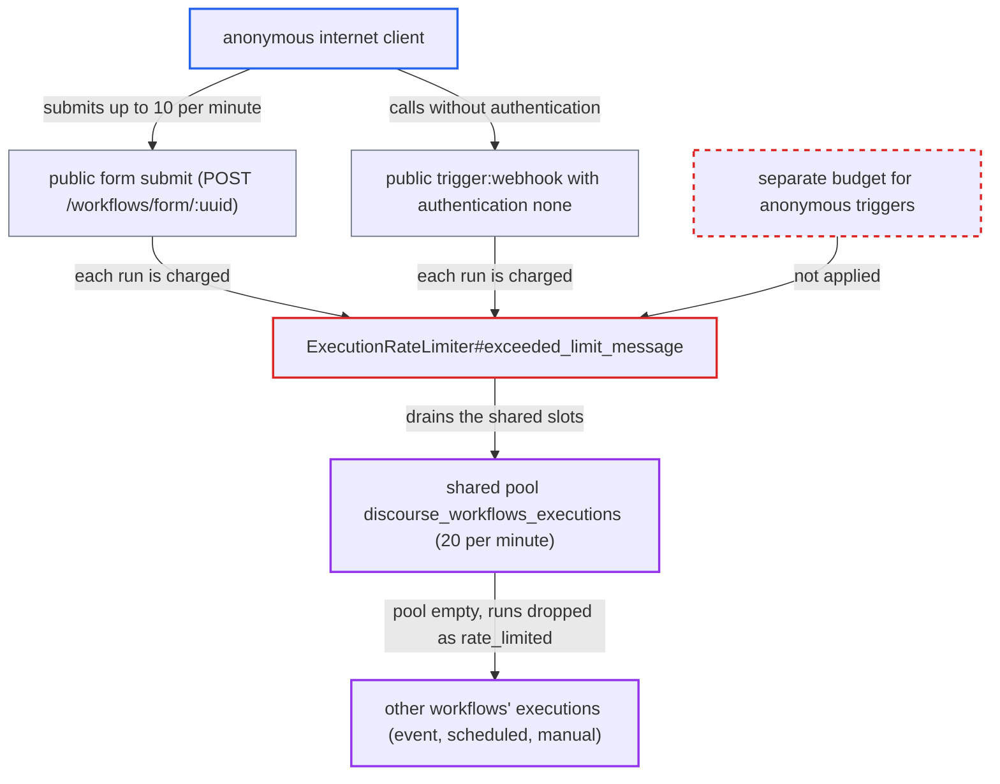

# Anonymous public-trigger executions drain shared workflow execution quota, dropping other workflows

| Field | Value |
|---|---|
| ID | `find_01HZmq3UjZ9miZ1dpQpxuPbM` |
| Severity | **Medium** |
| Status | open |
| CWE | CWE-410 — Insufficient resource pool |
| Created | 2026-10-27T21:17:25.780548Z |
| Claude Security | https://claude.ai/security/findings/find_01HZmq3UjZ9miZ1dpQpxuPbM |

## Description

An anonymous internet client can make a site's other workflows lose their runs. Event-driven, scheduled and manual executions are dropped as `rate_limited` while the attack continues. It needs the workflow plugin enabled and a published public form or unauthenticated webhook whose URL the attacker knows. `ExecutionRateLimiter` charges all executions to one shared pool and does not tell anonymous runs from internal ones.

1. **anonymous client** fetches a published public form and receives a `resume_token`. Any visitor gets the token, it is valid for 1 hour, and it is not single-use, so it works for repeated submissions. ([`plugins/discourse-workflows/app/services/discourse_workflows/form/show.rb:49-56`](https://github.com/cx-benchmark/discourse/blob/e08ed05b4b1ef773b2de7948a8f88a7c182a3520/plugins/discourse-workflows/app/services/discourse_workflows/form/show.rb#L49-L56))
2. **anonymous client** submits the form, or calls an unauthenticated `trigger:webhook`, about 10 times per minute. The per-IP limits (10 form submits per minute, 20 webhook requests per 10 seconds) are at or above the per-workflow cap of 10 per minute, so every request gets through. ([`plugins/discourse-workflows/app/controllers/discourse_workflows/forms_controller.rb:131-133`](https://github.com/cx-benchmark/discourse/blob/e08ed05b4b1ef773b2de7948a8f88a7c182a3520/plugins/discourse-workflows/app/controllers/discourse_workflows/forms_controller.rb#L131-L133))
3. **the executor `Executor#create_execution!`** charges each run to the per-workflow limiter and then to the shared `discourse_workflows_executions` limiter. The shared limit is 20 per minute by default, and nothing marks which runs came from anonymous triggers, so one public trigger takes up to 10 of the 20 slots and two take all of them. ([`plugins/discourse-workflows/lib/discourse_workflows/executor/execution_rate_limiter.rb:12-41`](https://github.com/cx-benchmark/discourse/blob/e08ed05b4b1ef773b2de7948a8f88a7c182a3520/plugins/discourse-workflows/lib/discourse_workflows/executor/execution_rate_limiter.rb#L12-L41))
4. **another workflow's trigger such as `trigger:post_created`** starts an execution while the shared pool is used up. The limit check fails, so `create_execution!` records a terminal `rate_limited` execution and returns `false`, and the run is dropped. ([`plugins/discourse-workflows/lib/discourse_workflows/executor.rb:1028-1043`](https://github.com/cx-benchmark/discourse/blob/e08ed05b4b1ef773b2de7948a8f88a7c182a3520/plugins/discourse-workflows/lib/discourse_workflows/executor.rb#L1028-L1043))
5. **the store `create_rate_limited_execution`** replaces the trigger data with `{"rate_limited" => true}`. The original event payload is lost, and nothing re-queues or replays the run. ([`plugins/discourse-workflows/lib/discourse_workflows/executor/execution_store.rb:99-111`](https://github.com/cx-benchmark/discourse/blob/e08ed05b4b1ef773b2de7948a8f88a7c182a3520/plugins/discourse-workflows/lib/discourse_workflows/executor/execution_store.rb#L99-L111))

## Assessment

The attacker is an anonymous internet client with no login. The opt-in `enable_discourse_workflows` setting must be on, and at least one anonymous-reachable trigger must be published. The attacker must know that trigger's URL. Public forms are meant to be shared, while webhook paths default to a random UUID. There are two ways in: a public form (`POST /workflows/form/:uuid`, which `Form::Submit#run_workflow` runs synchronously) and a published `trigger:webhook` with the default `authentication: none` (`Webhook::Receive#enqueue_async_workflows` or `#execute_sync_workflows`). Each public trigger can use up to 10 of the 20 shared slots per minute. In a multisite deployment the shared limiter is built with `global: true`, so its key is stored un-namespaced as `GLOBAL::...` and one 20 per minute budget is shared by every site on the cluster. Public triggers on one site then starve the workflows of all the others.

Impact: While the requests continue, the attacker can make every other workflow on the site fail to run, including post and reviewable event flows, scheduled jobs and manual runs. Dropped runs are permanently discarded with their trigger data. No data is read or changed, core forum functions keep working, and the denial lasts only as long as the requests continue.

## Recommendation

(1) Executions started by unauthenticated public triggers (forms, unauthenticated webhooks) are charged to the same site-wide execution budget as internal event, scheduled and admin-started executions. Untrusted traffic can use up the capacity that trusted automations need.

Fix criteria: Executions from anonymous-reachable triggers cannot exhaust the capacity available to other workflows. To check, publish one public form and one `trigger:post_created` workflow, submit the form at its maximum allowed rate, and confirm the post-created executions still run instead of being recorded as `rate_limited`.

(2) When the shared limit is hit, an execution is recorded as terminal `rate_limited` and its trigger data is discarded. A temporary quota exhaustion becomes a permanent loss of the triggering event.

Fix criteria: Event-driven and scheduled executions that are rate limited are either deferred and run once capacity returns, or keep enough data to be replayed. To check, fire an event while the pool is exhausted and confirm it eventually produces a successful execution.

(3) The shared limiter is created with `global: true`, so its Redis key is not namespaced per site. All sites of a multisite cluster share one budget.

Fix criteria: The execution budget is scoped to a single site. To check, in a multisite setup confirm that executions on one site do not reduce the remaining budget on another site.

## Evidence

**https://github.com/cx-benchmark/discourse**

- [`plugins/discourse-workflows/lib/discourse_workflows/executor/execution_rate_limiter.rb:12-41`](https://github.com/cx-benchmark/discourse/blob/e08ed05b4b1ef773b2de7948a8f88a7c182a3520/plugins/discourse-workflows/lib/discourse_workflows/executor/execution_rate_limiter.rb#L12-L41)
- [`plugins/discourse-workflows/lib/discourse_workflows/executor.rb:1028-1043`](https://github.com/cx-benchmark/discourse/blob/e08ed05b4b1ef773b2de7948a8f88a7c182a3520/plugins/discourse-workflows/lib/discourse_workflows/executor.rb#L1028-L1043)
- [`plugins/discourse-workflows/lib/discourse_workflows/executor/execution_store.rb:99-111`](https://github.com/cx-benchmark/discourse/blob/e08ed05b4b1ef773b2de7948a8f88a7c182a3520/plugins/discourse-workflows/lib/discourse_workflows/executor/execution_store.rb#L99-L111)
- [`plugins/discourse-workflows/app/services/discourse_workflows/form/submit.rb:87-99`](https://github.com/cx-benchmark/discourse/blob/e08ed05b4b1ef773b2de7948a8f88a7c182a3520/plugins/discourse-workflows/app/services/discourse_workflows/form/submit.rb#L87-L99)
- [`plugins/discourse-workflows/app/services/discourse_workflows/form/show.rb:49-56`](https://github.com/cx-benchmark/discourse/blob/e08ed05b4b1ef773b2de7948a8f88a7c182a3520/plugins/discourse-workflows/app/services/discourse_workflows/form/show.rb#L49-L56)
- [`plugins/discourse-workflows/app/controllers/discourse_workflows/forms_controller.rb:131-133`](https://github.com/cx-benchmark/discourse/blob/e08ed05b4b1ef773b2de7948a8f88a7c182a3520/plugins/discourse-workflows/app/controllers/discourse_workflows/forms_controller.rb#L131-L133)
- [`plugins/discourse-workflows/app/services/discourse_workflows/webhook/receive.rb:307-344`](https://github.com/cx-benchmark/discourse/blob/e08ed05b4b1ef773b2de7948a8f88a7c182a3520/plugins/discourse-workflows/app/services/discourse_workflows/webhook/receive.rb#L307-L344)
- [`plugins/discourse-workflows/app/controllers/discourse_workflows/webhooks_controller.rb:80-86`](https://github.com/cx-benchmark/discourse/blob/e08ed05b4b1ef773b2de7948a8f88a7c182a3520/plugins/discourse-workflows/app/controllers/discourse_workflows/webhooks_controller.rb#L80-L86)
- [`plugins/discourse-workflows/app/services/discourse_workflows/workflow/execute.rb:61-70`](https://github.com/cx-benchmark/discourse/blob/e08ed05b4b1ef773b2de7948a8f88a7c182a3520/plugins/discourse-workflows/app/services/discourse_workflows/workflow/execute.rb#L61-L70)
- [`plugins/discourse-workflows/config/settings.yml:27-32`](https://github.com/cx-benchmark/discourse/blob/e08ed05b4b1ef773b2de7948a8f88a7c182a3520/plugins/discourse-workflows/config/settings.yml#L27-L32)
- [`lib/rate_limiter.rb:162-168`](https://github.com/cx-benchmark/discourse/blob/e08ed05b4b1ef773b2de7948a8f88a7c182a3520/lib/rate_limiter.rb#L162-L168)
- [`plugins/discourse-workflows/admin/assets/javascripts/admin/components/workflows/editor/node-factory.js:10-13`](https://github.com/cx-benchmark/discourse/blob/e08ed05b4b1ef773b2de7948a8f88a7c182a3520/plugins/discourse-workflows/admin/assets/javascripts/admin/components/workflows/editor/node-factory.js#L10-L13)

