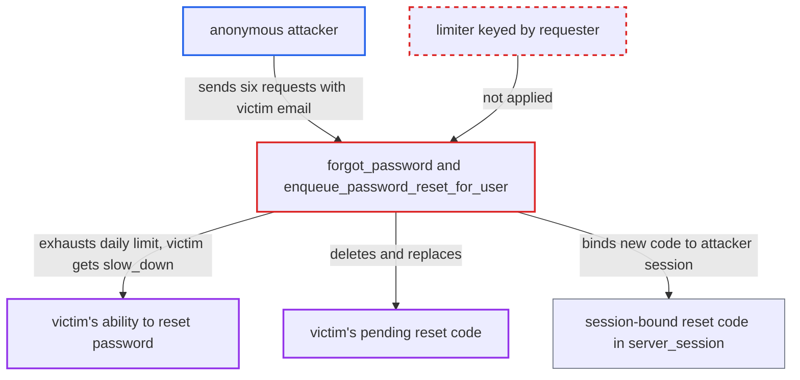

# Anonymous requests exhaust victim-keyed reset limiter, blocking a user's password reset

| Field | Value |
|---|---|
| ID | `find_0157MYwSoedbimNaPFBbJhbH` |
| Severity | **Medium** |
| Status | open |
| CWE | CWE-645 — Overly Restrictive Account Lockout |
| Created | 2026-10-27T21:23:31.419385Z |
| Claude Security | https://claude.ai/security/findings/find_0157MYwSoedbimNaPFBbJhbH |

## Description

An anonymous attacker who knows a user's email address can stop that user from resetting or changing their password, and can cancel a reset the user already started. Six requests a day are enough. `enqueue_password_reset_for_user` charges a daily limiter keyed to the target account, and in the default code variant each request also replaces the owner's pending reset code.

1. **Attacker** sends `POST /session/forgot_password` six times with the victim's email as `login`. The endpoint needs no login. The per-IP limits of 6/hour and 3/minute still allow six requests a day for one victim. ([`app/controllers/session_controller.rb:707-746`](https://github.com/cx-benchmark/discourse/blob/e08ed05b4b1ef773b2de7948a8f88a7c182a3520/app/controllers/session_controller.rb#L707-L746))
2. **`enqueue_password_reset_for_user`** charges the limiter `forgot-password-login-day-<username>` on each request. The key names the target account, not the requester, and the check runs before anything is sent. The limit is `FORGOT_PASSWORD_EMAIL_LIMIT_PER_DAY` (6). ([`app/controllers/session_controller.rb:1595-1601`](https://github.com/cx-benchmark/discourse/blob/e08ed05b4b1ef773b2de7948a8f88a7c182a3520/app/controllers/session_controller.rb#L1595-L1601))
3. **the code variant in `session_controller.rb`** expires the victim's `password_reset` tokens and generates a new code on each request. `EmailLoginCode.generate!` deletes every existing code of the same purpose for the address. This revokes any reset the victim has in progress. ([`app/models/email_login_code.rb:24-39`](https://github.com/cx-benchmark/discourse/blob/e08ed05b4b1ef773b2de7948a8f88a7c182a3520/app/models/email_login_code.rb#L24-L39))
4. **the code variant** stores the new code in the attacker's `server_session[:password_reset_code]`. The code is emailed to the victim, but `redeem_password_reset_code` looks it up only by the id stored in the requester's session. The victim's browser cannot redeem it. ([`app/controllers/session_controller.rb:748-760`](https://github.com/cx-benchmark/discourse/blob/e08ed05b4b1ef773b2de7948a8f88a7c182a3520/app/controllers/session_controller.rb#L748-L760))
5. **Victim** asks for a reset or uses the change-password flow. The daily limiter is already spent, so the request gets `rate_limiter.slow_down` and is refused. ([`app/controllers/session_controller.rb:1595-1601`](https://github.com/cx-benchmark/discourse/blob/e08ed05b4b1ef773b2de7948a8f88a7c182a3520/app/controllers/session_controller.rb#L1595-L1601))
6. **Attacker** repeats six requests each day. This keeps the victim locked out of password reset for as long as the attacker keeps going.

## Assessment

The attacker is anonymous. They need the victim's email address, because `hide_email_address_taken` defaults to true and a username is not enough. They fetch a CSRF token and send the six requests from one IP within an hour. The code variant is the shipped default. `enable_local_logins_via_code` is a `beta` upcoming change and `promote_upcoming_changes_on_status` defaults to `beta`, so `UpcomingChanges.enabled?` returns true. In the legacy link variant the limiter still blocks the victim. However, the newest link the attacker triggers stays valid for the victim, because the `EmailToken` `after_create` hook expires only older tokens. The login-code limiter `login-code-email-<sha256>` (3/hour) has the same victim-keyed design. Login codes are not session-bound, so the victim can still use an attacker-triggered code within its 10-minute life. That route gives only partial denial.

Impact: A chosen user cannot reset or change their password while the attacker keeps up the requests, and any reset in progress is revoked. The victim also gets unwanted reset emails, capped at six a day. Login by known password, passkey or email login code or link still works, so this is a partial denial of one function. No data is disclosed or modified.

## Recommendation

(1) The per-account reset limiter is charged by unauthenticated third parties and enforced against the account owner. Codes are bound to the requesting session, so codes triggered by others give the owner no way to recover.

Fix criteria: After any number of reset requests for an account from other clients, the owner can still get and redeem a working reset code or link from their own browser. Recipient anti-spam limits suppress extra mail without refusing the owner's request, or are keyed per requester. Check: six anonymous requests from another IP or session, then the owner's request, still give a code the owner can redeem.

(2) Each unauthenticated request deletes or expires the owner's pending reset code or token, so a third party can revoke a reset in progress.

Fix criteria: A reset request from one session does not invalidate a pending reset code issued to a different session. Check: an owner's outstanding code still redeems after an anonymous request for the same account.

## Evidence

**https://github.com/cx-benchmark/discourse**

- [`app/controllers/session_controller.rb:1595-1601`](https://github.com/cx-benchmark/discourse/blob/e08ed05b4b1ef773b2de7948a8f88a7c182a3520/app/controllers/session_controller.rb#L1595-L1601)
- [`app/controllers/session_controller.rb:1603-1615`](https://github.com/cx-benchmark/discourse/blob/e08ed05b4b1ef773b2de7948a8f88a7c182a3520/app/controllers/session_controller.rb#L1603-L1615)
- [`app/controllers/session_controller.rb:707-746`](https://github.com/cx-benchmark/discourse/blob/e08ed05b4b1ef773b2de7948a8f88a7c182a3520/app/controllers/session_controller.rb#L707-L746)
- [`app/controllers/session_controller.rb:748-760`](https://github.com/cx-benchmark/discourse/blob/e08ed05b4b1ef773b2de7948a8f88a7c182a3520/app/controllers/session_controller.rb#L748-L760)
- [`app/services/user/create_password_reset_token.rb:26-28`](https://github.com/cx-benchmark/discourse/blob/e08ed05b4b1ef773b2de7948a8f88a7c182a3520/app/services/user/create_password_reset_token.rb#L26-L28)
- [`config/site_settings.yml:647-703`](https://github.com/cx-benchmark/discourse/blob/e08ed05b4b1ef773b2de7948a8f88a7c182a3520/config/site_settings.yml#L647-L703)
- [`app/models/email_login_code.rb:24-39`](https://github.com/cx-benchmark/discourse/blob/e08ed05b4b1ef773b2de7948a8f88a7c182a3520/app/models/email_login_code.rb#L24-L39)
- [`app/controllers/session_controller.rb:920-933`](https://github.com/cx-benchmark/discourse/blob/e08ed05b4b1ef773b2de7948a8f88a7c182a3520/app/controllers/session_controller.rb#L920-L933)

