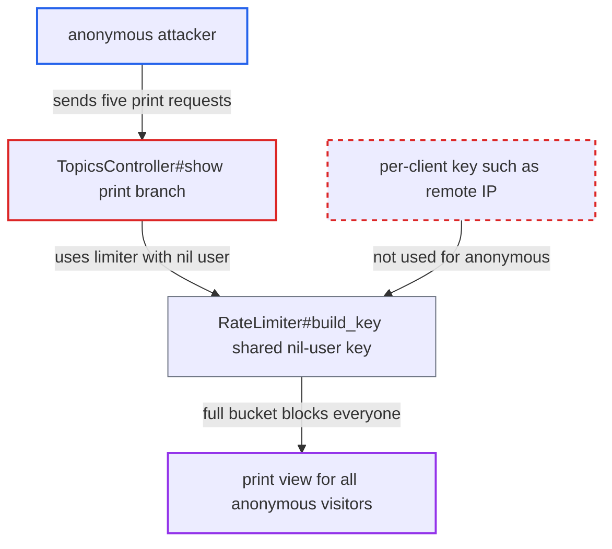

# Anonymous topic print view quota is one site-wide bucket any client can exhaust

| Field | Value |
|---|---|
| ID | `find_01QjAdfH5YmCUAaeTbeG64U8` |
| Severity | **Medium** |
| Status | open |
| CWE | CWE-410 — Insufficient Resource Pool |
| Created | 2026-10-27T22:05:25.365581Z |
| Claude Security | https://claude.ai/security/findings/find_01QjAdfH5YmCUAaeTbeG64U8 |

## Description

Any anonymous visitor can block the print view of topics for every other anonymous visitor on the site. It takes about five requests an hour and needs no login. Logged-in users are not affected. The cause is that `TopicsController#show` builds the print limiter with a nil `current_user`, so `RateLimiter#build_key` gives all anonymous clients one shared key.

1. **anonymous attacker** sends five GET requests to the print route. The requests go to `/t/x/<any id>/print`, or to any topic URL with `?print=true`. The id can be anything, and the route needs no login. ([`config/routes.rb:1635-1640`](https://github.com/cx-benchmark/discourse/blob/e08ed05b4b1ef773b2de7948a8f88a7c182a3520/config/routes.rb#L1635-L1640))
2. **the handler `TopicsController#show`** creates the print limiter with `current_user` and calls `performed!`. `current_user` is nil for anonymous requests. The limiter is consumed before the topic is looked up, so nonexistent or private ids also use up slots. ([`app/controllers/topics_controller.rb:117-131`](https://github.com/cx-benchmark/discourse/blob/e08ed05b4b1ef773b2de7948a8f88a7c182a3520/app/controllers/topics_controller.rb#L117-L131))
3. **the method `RateLimiter#build_key`** builds the same key for every anonymous client. It interpolates `@user && @user.id`, so a nil user gives the single key `l-rate-limit3::print-topic-per-hour`. ([`lib/rate_limiter.rb:34-36`](https://github.com/cx-benchmark/discourse/blob/e08ed05b4b1ef773b2de7948a8f88a7c182a3520/lib/rate_limiter.rb#L34-L36))
4. **the shared bucket** fills after `max_prints_per_hour_per_user` slots are used. The default is 5 within a sliding hour.
5. **other anonymous visitors** receive `rate_limiter.slow_down` instead of the print view. This lasts until the sliding window frees a slot. The attacker can keep it blocked by repeating five requests an hour. ([`app/controllers/topics_controller.rb:117-131`](https://github.com/cx-benchmark/discourse/blob/e08ed05b4b1ef773b2de7948a8f88a7c182a3520/app/controllers/topics_controller.rb#L117-L131))

## Assessment

The attacker is any anonymous internet client. They need no login and no victim action. They send five print requests within an hour, and can vary the topic id or query string. The default limit `max_prints_per_hour_per_user` is 5. The attacker repeats five requests an hour to keep the block in place. The route `t/:slug/:topic_id/print` is public, and the `?print=true` form on any topic URL also works.

Impact: The print view is denied to all anonymous users of the site for as long as the attacker keeps the bucket full. Logged-in users have per-user keys and are not affected. The rest of the site works, and nothing is disclosed or modified.

## Recommendation

A per-user rate limiter is created with a nil user on an action that anonymous visitors can reach. All anonymous requesters therefore share one key, and one client can use up the quota for everyone.

Fix criteria: Anonymous print requests count against a key scoped to the requesting client, for example the remote IP. One client's requests can no longer use up the quota for others. To verify, use up the limit from one address and check that a request from another anonymous address still gets the print view.

## Evidence

**https://github.com/cx-benchmark/discourse**

- [`app/controllers/topics_controller.rb:117-131`](https://github.com/cx-benchmark/discourse/blob/e08ed05b4b1ef773b2de7948a8f88a7c182a3520/app/controllers/topics_controller.rb#L117-L131)
- [`lib/rate_limiter.rb:34-36`](https://github.com/cx-benchmark/discourse/blob/e08ed05b4b1ef773b2de7948a8f88a7c182a3520/lib/rate_limiter.rb#L34-L36)
- [`config/routes.rb:1635-1640`](https://github.com/cx-benchmark/discourse/blob/e08ed05b4b1ef773b2de7948a8f88a7c182a3520/config/routes.rb#L1635-L1640)
- [`frontend/discourse/app/services/keyboard-shortcuts.js:114`](https://github.com/cx-benchmark/discourse/blob/e08ed05b4b1ef773b2de7948a8f88a7c182a3520/frontend/discourse/app/services/keyboard-shortcuts.js#L114)

