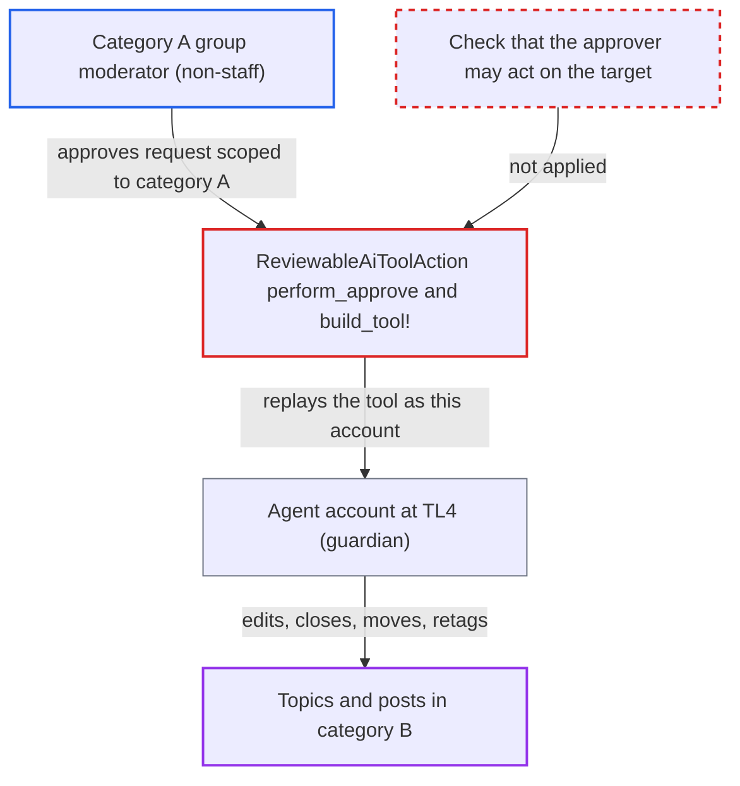

# Approved AI moderation tools run as TL4 agent account, escalating category group moderators

| Field | Value |
|---|---|
| ID | `find_01PRZiP5Ef5j8GQe2V8TSeVs` |
| Severity | **Medium** |
| Status | open |
| CWE | CWE-863 — Improper Authorization |
| Created | 2026-10-27T21:41:46.453034Z |
| Claude Security | https://claude.ai/security/findings/find_01PRZiP5Ef5j8GQe2V8TSeVs |

## Description

A non-staff category group moderator of one category can get AI moderation tools to act on topics and posts in categories they do not moderate. The tool runs as the agent's TL4 account, not as them. It needs `enable_category_group_moderation` on and an agent with moderation tools and `require_approval`, reachable from their category. The cause is `perform_approve`, which replays most tools with the agent account's rights and never checks the approver's rights on the target.

1. **Attacker (category A group moderator)** asks the agent in a category A topic to act on a topic or post in category B. The agent is reached by a topic mention from a member of `ai_bot_allowed_groups`, or by a `llm_agent_triage` automation, where any poster in the triaged category can supply the request. ([`plugins/discourse-ai/lib/automation/llm_agent_triage.rb:13-25`](https://github.com/cx-benchmark/discourse/blob/e08ed05b4b1ef773b2de7948a8f88a7c182a3520/plugins/discourse-ai/lib/automation/llm_agent_triage.rb#L13-L25))
2. **the method `enqueue_tool_for_approval`** stores the proposed tool call with the agent account's id and opens a `ReviewableAiToolAction`. The stored parameters include the target `topic_id` or `post_id`, and nothing relates that target to the approver's category. ([`plugins/discourse-ai/lib/agents/bot.rb:597-611`](https://github.com/cx-benchmark/discourse/blob/e08ed05b4b1ef773b2de7948a8f88a7c182a3520/plugins/discourse-ai/lib/agents/bot.rb#L597-L611))
3. **the method `created_new!`** scopes the reviewable to the category of the post where the agent was invoked. That is category A, not category B where the target lives. ([`plugins/discourse-ai/app/models/reviewable_ai_tool_action.rb:6-11`](https://github.com/cx-benchmark/discourse/blob/e08ed05b4b1ef773b2de7948a8f88a7c182a3520/plugins/discourse-ai/app/models/reviewable_ai_tool_action.rb#L6-L11))
4. **core `Reviewable.viewable_by`** shows the reviewable to category A's group moderators and lets them approve it. With `enable_category_group_moderation` on, non-staff members of a category's moderation groups are admitted to reviewables with that `category_id`. ([`app/models/reviewable.rb:581-595`](https://github.com/cx-benchmark/discourse/blob/e08ed05b4b1ef773b2de7948a8f88a7c182a3520/app/models/reviewable.rb#L581-L595))
5. **Attacker** approves the reviewable with `PUT /review/:id/perform/approve`. `perform_approve` only checks that the approver is a real person, and sets `context.user` to the approver only for `attribute_to_approver?` tools. ([`plugins/discourse-ai/app/models/reviewable_ai_tool_action.rb:43-63`](https://github.com/cx-benchmark/discourse/blob/e08ed05b4b1ef773b2de7948a8f88a7c182a3520/plugins/discourse-ai/app/models/reviewable_ai_tool_action.rb#L43-L63))
6. **the method `build_tool!`** rebuilds the tool with the agent account as `bot_user` and no user in the `BotContext`. `Tool#guardian` is therefore `Guardian.new` of the agent account, which is TL4 and in the groups `trust_level_0` to `trust_level_4`. ([`plugins/discourse-ai/app/models/reviewable_ai_tool_action.rb:235-252`](https://github.com/cx-benchmark/discourse/blob/e08ed05b4b1ef773b2de7948a8f88a7c182a3520/plugins/discourse-ai/app/models/reviewable_ai_tool_action.rb#L235-L252))
7. **the tool `edit_post`** passes its permission check for the agent account and applies the change in category B. `can_edit_post?` passes through the default `edit_all_post_groups`, so the attacker's chosen `raw` or title is written to a post in any category the agent account can see. ([`plugins/discourse-ai/lib/agents/tools/edit_post.rb:48-74`](https://github.com/cx-benchmark/discourse/blob/e08ed05b4b1ef773b2de7948a8f88a7c182a3520/plugins/discourse-ai/lib/agents/tools/edit_post.rb#L48-L74))

## Assessment

The attacker is a non-staff category group moderator of category A. The site must have `enable_category_group_moderation` on, which is not the default. An agent with moderation tools and `require_approval` must be reachable from a topic in A, which is also not the default. There are two routes to the agent. One is `allow_topic_mentions`, where the requester must be in `ai_bot_allowed_groups` (default staff and TL4), so a user below TL4 needs that setting widened. The other is the `llm_agent_triage` automation, where any poster can make the request. The requester and the approver can be the same person. The shipped Discourse Admin Assistant has `require_approval` but is limited to admins. Staff and TL4 approvers gain nothing, since they already hold these powers.

Impact: The attacker gets TL4-level moderation over every topic the agent account can see, outside the category they moderate. They can rewrite any post's content and topic title, close, unlist, slow-mode or set timers on any topic, change tags, and move posts. Moving posts out of categories open only to `trust_level_3` or `trust_level_4` into a topic the attacker can read leaks some content. Staff-only tools (lock, delete, badges) and approver-attributed tools stay blocked, and private categories the agent account is not granted stay out of reach.

## Recommendation

(1) `ReviewableAiToolAction#perform_approve` and `build_tool!` replay every tool that is not `attribute_to_approver?` with the agent's TL4 account as the authorizing identity. The tool's permission checks never involve what the approver, or the requester, may do to the target.

Fix criteria: After approval, the replayed tool's authorization also requires that the approving human may perform that action on that specific target. One example is binding the guardian to the approver, as `attribute_to_approver?` tools already do. Verify that a non-staff category group moderator of category A who approves an AI `edit_post` or `close_topic` aimed at a topic in category B gets a `not_allowed` error. The target must be unchanged and the reviewable must stay pending.

(2) `created_new!` scopes the reviewable to the category where the agent was invoked, not to the category of the action's target. Moderators of an unrelated category are therefore offered Approve on actions affecting content they do not moderate.

Fix criteria: Only staff and moderators responsible for the action's actual target can see or perform a pending AI tool action. Verify that a reviewable created in category A for a target in category B does not appear in `Reviewable.viewable_by` for category-A-only group moderators.

## Evidence

**https://github.com/cx-benchmark/discourse**

- [`plugins/discourse-ai/app/models/reviewable_ai_tool_action.rb:43-63`](https://github.com/cx-benchmark/discourse/blob/e08ed05b4b1ef773b2de7948a8f88a7c182a3520/plugins/discourse-ai/app/models/reviewable_ai_tool_action.rb#L43-L63)
- [`plugins/discourse-ai/app/models/reviewable_ai_tool_action.rb:235-252`](https://github.com/cx-benchmark/discourse/blob/e08ed05b4b1ef773b2de7948a8f88a7c182a3520/plugins/discourse-ai/app/models/reviewable_ai_tool_action.rb#L235-L252)
- [`plugins/discourse-ai/lib/agents/tools/tool.rb:360-366`](https://github.com/cx-benchmark/discourse/blob/e08ed05b4b1ef773b2de7948a8f88a7c182a3520/plugins/discourse-ai/lib/agents/tools/tool.rb#L360-L366)
- [`plugins/discourse-ai/app/models/ai_agent.rb:545-562`](https://github.com/cx-benchmark/discourse/blob/e08ed05b4b1ef773b2de7948a8f88a7c182a3520/plugins/discourse-ai/app/models/ai_agent.rb#L545-L562)
- [`lib/guardian/topic_guardian.rb:330-350`](https://github.com/cx-benchmark/discourse/blob/e08ed05b4b1ef773b2de7948a8f88a7c182a3520/lib/guardian/topic_guardian.rb#L330-L350)
- [`lib/guardian/post_guardian.rb:156-169`](https://github.com/cx-benchmark/discourse/blob/e08ed05b4b1ef773b2de7948a8f88a7c182a3520/lib/guardian/post_guardian.rb#L156-L169)
- [`plugins/discourse-ai/app/models/reviewable_ai_tool_action.rb:6-11`](https://github.com/cx-benchmark/discourse/blob/e08ed05b4b1ef773b2de7948a8f88a7c182a3520/plugins/discourse-ai/app/models/reviewable_ai_tool_action.rb#L6-L11)
- [`app/models/reviewable.rb:581-595`](https://github.com/cx-benchmark/discourse/blob/e08ed05b4b1ef773b2de7948a8f88a7c182a3520/app/models/reviewable.rb#L581-L595)
- [`plugins/discourse-ai/spec/models/reviewable_ai_tool_action_spec.rb:128-144`](https://github.com/cx-benchmark/discourse/blob/e08ed05b4b1ef773b2de7948a8f88a7c182a3520/plugins/discourse-ai/spec/models/reviewable_ai_tool_action_spec.rb#L128-L144)
- [`plugins/discourse-ai/lib/agents/bot.rb:376-380`](https://github.com/cx-benchmark/discourse/blob/e08ed05b4b1ef773b2de7948a8f88a7c182a3520/plugins/discourse-ai/lib/agents/bot.rb#L376-L380)
- [`plugins/discourse-ai/lib/agents/bot.rb:597-611`](https://github.com/cx-benchmark/discourse/blob/e08ed05b4b1ef773b2de7948a8f88a7c182a3520/plugins/discourse-ai/lib/agents/bot.rb#L597-L611)
- [`plugins/discourse-ai/lib/ai_bot/playground.rb:1169-1176`](https://github.com/cx-benchmark/discourse/blob/e08ed05b4b1ef773b2de7948a8f88a7c182a3520/plugins/discourse-ai/lib/ai_bot/playground.rb#L1169-L1176)
- [`plugins/discourse-ai/lib/automation/llm_agent_triage.rb:13-25`](https://github.com/cx-benchmark/discourse/blob/e08ed05b4b1ef773b2de7948a8f88a7c182a3520/plugins/discourse-ai/lib/automation/llm_agent_triage.rb#L13-L25)
- [`plugins/discourse-ai/lib/agents/tools/edit_post.rb:48-74`](https://github.com/cx-benchmark/discourse/blob/e08ed05b4b1ef773b2de7948a8f88a7c182a3520/plugins/discourse-ai/lib/agents/tools/edit_post.rb#L48-L74)

