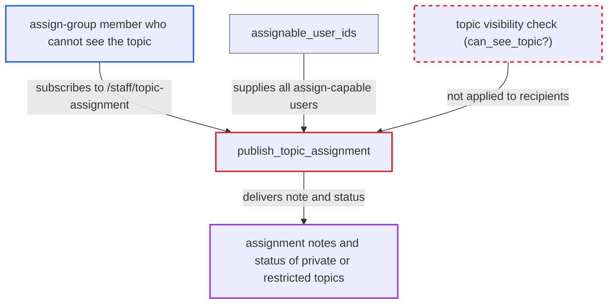

# Assignment notes of private messages broadcast to all assign-capable users via MessageBus

| Field | Value |
|---|---|
| ID | `find_019jnoCY93ABeseMv1cJDLAd` |
| Severity | **Medium** |
| Status | open |
| CWE | CWE-200 — Information exposure |
| Created | 2026-10-27T21:42:27.395853Z |
| Claude Security | https://claude.ai/security/findings/find_019jnoCY93ABeseMv1cJDLAd |

## Description

A user in an assign-allowed group, such as a moderator by default, can read assignment notes and statuses of private messages and restricted-category topics they are not allowed to see. The attacker only needs to be logged in with assign rights. `publish_topic_assignment` sends each note to every assign-capable user without checking that the user can see the topic.

1. **an assigner** creates an assignment or edits its note or status on a private message or restricted topic. `assign` calls `publish_topic_assignment` after every new assignment, and `update_details` does the same on each note or status edit. ([`plugins/discourse-assign/lib/assigner.rb:355`](https://github.com/cx-benchmark/discourse/blob/e08ed05b4b1ef773b2de7948a8f88a7c182a3520/plugins/discourse-assign/lib/assigner.rb#L355))
2. **`publish_topic_assignment`** publishes the topic id, post id, assignee, note and status on `/staff/topic-assignment`. The message goes to every user id returned by `assignable_user_ids(target || topic)`, and nothing checks whether those users can see the topic. ([`plugins/discourse-assign/app/models/assignment.rb:108-130`](https://github.com/cx-benchmark/discourse/blob/e08ed05b4b1ef773b2de7948a8f88a7c182a3520/plugins/discourse-assign/app/models/assignment.rb#L108-L130))
3. **`assignable_user_ids`** returns all members of the global assign groups. For a private message the category is nil, so every member of `assign_allowed_on_groups` is included, whether or not they take part in the PM. ([`plugins/discourse-assign/lib/discourse_assign/assignment_permissions.rb:9-22`](https://github.com/cx-benchmark/discourse/blob/e08ed05b4b1ef773b2de7948a8f88a7c182a3520/plugins/discourse-assign/lib/discourse_assign/assignment_permissions.rb#L9-L22))
4. **the attacker's MessageBus client** receives the message for a topic they cannot read. The attacker is in an assign group but is not a participant of the PM or a member of the restricted category. They do not need to open the topic. ([`lib/guardian/topic_guardian.rb:254-256`](https://github.com/cx-benchmark/discourse/blob/e08ed05b4b1ef773b2de7948a8f88a7c182a3520/lib/guardian/topic_guardian.rb#L254-L256))

## Assessment

The attacker is a logged-in user in a group listed in `assign_allowed_on_groups`. By default that is the `staff` group, so moderators qualify, but an admin can configure any group. The attacker is not a participant of the target PM and not a member of the restricted category. Their MessageBus client subscribes to `/staff/topic-assignment`, which the stock topic controller already does. The server filters by `user_ids`, so the topic does not need to be open. Any client of such a user can poll `/message-bus/<client_id>/poll` and collect notes for all assignments site-wide. Topics in read-restricted categories leak the same way to global assigners outside the category's groups. No action by a victim is needed beyond normal use of the assign feature.

Impact: The attacker learns the existence, topic id, post number, assignee, status and free-text note of private messages and restricted-category topics they cannot read. The leak does not include post bodies, and notes are limited to `max_post_length` characters, so the loss is limited.

## Recommendation

`publish_topic_assignment`, and the matching unassign publish in `Assigner#unassign`, chooses MessageBus recipients by assign capability alone. Users who cannot see a PM or restricted topic still receive its data.

Fix criteria: The recipients of `/staff/topic-assignment` messages are only users who are both assign-capable and allowed by `Guardian#can_see_topic?` (or `topic.secure_audience_publish_messages`). Alternatively, `assignment_note` and `assignment_status` are left out of the broadcast and clients fetch them through the guarded serializer. Test: a moderator who is not a PM participant subscribes to the channel and a PM is assigned with a note. The moderator receives nothing, or a payload without the note.

## Evidence

**https://github.com/cx-benchmark/discourse**

- [`plugins/discourse-assign/app/models/assignment.rb:108-130`](https://github.com/cx-benchmark/discourse/blob/e08ed05b4b1ef773b2de7948a8f88a7c182a3520/plugins/discourse-assign/app/models/assignment.rb#L108-L130)
- [`plugins/discourse-assign/lib/discourse_assign/assignment_permissions.rb:9-22`](https://github.com/cx-benchmark/discourse/blob/e08ed05b4b1ef773b2de7948a8f88a7c182a3520/plugins/discourse-assign/lib/discourse_assign/assignment_permissions.rb#L9-L22)
- [`plugins/discourse-assign/lib/assigner.rb:355`](https://github.com/cx-benchmark/discourse/blob/e08ed05b4b1ef773b2de7948a8f88a7c182a3520/plugins/discourse-assign/lib/assigner.rb#L355)
- [`plugins/discourse-assign/plugin.rb:570-577`](https://github.com/cx-benchmark/discourse/blob/e08ed05b4b1ef773b2de7948a8f88a7c182a3520/plugins/discourse-assign/plugin.rb#L570-L577)
- [`lib/guardian/topic_guardian.rb:254-256`](https://github.com/cx-benchmark/discourse/blob/e08ed05b4b1ef773b2de7948a8f88a7c182a3520/lib/guardian/topic_guardian.rb#L254-L256)

