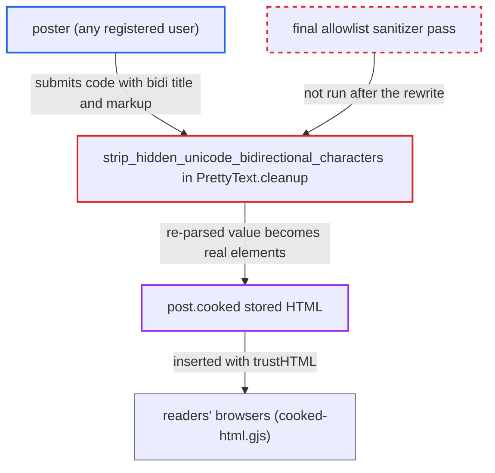

# Bidi highlighting re-parses gsubbed serialized HTML after sanitization, enabling stored HTML injection

| Field | Value |
|---|---|
| ID | `find_018eXtcu9dPwR9utveDDTudb` |
| Severity | **Medium** |
| Status | open |
| CWE | CWE-79 — Cross-site scripting |
| Created | 2026-10-27T21:23:31.598382Z |
| Claude Security | https://claude.ai/security/findings/find_018eXtcu9dPwR9utveDDTudb |

## Description

Any registered user who can post can store their own HTML and CSS in a post that every reader sees, staff included. Everything except `<script>` survives. On the default setup the content security policy stops script from running. The cause is `strip_hidden_unicode_bidirectional_characters` in `lib/pretty_text.rb`. It runs a string replace on already-sanitized serialized HTML and then parses the result again.

1. **poster** submits raw `<code>` containing an `<a>` whose `title` holds a bidi character followed by markup. Markdown runs with `html: true`, and the allowlist permits free-text attributes such as `a[title]`, so the sanitizer lets this through. ([`frontend/discourse-markdown-it/src/setup.js:179`](https://github.com/cx-benchmark/discourse/blob/e08ed05b4b1ef773b2de7948a8f88a7c182a3520/frontend/discourse-markdown-it/src/setup.js#L179))
2. **allowlist sanitizer** accepts the `code` element and the attribute value unchanged. `a[title]`, `abbr[title]`, `img[alt]`, `img[title]` and `div[data-*]` are allowed with arbitrary text. ([`frontend/pretty-text/addon/allow-lister.js:136-184`](https://github.com/cx-benchmark/discourse/blob/e08ed05b4b1ef773b2de7948a8f88a7c182a3520/frontend/pretty-text/addon/allow-lister.js#L136-L184))
3. **the method `strip_hidden_unicode_bidirectional_characters`** serializes the children of the `code` element with `inner_html` and replaces each bidi character with fixed markup. The check looks at the text content, but the replacement runs on the whole serialized string, attribute values included. The inserted `"` and `>` end the attribute and the tag. ([`lib/pretty_text.rb:290-311`](https://github.com/cx-benchmark/discourse/blob/e08ed05b4b1ef773b2de7948a8f88a7c182a3520/lib/pretty_text.rb#L290-L311))
4. **the method `strip_hidden_unicode_bidirectional_characters`** parses the modified string back with `inner_html=`. The rest of the attacker's attribute value becomes real elements. The Nokogiri serializer leaves `<` and `>` unescaped in attribute values, which the project's own spec pins. ([`spec/lib/cooked_post_processor_spec.rb:2446-2450`](https://github.com/cx-benchmark/discourse/blob/e08ed05b4b1ef773b2de7948a8f88a7c182a3520/spec/lib/cooked_post_processor_spec.rb#L2446-L2450))
5. **`PrettyText.cleanup`** finishes with a scrubber that removes only `script`. The sanitizer does not run again, so injected `style`, `form`, `iframe` and similar elements stay. ([`lib/pretty_text.rb:692-706`](https://github.com/cx-benchmark/discourse/blob/e08ed05b4b1ef773b2de7948a8f88a7c182a3520/lib/pretty_text.rb#L692-L706))
6. **the job `Jobs::ProcessPost`** stores the mutated HTML in `post.cooked`. No allowlist pass happens at this point. ([`app/jobs/regular/process_post.rb:26-44`](https://github.com/cx-benchmark/discourse/blob/e08ed05b4b1ef773b2de7948a8f88a7c182a3520/app/jobs/regular/process_post.rb#L26-L44))
7. **reader's browser** inserts `post.cooked` with `trustHTML`. The injected elements render for every reader of the topic. ([`frontend/discourse/app/components/post/cooked-html.gjs:201`](https://github.com/cx-benchmark/discourse/blob/e08ed05b4b1ef773b2de7948a8f88a7c182a3520/frontend/discourse/app/components/post/cooked-html.gjs#L201))

## Assessment

The attacker is any registered user who can post, starting at the lowest trust level (TL0). The attacker submits raw `<code>` with an `<a title="...">` whose value holds a bidi character followed by markup. No special setting is needed, and it works on default settings. Any reader who views the topic receives the injected markup, so no victim action is needed beyond viewing the page. Handlers such as `onerror` run only on sites that have disabled `content_security_policy`, which is not the default.

Impact: The attacker stores arbitrary HTML and CSS (everything but `<script>`) on the forum's own origin. This allows page-wide CSS overlays and defacement, phishing forms on the trusted origin, arbitrary iframes, and links that skip the href checks. Under the default policy no script runs, so the loss of page integrity and, through phishing, of confidentiality is limited.

## Recommendation

(1) The bidi highlighting works on serialized HTML. It runs a string replace with `inner_html` and then calls `inner_html=`. The fixed replacement inserted inside an attribute value changes how the attacker's following characters are parsed.

Fix criteria: The bidi highlighting works on the DOM. It iterates the text nodes under `code`/`pre` and replaces them with text and `span` nodes. It leaves attribute values untouched, or strips bidi characters from attributes separately. Cooking `<code>\u202E<a title="\u202E">x</a></code>` yields no `img` element, and the `title` attribute still contains the escaped text.

(2) `PrettyText.cleanup` runs several DOM rewrites after sanitization and ends with a scrubber that removes only `script`. Any bug in a rewrite therefore ends up as stored HTML.

Fix criteria: The full allowlist sanitizer, or an equivalent server-side allowlist scrub, runs as the last step of `cleanup` after all rewrites. Elements and attributes outside the allowlist cannot reach `post.cooked`. The payload above produces no injected elements. An `onerror` attribute added directly to the post-processed document is also removed.

## Evidence

**https://github.com/cx-benchmark/discourse**

- [`lib/pretty_text.rb:290-311`](https://github.com/cx-benchmark/discourse/blob/e08ed05b4b1ef773b2de7948a8f88a7c182a3520/lib/pretty_text.rb#L290-L311)
- [`lib/pretty_text.rb:692-706`](https://github.com/cx-benchmark/discourse/blob/e08ed05b4b1ef773b2de7948a8f88a7c182a3520/lib/pretty_text.rb#L692-L706)
- [`spec/lib/cooked_post_processor_spec.rb:2446-2450`](https://github.com/cx-benchmark/discourse/blob/e08ed05b4b1ef773b2de7948a8f88a7c182a3520/spec/lib/cooked_post_processor_spec.rb#L2446-L2450)
- [`frontend/pretty-text/addon/allow-lister.js:136-184`](https://github.com/cx-benchmark/discourse/blob/e08ed05b4b1ef773b2de7948a8f88a7c182a3520/frontend/pretty-text/addon/allow-lister.js#L136-L184)
- [`frontend/discourse-markdown-it/src/setup.js:179`](https://github.com/cx-benchmark/discourse/blob/e08ed05b4b1ef773b2de7948a8f88a7c182a3520/frontend/discourse-markdown-it/src/setup.js#L179)
- [`app/jobs/regular/process_post.rb:26-44`](https://github.com/cx-benchmark/discourse/blob/e08ed05b4b1ef773b2de7948a8f88a7c182a3520/app/jobs/regular/process_post.rb#L26-L44)
- [`frontend/discourse/app/components/post/cooked-html.gjs:201`](https://github.com/cx-benchmark/discourse/blob/e08ed05b4b1ef773b2de7948a8f88a7c182a3520/frontend/discourse/app/components/post/cooked-html.gjs#L201)
- [`lib/content_security_policy/default.rb:10-31`](https://github.com/cx-benchmark/discourse/blob/e08ed05b4b1ef773b2de7948a8f88a7c182a3520/lib/content_security_policy/default.rb#L10-L31)

