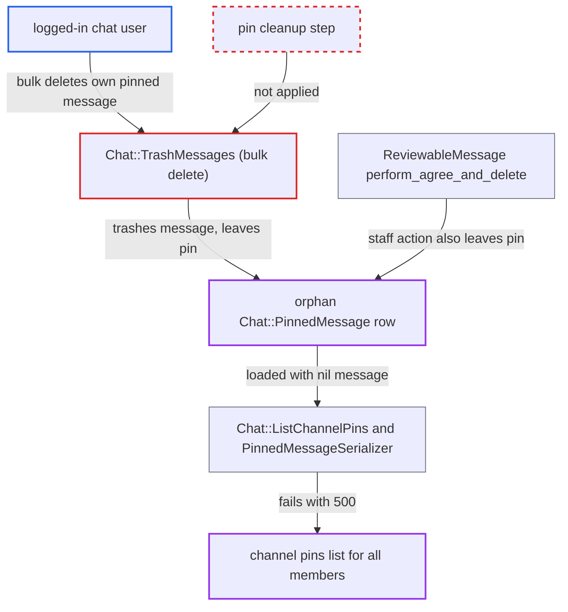

# Bulk chat message deletion leaves an orphan pin that persistently breaks the channel pins list

| Field | Value |
|---|---|
| ID | `find_01EVeoJyr9CeC8bwbpK6Fcy1` |
| Severity | **Medium** |
| Status | open |
| CWE | CWE-459 — Improper resource cleanup |
| Created | 2026-10-27T21:19:45.555571Z |
| Claude Security | https://claude.ai/security/findings/find_01EVeoJyr9CeC8bwbpK6Fcy1 |

## Description

Any logged-in, non-silenced chat user can break the pins list for every member of a channel they can post in. They delete one of their own pinned messages through the bulk delete path. The pin row stays behind, and `GET /chat/api/channels/:id/pins` then returns 500. The cause is that `Chat::TrashMessages` never removes the message's `Chat::PinnedMessage`, and `Chat::PinnedMessageSerializer#excerpt` assumes the message exists.

1. **attacker** gets one of their own messages pinned. In a DM or group DM any participant can pin, so they pin it themselves. In a public channel only `chat_pinning_messages_allowed_groups` (default admins and moderators) can pin, so the message must be one staff pinned. ([`plugins/chat/lib/chat/guardian_extensions.rb:248-265`](https://github.com/cx-benchmark/discourse/blob/e08ed05b4b1ef773b2de7948a8f88a7c182a3520/plugins/chat/lib/chat/guardian_extensions.rb#L248-L265))
2. **attacker** deletes that message through the bulk endpoint. They send `DELETE /chat/api/channels/:channel_id/messages` with `message_ids: [mid]`, or use the selection-mode Delete button, which calls the same endpoint. ([`plugins/chat/app/controllers/chat/api/channel_messages_controller.rb:36-46`](https://github.com/cx-benchmark/discourse/blob/e08ed05b4b1ef773b2de7948a8f88a7c182a3520/plugins/chat/app/controllers/chat/api/channel_messages_controller.rb#L36-L46))
3. **the service `Chat::TrashMessages`** trashes the message but leaves its pin. It calls `message.trash!`, which only sets `deleted_at`, and it has no step that destroys the `Chat::PinnedMessage`, so the pin row now points at a trashed message. ([`plugins/chat/app/services/chat/trash_messages.rb:32-57`](https://github.com/cx-benchmark/discourse/blob/e08ed05b4b1ef773b2de7948a8f88a7c182a3520/plugins/chat/app/services/chat/trash_messages.rb#L32-L57))
4. **the service `Chat::ListChannelPins`** loads the pins with a nil message for the orphan. `fetch_pins` preloads `chat_message`, and the `Trashable` default scope hides the trashed message, so that pin's `chat_message` is nil. ([`plugins/chat/app/services/chat/list_channel_pins.rb:33-58`](https://github.com/cx-benchmark/discourse/blob/e08ed05b4b1ef773b2de7948a8f88a7c182a3520/plugins/chat/app/services/chat/list_channel_pins.rb#L33-L58))
5. **the serializer `Chat::PinnedMessageSerializer`** calls `build_excerpt` on nil and raises. `excerpt` has no nil check, so a `NoMethodError` aborts the whole list and `GET /chat/api/channels/:id/pins` returns 500 for every member. ([`plugins/chat/app/serializers/chat/pinned_message_serializer.rb:16-18`](https://github.com/cx-benchmark/discourse/blob/e08ed05b4b1ef773b2de7948a8f88a7c182a3520/plugins/chat/app/serializers/chat/pinned_message_serializer.rb#L16-L18))
6. **a member or staff user** tries to remove the orphan pin and gets 404. `Chat::UnpinMessage` looks the message up in the non-trashed scope, so the pin cannot be removed until the message is restored. ([`plugins/chat/app/services/chat/unpin_message.rb:23-40`](https://github.com/cx-benchmark/discourse/blob/e08ed05b4b1ef773b2de7948a8f88a7c182a3520/plugins/chat/app/services/chat/unpin_message.rb#L23-L40))

## Assessment

The attacker is any logged-in, non-silenced chat user, and no victim action is needed. The feature is on in the default configuration. `chat_pinned_messages` is `default: false`, but it is an upcoming change with status `stable`, and `UpcomingChanges.enabled?` treats it as on under the default `promote_upcoming_changes_on_status` of `beta`. An admin can opt out. In a DM or group DM the attacker pins their own message and then bulk deletes it. In a public channel the message must already be pinned by staff. A second route to the same orphan is the staff-only reviewable action `Chat::ReviewableMessage#perform_agree_and_delete`, which also calls `trash!` without removing the pin. Staff trigger that route, not the attacker.

Impact: The pins list returns 500 for every member of the channel, and the pinned-message bar shows nothing, which hides every other pin. The orphan still counts in `pinned_messages_count`, `has_unseen_pins?` and the `MAX_PINS_PER_CHANNEL` limit, and it keeps the trashed message from retention purging. The state persists, and only restoring the message and then unpinning clears it. The damage is limited to the pins feature of channels the attacker can post in. Chat itself keeps working, and no data is disclosed or altered.

## Recommendation

(1) Pin removal exists only in `Chat::TrashMessage`. `Chat::TrashMessages` and `Chat::ReviewableMessage#perform_agree_and_delete` trash messages and leave `Chat::PinnedMessage` rows pointing at them.

Fix criteria: After a message is trashed by any path (single, bulk or reviewable), no `Chat::PinnedMessage` references it. Clients are notified of the unpin. Test it by pinning a message and trashing it through the bulk endpoint and through `agree_and_delete`. In both cases the pin row must be gone and `GET /chat/api/channels/:id/pins` must return 200.

(2) The pins read path (`ListChannelPins`, `PinnedMessageSerializer#excerpt`), the pin counts and `UnpinMessage` all assume every pin's message can be loaded. One stale pin therefore breaks the whole list and cannot be removed.

Fix criteria: A pin whose message is trashed or missing does not make the pins list fail. It does not count toward pin totals or the per-channel limit, and staff can remove it. Test it against a pre-existing orphan row created before the fix.

## Evidence

**https://github.com/cx-benchmark/discourse**

- [`plugins/chat/app/services/chat/trash_messages.rb:32-57`](https://github.com/cx-benchmark/discourse/blob/e08ed05b4b1ef773b2de7948a8f88a7c182a3520/plugins/chat/app/services/chat/trash_messages.rb#L32-L57)
- [`plugins/chat/app/services/chat/trash_message.rb:34-68`](https://github.com/cx-benchmark/discourse/blob/e08ed05b4b1ef773b2de7948a8f88a7c182a3520/plugins/chat/app/services/chat/trash_message.rb#L34-L68)
- [`plugins/chat/app/controllers/chat/api/channel_messages_controller.rb:36-46`](https://github.com/cx-benchmark/discourse/blob/e08ed05b4b1ef773b2de7948a8f88a7c182a3520/plugins/chat/app/controllers/chat/api/channel_messages_controller.rb#L36-L46)
- [`plugins/chat/lib/chat/guardian_extensions.rb:248-265`](https://github.com/cx-benchmark/discourse/blob/e08ed05b4b1ef773b2de7948a8f88a7c182a3520/plugins/chat/lib/chat/guardian_extensions.rb#L248-L265)
- [`plugins/chat/app/services/chat/list_channel_pins.rb:33-58`](https://github.com/cx-benchmark/discourse/blob/e08ed05b4b1ef773b2de7948a8f88a7c182a3520/plugins/chat/app/services/chat/list_channel_pins.rb#L33-L58)
- [`plugins/chat/app/serializers/chat/pinned_message_serializer.rb:16-18`](https://github.com/cx-benchmark/discourse/blob/e08ed05b4b1ef773b2de7948a8f88a7c182a3520/plugins/chat/app/serializers/chat/pinned_message_serializer.rb#L16-L18)
- [`plugins/chat/app/services/chat/unpin_message.rb:23-40`](https://github.com/cx-benchmark/discourse/blob/e08ed05b4b1ef773b2de7948a8f88a7c182a3520/plugins/chat/app/services/chat/unpin_message.rb#L23-L40)
- [`plugins/chat/app/models/chat/reviewable_message.rb:157-159`](https://github.com/cx-benchmark/discourse/blob/e08ed05b4b1ef773b2de7948a8f88a7c182a3520/plugins/chat/app/models/chat/reviewable_message.rb#L157-L159)
- [`plugins/chat/config/settings.yml:5-12`](https://github.com/cx-benchmark/discourse/blob/e08ed05b4b1ef773b2de7948a8f88a7c182a3520/plugins/chat/config/settings.yml#L5-L12)

