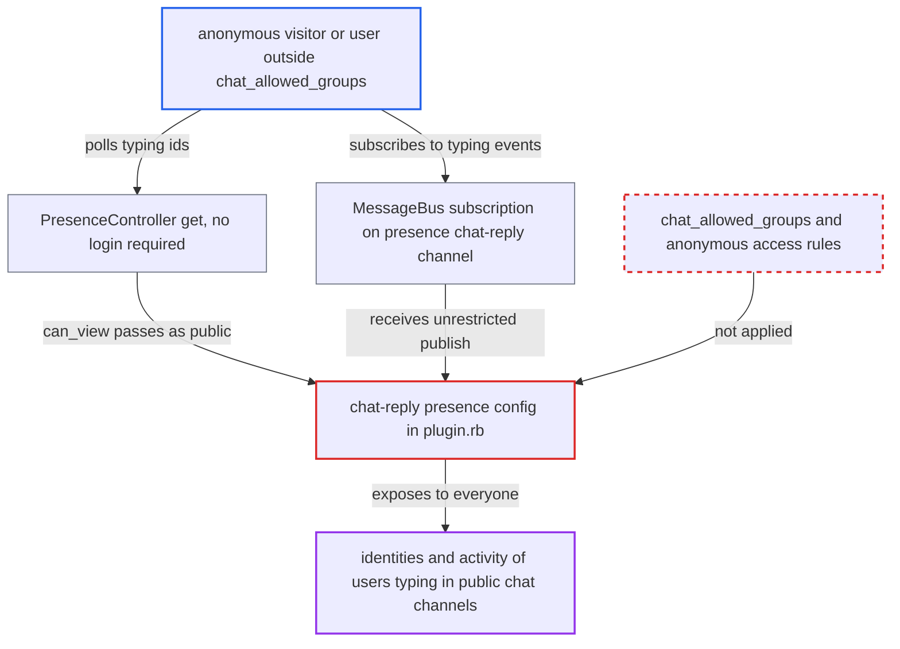

# Chat typing-presence channel readable by anonymous and non-chat users for public channels

| Field | Value |
|---|---|
| ID | `find_01P1mmt76krBmdwPXZjkqPSW` |
| Severity | **Medium** |
| Status | open |
| CWE | CWE-862 — Missing Authorization |
| Created | 2026-10-27T21:48:48.244202Z |
| Claude Security | https://claude.ai/security/findings/find_01P1mmt76krBmdwPXZjkqPSW |

## Description

Anonymous visitors and logged-in users who are not allowed to use chat can see which users are typing in public chat channels. They get user ids by polling, or usernames and avatars by subscribing. Only metadata leaks, not message content. It matters on sites that have narrowed `chat_allowed_groups`. The `chat-reply` presence config in `plugins/chat/plugin.rb` uses only category read permissions and skips chat's own audience rules.

1. **attacker** requests the typing-presence channel of a public chat channel. The attacker sends `GET /presence/get?channels[]=/chat-reply/1` and needs no login, because channel ids are small integers. ([`app/controllers/presence_controller.rb:10-40`](https://github.com/cx-benchmark/discourse/blob/e08ed05b4b1ef773b2de7948a8f88a7c182a3520/app/controllers/presence_controller.rb#L10-L40))
2. **the `chat-reply` presence block** builds a config that marks the channel as public. It sets `public = !chat_channel.read_restricted?` and passes the raw `allowed_group_ids`. It never looks at `chat_allowed_groups` or the anonymous-access setting. ([`plugins/chat/plugin.rb:495-514`](https://github.com/cx-benchmark/discourse/blob/e08ed05b4b1ef773b2de7948a8f88a7c182a3520/plugins/chat/plugin.rb#L495-L514))
3. **`PresenceChannel#can_view?`** returns true for the caller. A public config short-circuits to true, including for an anonymous caller whose `user_id` is nil. ([`lib/presence_channel.rb:105-120`](https://github.com/cx-benchmark/discourse/blob/e08ed05b4b1ef773b2de7948a8f88a7c182a3520/lib/presence_channel.rb#L105-L120))
4. **`PresenceController#get`** returns the ids of the users currently typing. The action has no `ensure_logged_in`, so the attacker gets the ids for every channel whose config lets them view it. ([`app/controllers/presence_controller.rb:10-40`](https://github.com/cx-benchmark/discourse/blob/e08ed05b4b1ef773b2de7948a8f88a7c182a3520/app/controllers/presence_controller.rb#L10-L40))
5. **`PresenceChannel#publish_message`** publishes the typing users to every MessageBus subscriber. The `entering_users` list, serialized with `BasicUserSerializer` (id, username, name, avatar), goes out on `/presence/chat-reply/<id>` with no `user_ids` or `group_ids` restriction. An attacker who subscribes there gets the identities live. ([`lib/presence_channel.rb:335-365`](https://github.com/cx-benchmark/discourse/blob/e08ed05b4b1ef773b2de7948a8f88a7c182a3520/lib/presence_channel.rb#L335-L365))

## Assessment

The attacker is an anonymous internet visitor, or any logged-in user outside `chat_allowed_groups`. The site has chat enabled but restricted to specific groups, such as staff or a paid group, and `login_required` is off. That narrowing is not the default. By default `chat_allowed_groups` includes `anonymous_users`, and anonymous preview is a designed feature. The attacker has two ways in. One is to request `GET /presence/get?channels[]=/chat-reply/<id>`. The other is to subscribe to `/presence/chat-reply/<id>` over MessageBus. No victim action is needed. A second case covers read-restricted category channels. There, members of category groups that are not chat-enabled, and groups with see-only category permission, can also view typing presence.

Impact: The attacker learns which chat channels exist and are active. They also learn who is typing, and when, in channels they may not read. No message content is exposed and nothing can be modified. Any logged-in user can also join presence, because `can_enter?` reuses `can_view?`. That only pollutes the typing indicator.

## Recommendation

The `chat-reply` presence config takes its audience from category read permissions alone. It bypasses chat's own authorization (`chat_allowed_groups`, the anonymous-access setting and the chat-restricted pseudo-audience), so presence data reaches people who cannot read the channel.

Fix criteria: The set of principals who can view or join `/chat-reply/*` is no broader than the set that `Chat::Publisher.permissions` delivers that channel's messages to, and ideally also passes `can_join_chat_channel?`. Public channels are not `public: true` unless `Chat.anonymous_public_channel_access_allowed?` is true. Otherwise they are limited to `Chat.message_bus_allowed_group_ids`. Restricted channels are limited to chat-enabled members with posting rights. With `chat_allowed_groups` set to a single custom group, `GET /presence/get?channels[]=/chat-reply/<public id>` returns `null` for anonymous and non-member users.

## Evidence

**https://github.com/cx-benchmark/discourse**

- [`plugins/chat/plugin.rb:495-514`](https://github.com/cx-benchmark/discourse/blob/e08ed05b4b1ef773b2de7948a8f88a7c182a3520/plugins/chat/plugin.rb#L495-L514)
- [`lib/presence_channel.rb:105-120`](https://github.com/cx-benchmark/discourse/blob/e08ed05b4b1ef773b2de7948a8f88a7c182a3520/lib/presence_channel.rb#L105-L120)
- [`app/controllers/presence_controller.rb:10-40`](https://github.com/cx-benchmark/discourse/blob/e08ed05b4b1ef773b2de7948a8f88a7c182a3520/app/controllers/presence_controller.rb#L10-L40)
- [`lib/presence_channel.rb:335-365`](https://github.com/cx-benchmark/discourse/blob/e08ed05b4b1ef773b2de7948a8f88a7c182a3520/lib/presence_channel.rb#L335-L365)
- [`plugins/chat/app/services/chat/publisher.rb:511-527`](https://github.com/cx-benchmark/discourse/blob/e08ed05b4b1ef773b2de7948a8f88a7c182a3520/plugins/chat/app/services/chat/publisher.rb#L511-L527)
- [`plugins/chat/lib/chat/engine.rb:26-55`](https://github.com/cx-benchmark/discourse/blob/e08ed05b4b1ef773b2de7948a8f88a7c182a3520/plugins/chat/lib/chat/engine.rb#L26-L55)

