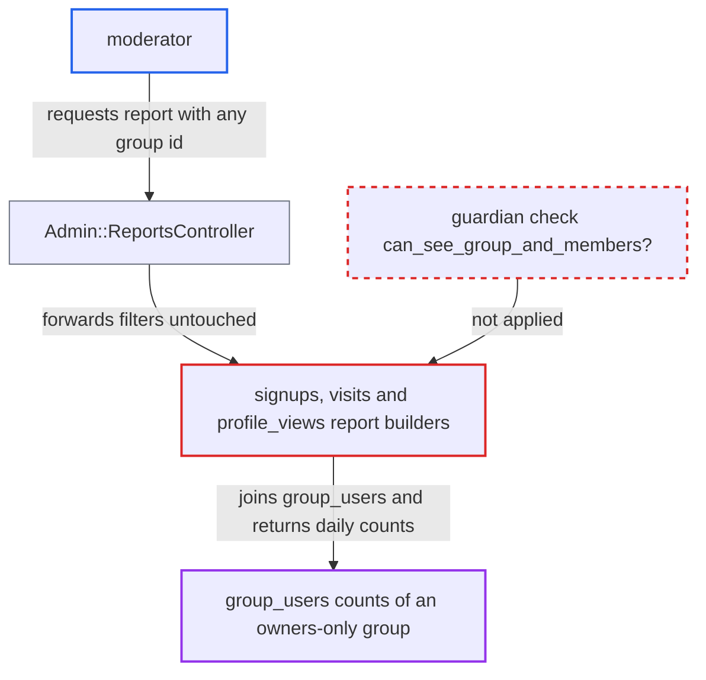

# Core signups/visits/profile_views reports leak owner-only hidden group activity to moderators

| Field | Value |
|---|---|
| ID | `find_01GoeScmmsAh6h7rN6BhZk3U` |
| Severity | **Medium** |
| Status | open |
| CWE | CWE-862 — Missing authorization |
| Created | 2026-10-27T22:06:09.447891Z |
| Claude Security | https://claude.ai/security/findings/find_01GoeScmmsAh6h7rN6BhZk3U |

## Description

A moderator can read per-day figures about the members of an owners-only hidden group that moderators are not allowed to see. The figures are signup counts, visit counts and profile-view counts, and the response confirms the group exists and shows its approximate size. The `signups`, `visits` and `profile_views` reports take the request's `group` filter and never ask `report.guardian` whether the requester may see that group.

1. **moderator** requests a report with a group id of their choice. The request is `GET /admin/reports/signups.json?filters[group]=<id>` with start and end dates. The same works for `visits`, `profile_views` or `reports/bulk`, and the attacker tries successive small integer ids. ([`app/controllers/admin/reports_controller.rb:48-71`](https://github.com/cx-benchmark/discourse/blob/e08ed05b4b1ef773b2de7948a8f88a7c182a3520/app/controllers/admin/reports_controller.rb#L48-L71))
2. **`Admin::ReportsController`** lets the request through to the report. It rejects only report types for which `Report.hidden?` is true, and these three types are not in `Report::ADMIN_ONLY_REPORTS`. It forwards `filters` untouched with the caller's guardian. ([`app/models/report.rb:41-58`](https://github.com/cx-benchmark/discourse/blob/e08ed05b4b1ef773b2de7948a8f88a7c182a3520/app/models/report.rb#L41-L58))
3. **the report builders in `signups.rb`, `visits.rb` and `profile_views.rb`** read the `group` filter and pass it on as a group id. The value is used as given, and `report.guardian` is never consulted about the group or its members. ([`app/models/concerns/reports/signups.rb:10-20`](https://github.com/cx-benchmark/discourse/blob/e08ed05b4b1ef773b2de7948a8f88a7c182a3520/app/models/concerns/reports/signups.rb#L10-L20))
4. **`User.count_by_signup_date`, `UserVisit.counts_by_day_and_mobile` and `UserProfileView.profile_views_by_day`** join `group_users` on the supplied id and count per day. Group visibility is never considered. For profile views the count is of views made by group members, because `user_profile_views.user_id` is the viewer. ([`app/models/user.rb:1588-1604`](https://github.com/cx-benchmark/discourse/blob/e08ed05b4b1ef773b2de7948a8f88a7c182a3520/app/models/user.rb#L1588-L1604))
5. **moderator** receives the group's daily counts. The JSON holds per-day signup counts, per-day desktop and mobile visit counts with a total, and per-day profile views made by members, all for a group that visibility rules hide from this moderator.

## Assessment

The attacker is a moderator, which is a staff role below admin. No victim action is needed. The moderator sends the report request to the staff reports endpoint with a group id. Besides `signups`, `visits` and `profile_views` requested one at a time, the `reports/bulk` route also works. The ids are small integers, so they can be tried one after another. Moderators can also list users with their `created_at` dates, so a day with one site-wide signup and a group count of 1 points to a single member.

Impact: The moderator learns that an owners-only hidden group exists, roughly how large it is, when its members signed up, and how active they are in visits and profile views. On low-signup days this can identify an individual member. The leak stops at aggregate counts: the signups user list stays admin-only, and the report returns the group id but not the group name. Nothing is modified.

## Recommendation

The `signups`, `visits` and `profile_views` report builders apply the request-supplied `group` filter without checking whether `report.guardian` may see the group and its members. This bypasses the owners-only visibility that `Group.visible_groups` and `Guardian#can_see_group_and_members?` enforce elsewhere.

Fix criteria: A group filter in these reports takes effect only when the requester is an admin or `can_see_group_and_members?(group)` holds. Otherwise the report returns an error or no group-scoped data. To verify, request each report as a non-owner moderator with the id of a `visibility_level: owners` group that has members. Confirm the response holds no group-scoped counts. Confirm that an admin or the group's owner still gets them.

## Evidence

**https://github.com/cx-benchmark/discourse**

- [`app/models/concerns/reports/signups.rb:10-20`](https://github.com/cx-benchmark/discourse/blob/e08ed05b4b1ef773b2de7948a8f88a7c182a3520/app/models/concerns/reports/signups.rb#L10-L20)
- [`app/models/concerns/reports/visits.rb:8-26`](https://github.com/cx-benchmark/discourse/blob/e08ed05b4b1ef773b2de7948a8f88a7c182a3520/app/models/concerns/reports/visits.rb#L8-L26)
- [`app/models/concerns/reports/profile_views.rb:8-19`](https://github.com/cx-benchmark/discourse/blob/e08ed05b4b1ef773b2de7948a8f88a7c182a3520/app/models/concerns/reports/profile_views.rb#L8-L19)
- [`app/models/user.rb:1588-1604`](https://github.com/cx-benchmark/discourse/blob/e08ed05b4b1ef773b2de7948a8f88a7c182a3520/app/models/user.rb#L1588-L1604)
- [`app/models/user_visit.rb:91-110`](https://github.com/cx-benchmark/discourse/blob/e08ed05b4b1ef773b2de7948a8f88a7c182a3520/app/models/user_visit.rb#L91-L110)
- [`app/models/user_profile_view.rb:57-67`](https://github.com/cx-benchmark/discourse/blob/e08ed05b4b1ef773b2de7948a8f88a7c182a3520/app/models/user_profile_view.rb#L57-L67)
- [`app/controllers/admin/reports_controller.rb:48-71`](https://github.com/cx-benchmark/discourse/blob/e08ed05b4b1ef773b2de7948a8f88a7c182a3520/app/controllers/admin/reports_controller.rb#L48-L71)
- [`app/models/report.rb:41-58`](https://github.com/cx-benchmark/discourse/blob/e08ed05b4b1ef773b2de7948a8f88a7c182a3520/app/models/report.rb#L41-L58)
- [`app/models/group.rb:202-214`](https://github.com/cx-benchmark/discourse/blob/e08ed05b4b1ef773b2de7948a8f88a7c182a3520/app/models/group.rb#L202-L214)
- [`lib/guardian.rb:304-356`](https://github.com/cx-benchmark/discourse/blob/e08ed05b4b1ef773b2de7948a8f88a7c182a3520/lib/guardian.rb#L304-L356)
- [`app/models/concerns/reports/posters_by_member_type.rb:146-160`](https://github.com/cx-benchmark/discourse/blob/e08ed05b4b1ef773b2de7948a8f88a7c182a3520/app/models/concerns/reports/posters_by_member_type.rb#L146-L160)

