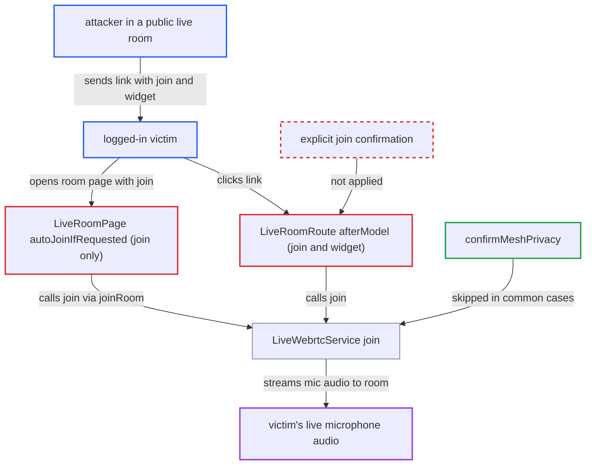

# Crafted room link with ?join auto-joins victim to a voice call with live microphone

| Field | Value |
|---|---|
| ID | `find_01WwdtC2fV7noXTq2BYhvu2r` |
| Severity | **Medium** |
| Status | open |
| CWE | CWE-352 — Cross-Site Request Forgery |
| Created | 2026-10-27T21:47:25.152615Z |
| Claude Security | https://claude.ai/security/findings/find_01WwdtC2fV7noXTq2BYhvu2r |

## Description

A user who can post a link can join any logged-in victim to a live voice call with an open microphone. The attacker, present in the room, hears the victim's surroundings. It needs only that the victim clicks a link such as `/live/r/watercooler?join&widget`. The route reads `join` and `widget` from the URL and calls `liveWebrtc.join(room)` with no confirmation.

1. **Attacker** puts a room link with `?join&widget` into a post, chat message, PM or external page. `join` and `widget` are plain query parameters of the public route `/live/r/:slug`, so any link author controls them, and the default room 'Watercooler' is public. ([`plugins/live/assets/javascripts/discourse/controllers/live-room.js:5-14`](https://github.com/cx-benchmark/discourse/blob/e08ed05b4b1ef773b2de7948a8f88a7c182a3520/plugins/live/assets/javascripts/discourse/controllers/live-room.js#L5-L14))
2. **Victim** clicks the link while logged in. Any logged-in user with live access can be hit, and the default is all logged-in users.
3. **the route `LiveRoomRoute#afterModel`** calls `liveWebrtc.join(room)` and aborts the transition. With both `join` and `widget` set, the victim stays on the current page and the call starts in the floating widget. ([`plugins/live/assets/javascripts/discourse/routes/live-room.js:25-62`](https://github.com/cx-benchmark/discourse/blob/e08ed05b4b1ef773b2de7948a8f88a7c182a3520/plugins/live/assets/javascripts/discourse/routes/live-room.js#L25-L62))
4. **the page component `LiveRoomPage`** calls `joinRoom()` through `autoJoinIfRequested` when only `join` is set. This is a second way in: `autoJoinIfRequested` runs when the room page is inserted and has no confirmation, and `joinRoom` calls `liveWebrtc.join(this.room)`. ([`plugins/live/assets/javascripts/discourse/components/live/room-page.gjs:326-345`](https://github.com/cx-benchmark/discourse/blob/e08ed05b4b1ef773b2de7948a8f88a7c182a3520/plugins/live/assets/javascripts/discourse/components/live/room-page.gjs#L326-L345))
5. **the service `LiveWebrtcService#join`** POSTs `/live/rooms/:id/join`, acquires the microphone and enables the audio track. The track is enabled with `#setMicEnabled(!this.pttEnabled)`, so the victim transmits audio to everyone in the room as soon as the join completes. ([`plugins/live/assets/javascripts/discourse/app/services/live-webrtc.js:695-830`](https://github.com/cx-benchmark/discourse/blob/e08ed05b4b1ef773b2de7948a8f88a7c182a3520/plugins/live/assets/javascripts/discourse/app/services/live-webrtc.js#L695-L830))
6. **`confirmMeshPrivacy`** returns true without asking the user. It skips the prompt for LiveKit-transport rooms, when the admin turns off `live_mesh_privacy_warning_enabled`, and when the user ticked 'don't show again', which is saved in `localStorage`. ([`plugins/live/assets/javascripts/discourse/components/modal/live-mesh-privacy-warning.gjs:36-70`](https://github.com/cx-benchmark/discourse/blob/e08ed05b4b1ef773b2de7948a8f88a7c182a3520/plugins/live/assets/javascripts/discourse/components/modal/live-mesh-privacy-warning.gjs#L36-L70))

## Assessment

The attacker needs only to post a link, or send it by chat, PM or an external page, and be present in a public live room. The default room 'Watercooler' is public, so room-creation rights are not needed. The victim is a logged-in user with live access (default: all logged-in users). The victim must click the link. The browser must also already allow the site's microphone, and for mesh rooms the victim must have accepted the privacy warning once. The warning is skipped for LiveKit rooms, when the admin disables it, and once the user ticked 'don't show again'. The attacker can use `?join&widget`, or `?join` alone, which joins through the room page. The plugin itself generates `/live/r/<slug>?join` links.

Impact: The attacker hears the victim's microphone audio, and so the victim's surroundings, until the victim notices the call widget and leaves. The attacker also learns the victim is online, and the victim's presence and status are updated through `UserStatusManager.set_live_status`. Joining also pulls the victim out of any other active room. The exposure lasts only until the victim reacts, and availability is not affected.

## Recommendation

The URL parameters `?join` and `?widget` are treated as the user's intent to join a call and publish their microphone. No explicit confirmation is asked for on that navigation.

Fix criteria: Navigating to a room URL never starts a call or acquires the microphone without an explicit in-page confirmation, such as a 'Join call' click or an accept dialog. The only exception is a trusted in-app action, such as the ring 'Answer' button passing state in memory rather than a URL flag. Opening `/live/r/<slug>?join&widget` from a post link or a fresh page load shows the room page or a prompt. It does not POST `/join` or call `getUserMedia` until the user confirms. The incoming-call Answer flow still joins directly.

## Evidence

**https://github.com/cx-benchmark/discourse**

- [`plugins/live/assets/javascripts/discourse/components/live/room-page.gjs:326-345`](https://github.com/cx-benchmark/discourse/blob/e08ed05b4b1ef773b2de7948a8f88a7c182a3520/plugins/live/assets/javascripts/discourse/components/live/room-page.gjs#L326-L345)
- [`plugins/live/assets/javascripts/discourse/components/live/room-page.gjs:384-400`](https://github.com/cx-benchmark/discourse/blob/e08ed05b4b1ef773b2de7948a8f88a7c182a3520/plugins/live/assets/javascripts/discourse/components/live/room-page.gjs#L384-L400)
- [`plugins/live/assets/javascripts/discourse/routes/live-room.js:25-62`](https://github.com/cx-benchmark/discourse/blob/e08ed05b4b1ef773b2de7948a8f88a7c182a3520/plugins/live/assets/javascripts/discourse/routes/live-room.js#L25-L62)
- [`plugins/live/assets/javascripts/discourse/app/services/live-webrtc.js:695-830`](https://github.com/cx-benchmark/discourse/blob/e08ed05b4b1ef773b2de7948a8f88a7c182a3520/plugins/live/assets/javascripts/discourse/app/services/live-webrtc.js#L695-L830)
- [`plugins/live/assets/javascripts/discourse/components/modal/live-mesh-privacy-warning.gjs:36-70`](https://github.com/cx-benchmark/discourse/blob/e08ed05b4b1ef773b2de7948a8f88a7c182a3520/plugins/live/assets/javascripts/discourse/components/modal/live-mesh-privacy-warning.gjs#L36-L70)
- [`plugins/live/assets/javascripts/discourse/controllers/live-room.js:5-14`](https://github.com/cx-benchmark/discourse/blob/e08ed05b4b1ef773b2de7948a8f88a7c182a3520/plugins/live/assets/javascripts/discourse/controllers/live-room.js#L5-L14)
- [`plugins/live/assets/javascripts/discourse/initializers/live-sidebar.js:703`](https://github.com/cx-benchmark/discourse/blob/e08ed05b4b1ef773b2de7948a8f88a7c182a3520/plugins/live/assets/javascripts/discourse/initializers/live-sidebar.js#L703)

