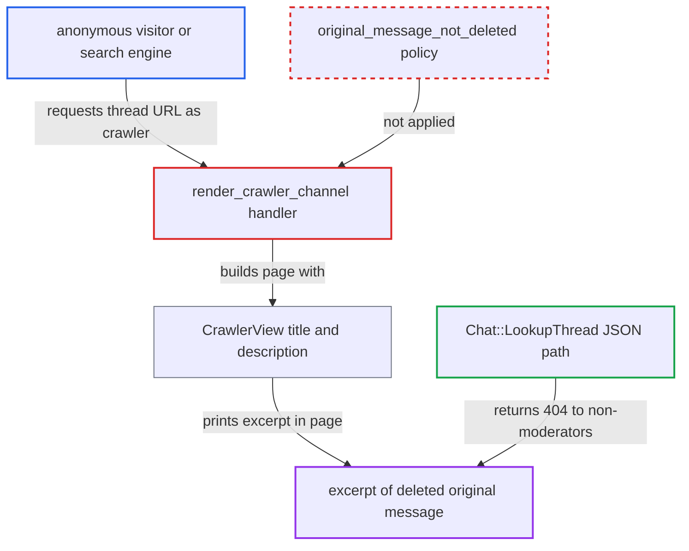

# Crawler thread page leaks excerpt of trashed thread original message to anonymous users

| Field | Value |
|---|---|
| ID | `find_01ADHtDt7GRHF9baWPjvebkx` |
| Severity | **Medium** |
| Status | open |
| CWE | CWE-862 — Missing authorization |
| Created | 2026-10-27T21:16:06.411577Z |
| Claude Security | https://claude.ai/security/findings/find_01ADHtDt7GRHF9baWPjvebkx |

## Description

Anonymous visitors and search engines can read a short excerpt (up to 150 characters) of a thread's original message after a moderator or the author deleted it. They also see the author's username, post date and like count. This works on threads in anonymously viewable public channels, which is the default setup. `render_crawler_channel` loads the thread and never applies the rule that hides threads with a deleted original message.

1. **anonymous attacker or search engine** requests the crawler thread URL of a thread whose original message was deleted. The request goes to `GET /chat/c/-/<channel_id>/t/<thread_id>` with a crawler User-Agent or the `?print` parameter, and needs no login. ([`plugins/chat/config/settings.yml:13-24`](https://github.com/cx-benchmark/discourse/blob/e08ed05b4b1ef773b2de7948a8f88a7c182a3520/plugins/chat/config/settings.yml#L13-L24))
2. **the handler `render_crawler_channel`** loads the thread and renders it. It finds the thread with `channel.threads.find_by(id:)` and checks only that threading is enabled or forced. It never checks whether the original message is deleted. ([`plugins/chat/app/controllers/chat/chat_controller.rb:121-146`](https://github.com/cx-benchmark/discourse/blob/e08ed05b4b1ef773b2de7948a8f88a7c182a3520/plugins/chat/app/controllers/chat/chat_controller.rb#L121-L146))
3. **the model `Chat::Thread`** returns the deleted original message. `belongs_to :original_message` is declared with `with_deleted`, and `Trashable#trash!` only sets `deleted_at`, so the stored `excerpt` and `cooked` are still there. ([`plugins/chat/app/models/chat/thread.rb:14-17`](https://github.com/cx-benchmark/discourse/blob/e08ed05b4b1ef773b2de7948a8f88a7c182a3520/plugins/chat/app/models/chat/thread.rb#L14-L17))
4. **the class `CrawlerView`** builds the page title and description from the deleted message. `thread_title` and `description` read `original_message.excerpt_for_display` with no deleted check. ([`plugins/chat/lib/chat/crawler_view.rb:217-225`](https://github.com/cx-benchmark/discourse/blob/e08ed05b4b1ef773b2de7948a8f88a7c182a3520/plugins/chat/lib/chat/crawler_view.rb#L217-L225))
5. **the template `crawler_channel.html.erb`** prints the excerpt and author details into the page. The excerpt appears in the `<h1>`, `itemprop=headline`, `<title>` and the description and og meta tags, together with the author's username, `datePublished` and like count. ([`plugins/chat/app/views/chat/chat/crawler_channel.html.erb:5-86`](https://github.com/cx-benchmark/discourse/blob/e08ed05b4b1ef773b2de7948a8f88a7c182a3520/plugins/chat/app/views/chat/chat/crawler_channel.html.erb#L5-L86))

## Assessment

The attacker is any anonymous internet user, with no account. They send a request to the crawler thread URL with a crawler User-Agent or the `?print` parameter. Anonymous access is on in the shipped defaults: `enable_public_channels` is true and `chat_allowed_groups` is `1|2|4|10`, which includes `anonymous_users`. Channel ids are listed in the `/chat` crawler directory, and thread ids are sequential. A thread URL indexed before the deletion also keeps being recrawled. The attack needs a thread in a public category channel, with threading enabled or forced, whose original message was deleted. The attacker cannot cause that state themselves.

Impact: Anonymous users and search engines can read up to 150 characters of deleted original messages, plus the author's username, post date and like count. Reply bodies, full message bodies and private or DM channels are not exposed, so the loss is limited. Search engines keep re-indexing the deleted text.

## Recommendation

`render_crawler_channel` trusts `params[:thread_id]` and checks only that threading is enabled or forced. It builds the page from `thread.original_message`, which is loaded with `with_deleted`. It skips the deleted-original-message rule that the JSON API applies.

Fix criteria: A thread whose original message is trashed is not rendered for anonymous or crawler requests, and the response is 404, as `Chat::LookupThread` does. The `CrawlerView` title and description are never derived from a trashed message. To verify, trash a thread's original message and request its crawler URL with a crawler User-Agent. The response must be 404 and contain no excerpt of the message.

## Evidence

**https://github.com/cx-benchmark/discourse**

- [`plugins/chat/app/controllers/chat/chat_controller.rb:121-146`](https://github.com/cx-benchmark/discourse/blob/e08ed05b4b1ef773b2de7948a8f88a7c182a3520/plugins/chat/app/controllers/chat/chat_controller.rb#L121-L146)
- [`plugins/chat/lib/chat/crawler_view.rb:217-225`](https://github.com/cx-benchmark/discourse/blob/e08ed05b4b1ef773b2de7948a8f88a7c182a3520/plugins/chat/lib/chat/crawler_view.rb#L217-L225)
- [`plugins/chat/app/models/chat/thread.rb:14-17`](https://github.com/cx-benchmark/discourse/blob/e08ed05b4b1ef773b2de7948a8f88a7c182a3520/plugins/chat/app/models/chat/thread.rb#L14-L17)
- [`plugins/chat/app/views/chat/chat/crawler_channel.html.erb:5-86`](https://github.com/cx-benchmark/discourse/blob/e08ed05b4b1ef773b2de7948a8f88a7c182a3520/plugins/chat/app/views/chat/chat/crawler_channel.html.erb#L5-L86)
- [`plugins/chat/app/services/chat/lookup_thread.rb:59-62`](https://github.com/cx-benchmark/discourse/blob/e08ed05b4b1ef773b2de7948a8f88a7c182a3520/plugins/chat/app/services/chat/lookup_thread.rb#L59-L62)
- [`plugins/chat/lib/chat/guardian_extensions.rb:163-168`](https://github.com/cx-benchmark/discourse/blob/e08ed05b4b1ef773b2de7948a8f88a7c182a3520/plugins/chat/lib/chat/guardian_extensions.rb#L163-L168)
- [`plugins/chat/config/settings.yml:13-24`](https://github.com/cx-benchmark/discourse/blob/e08ed05b4b1ef773b2de7948a8f88a7c182a3520/plugins/chat/config/settings.yml#L13-L24)

