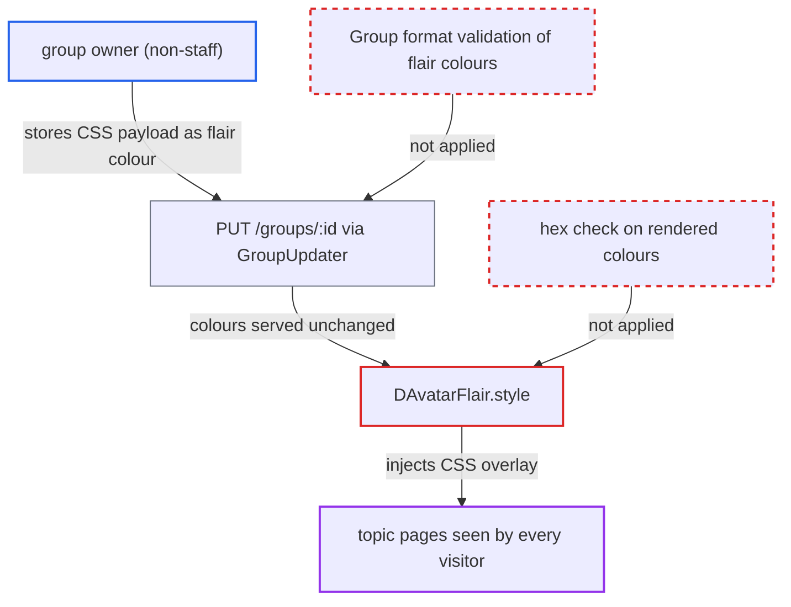

# CSS injection via unvalidated group flair colors rendered into avatar flair style attribute

| Field | Value |
|---|---|
| ID | `find_012kqCgAf7Fz9PASqYz1w9ma` |
| Severity | **Medium** |
| Status | open |
| CWE | CWE-79 — CSS injection |
| Created | 2026-10-27T21:36:45.682478Z |
| Claude Security | https://claude.ai/security/findings/find_012kqCgAf7Fz9PASqYz1w9ma |

## Description

A non-staff group owner can inject their own CSS into the flair element on avatars. Every visitor to a topic with a post by a member of that flair group sees it, anonymous or staff. The CSS can lay attacker-hosted images over the page and block clicks, but it cannot read data or run script. The cause is `DAvatarFlair.style`, which puts unvalidated colour strings into an inline style, while the server stores any string for `flair_bg_color` and `flair_color`.

1. **group owner** sends `PUT /groups/:id` with a CSS payload in `flair_bg_color`. The request also sets `flair_icon=star`, and the colour value closes the declaration and adds more, such as `position:fixed;inset:0;z-index:99999;background:url(https://attacker/x.png) center/cover`. ([`app/controllers/groups_controller.rb:102-109`](https://github.com/cx-benchmark/discourse/blob/e08ed05b4b1ef773b2de7948a8f88a7c182a3520/app/controllers/groups_controller.rb#L102-L109))
2. **`GroupUpdater#permitted_params`** allows `flair_bg_color`, `flair_color` and `flair_icon` from any group editor. Non-staff group owners count as editors, so the request is accepted. ([`lib/group_updater.rb:39-49`](https://github.com/cx-benchmark/discourse/blob/e08ed05b4b1ef773b2de7948a8f88a7c182a3520/lib/group_updater.rb#L39-L49))
3. **`Group` model** saves the colour string as sent. There is no format validation on either column, and the hex filtering exists only in the Ember client, which a direct API request skips. ([`app/models/group.rb:97-106`](https://github.com/cx-benchmark/discourse/blob/e08ed05b4b1ef773b2de7948a8f88a7c182a3520/app/models/group.rb#L97-L106))
4. **group owner** sets their own `flair_group_id` to this group. A member may select any group they belong to that has a flair icon or upload, which is why the attacker sets `flair_icon` first. ([`app/services/user_updater.rb:157-162`](https://github.com/cx-benchmark/discourse/blob/e08ed05b4b1ef773b2de7948a8f88a7c182a3520/app/services/user_updater.rb#L157-L162))
5. **`PostSerializer`** sends the stored colours unchanged with every post by a member whose flair group is this group. Every reader of those posts receives the raw strings. ([`app/serializers/post_serializer.rb:250-256`](https://github.com/cx-benchmark/discourse/blob/e08ed05b4b1ef773b2de7948a8f88a7c182a3520/app/serializers/post_serializer.rb#L250-L256))
6. **`DUserAvatarFlair`** passes the raw colours to `DAvatarFlair` for the post author's avatar. It does no hex normalisation, so the payload reaches the renderer on every topic page containing such a post. ([`frontend/discourse/app/ui-kit/d-user-avatar-flair.gjs:9-42`](https://github.com/cx-benchmark/discourse/blob/e08ed05b4b1ef773b2de7948a8f88a7c182a3520/frontend/discourse/app/ui-kit/d-user-avatar-flair.gjs#L9-L42))
7. **`DAvatarFlair.style`** joins the colours into an inline `style`, marks it with `trustHTML` and binds it to the element. `escapeExpression` encodes only `& < > " ' ` and a backtick, so `;`, `:`, `(`, `)`, `/` and spaces pass through and the extra declarations apply in the visitor's browser. ([`frontend/discourse/app/ui-kit/d-avatar-flair.gjs:18-38`](https://github.com/cx-benchmark/discourse/blob/e08ed05b4b1ef773b2de7948a8f88a7c182a3520/frontend/discourse/app/ui-kit/d-avatar-flair.gjs#L18-L38))

## Assessment

The attacker is a registered non-staff user whom staff made owner of a non-automatic group. They send `PUT /groups/:id` with `flair_icon=star` and a `flair_bg_color` such as `fff;position:fixed;inset:0;z-index:99999;background:url(https://attacker/x.png) center/cover`. They then set their own `flair_group_id` to the group and post in any public topic. Every visitor to that topic, anonymous or staff, receives the string and `DAvatarFlair.style` renders it as inline CSS. No further victim action is needed. The same values also go out in user cards and group payloads, and `DAvatarFlair` is also used by `group-card.gjs`, `group-card-contents.gjs` and `templates/group.gjs`. The default CSP in `lib/content_security_policy/default.rb` has no `style-src` or `img-src`, so the injected CSS runs and can load remote images.

Impact: The attacker controls arbitrary CSS on one element on every page that shows their flair, or another member's. That is enough to overlay attacker-hosted imagery on the topic view (a fake login or phishing prompt, or defacement) and to block clicks on the page beneath until staff clear the group's colours. No script runs and a style attribute has no selectors, so no data can be read. Ancestor stacking contexts may keep the overlay under the site header. This is CSS injection, not script XSS.

## Recommendation

(1) `DAvatarFlair.style` puts untrusted colour strings into CSS with HTML escaping only, which does not neutralise CSS syntax, and marks the result as trusted.

Fix criteria: The rendered `style` attribute contains only a well-formed hex colour for `background-color` and `color`. The value must match `/^[0-9a-fA-F]{3,8}$/` after stripping `#`, otherwise the declaration is omitted. Test: set `flair_bg_color` to `fff;position:fixed;inset:0` and confirm the rendered element's style has no `position` declaration.

(2) The server accepts and stores any string for `Group#flair_bg_color` and `Group#flair_color`, including from non-staff group owners.

Fix criteria: `Group` rejects with a validation error any `flair_bg_color` or `flair_color` that is not a 3 to 8 digit hex colour. Test: `PUT /groups/:id` with a CSS payload fails, and nothing is stored or serialized.

## Evidence

**https://github.com/cx-benchmark/discourse**

- [`frontend/discourse/app/ui-kit/d-avatar-flair.gjs:18-38`](https://github.com/cx-benchmark/discourse/blob/e08ed05b4b1ef773b2de7948a8f88a7c182a3520/frontend/discourse/app/ui-kit/d-avatar-flair.gjs#L18-L38)
- [`frontend/discourse/app/lib/escape.js:1-31`](https://github.com/cx-benchmark/discourse/blob/e08ed05b4b1ef773b2de7948a8f88a7c182a3520/frontend/discourse/app/lib/escape.js#L1-L31)
- [`frontend/discourse/app/ui-kit/d-user-avatar-flair.gjs:9-42`](https://github.com/cx-benchmark/discourse/blob/e08ed05b4b1ef773b2de7948a8f88a7c182a3520/frontend/discourse/app/ui-kit/d-user-avatar-flair.gjs#L9-L42)
- [`lib/group_updater.rb:39-49`](https://github.com/cx-benchmark/discourse/blob/e08ed05b4b1ef773b2de7948a8f88a7c182a3520/lib/group_updater.rb#L39-L49)
- [`app/controllers/groups_controller.rb:102-109`](https://github.com/cx-benchmark/discourse/blob/e08ed05b4b1ef773b2de7948a8f88a7c182a3520/app/controllers/groups_controller.rb#L102-L109)
- [`app/models/group.rb:97-106`](https://github.com/cx-benchmark/discourse/blob/e08ed05b4b1ef773b2de7948a8f88a7c182a3520/app/models/group.rb#L97-L106)
- [`frontend/discourse/app/models/group.js:200-211`](https://github.com/cx-benchmark/discourse/blob/e08ed05b4b1ef773b2de7948a8f88a7c182a3520/frontend/discourse/app/models/group.js#L200-L211)
- [`app/services/user_updater.rb:157-162`](https://github.com/cx-benchmark/discourse/blob/e08ed05b4b1ef773b2de7948a8f88a7c182a3520/app/services/user_updater.rb#L157-L162)
- [`app/serializers/post_serializer.rb:250-256`](https://github.com/cx-benchmark/discourse/blob/e08ed05b4b1ef773b2de7948a8f88a7c182a3520/app/serializers/post_serializer.rb#L250-L256)
- [`frontend/discourse/app/components/post/avatar.gjs:98`](https://github.com/cx-benchmark/discourse/blob/e08ed05b4b1ef773b2de7948a8f88a7c182a3520/frontend/discourse/app/components/post/avatar.gjs#L98)

