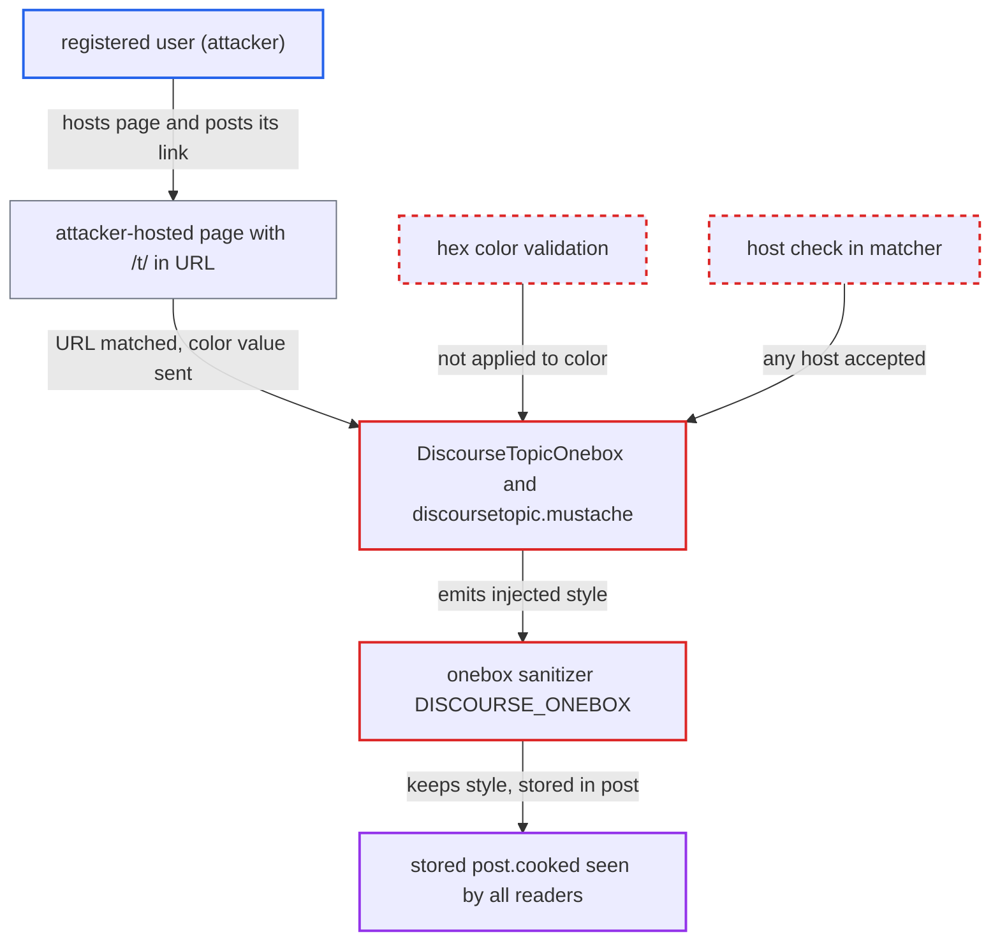

# DiscourseTopicOnebox matches any URL containing /t/ and injects remote section color into a style attribute

| Field | Value |
|---|---|
| ID | `find_01KDmktS5WZi513Cf8VZz1n4` |
| Severity | **Medium** |
| Status | open |
| CWE | CWE-79 — CSS injection |
| Created | 2026-10-27T21:25:11.630145Z |
| Claude Security | https://claude.ai/security/findings/find_01KDmktS5WZi513Cf8VZz1n4 |

## Description

A low-trust registered user can store arbitrary inline CSS in a post, so a full-page overlay covers or restyles the topic for every reader. No script or new elements can be injected and no data can be read. The attack needs one posted link to an attacker-hosted page whose URL contains `/t/`. `DiscourseTopicOnebox` accepts any such host. It puts the remote `article:section-color` value into a `style` attribute without checking it, and the onebox sanitizer keeps that style.

1. **attacker** hosts a page at a URL containing `/t/`. The page sets `article:section=x` and an `article:section-color` value such as `fff;position:fixed;top:0;left:0;width:100vw;height:100vh;z-index:2147483647;background:url(https://attacker.example/o.png)`.
2. **attacker** posts the URL in a topic or reply. Any registered user allowed to post a link can do this (TL0 by default).
3. **the matcher in `DiscourseTopicOnebox`** selects this engine for the attacker's URL. The regexp `%r{/t/.*(/\d+)?}` is unanchored and checks no host, and `Engine.===` applies it to the whole URL string when the engine defines no domains. ([`lib/onebox/engine/discourse_topic_onebox.rb:10`](https://github.com/cx-benchmark/discourse/blob/e08ed05b4b1ef773b2de7948a8f88a7c182a3520/lib/onebox/engine/discourse_topic_onebox.rb#L10))
4. **`Onebox::OpenGraph#extract`** collects the remote `article:section-color` values from the fetched page. The values go into `article_section_colors`, and `Normalizer#sanitize_value` only strips tags, so the CSS text stays intact. ([`lib/onebox/open_graph.rb:25-45`](https://github.com/cx-benchmark/discourse/blob/e08ed05b4b1ef773b2de7948a8f88a7c182a3520/lib/onebox/open_graph.rb#L25-L45))
5. **`categories` in `DiscourseTopicOnebox`** passes each remote color to the template unchecked. It does not test that the value is a hex color. ([`lib/onebox/engine/discourse_topic_onebox.rb:30-35`](https://github.com/cx-benchmark/discourse/blob/e08ed05b4b1ef773b2de7948a8f88a7c182a3520/lib/onebox/engine/discourse_topic_onebox.rb#L30-L35))
6. **the view `discoursetopic.mustache`** writes the color into `style="background-color: #{{color}};"`. Mustache escapes only for HTML, so a `;` in the value adds extra CSS declarations. ([`lib/onebox/templates/discoursetopic.mustache:9`](https://github.com/cx-benchmark/discourse/blob/e08ed05b4b1ef773b2de7948a8f88a7c182a3520/lib/onebox/templates/discoursetopic.mustache#L9))
7. **the onebox sanitizer `DISCOURSE_ONEBOX`** keeps the injected style. It is based on Sanitize RELAXED, which keeps `style` on every element, and the report assumes it allows `position`, `z-index` and http(s) `url()`. ([`lib/onebox/sanitize_config.rb:7-106`](https://github.com/cx-benchmark/discourse/blob/e08ed05b4b1ef773b2de7948a8f88a7c182a3520/lib/onebox/sanitize_config.rb#L7-L106))
8. **`post_process_oneboxes`** stores the onebox HTML in `post.cooked` with no further sanitization. Every reader of the topic then receives the injected style. ([`lib/cooked_processor_mixin.rb:8-45`](https://github.com/cx-benchmark/discourse/blob/e08ed05b4b1ef773b2de7948a8f88a7c182a3520/lib/cooked_processor_mixin.rb#L8-L45))

## Assessment

The attacker is any registered user who may post one link (TL0 by default). They need a page they control at a URL containing `/t/`, for example `https://attacker.example/t/x`. The page serves `og:site_name`, `og:title`, `og:description`, `article:published_time`, `article:section` and a crafted `article:section-color`. A victim only has to open the topic. The report names no other way in.

Impact: The attacker can overlay or restyle the whole topic page for every reader. That allows defacement, fake on-page content drawn by an attacker image, and blocking the topic UI until the post is removed some other way. No elements or script can be injected and no data can be read, so the effect is limited.

## Recommendation

(1) `discoursetopic.mustache` puts a remote-controlled color into a `style` attribute, and HTML escaping is the wrong encoding for a CSS context.

Fix criteria: Category colors from remote pages are checked as 3- or 6-digit hex before templating, and anything else is rejected or dropped. The emitted `style` attribute can then only be `background-color: #<hex>;`. A page sending `article:section-color=fff;position:fixed` renders with no `position` declaration.

(2) The matcher in `DiscourseTopicOnebox` is unanchored and ignores the host. Attacker hosts can therefore use a template meant for trusted Discourse sites.

Fix criteria: The engine only handles URLs verified to be Discourse topic pages, for example an anchored path match plus a Discourse-specific marker in the fetched page such as `og:site_name` or generator meta. Otherwise it falls back to the generic engine.

(3) The onebox sanitizer allows unrestricted `style` attributes with positioning properties, so any inline style that reaches it can affect the whole page.

Fix criteria: The onebox sanitizer drops the `style` attribute or limits it to an allow-list of non-positioning properties the templates use (`--aspect-ratio`, `float`, `clear`, `max-width`, `display`). `position`, `z-index` and `top`/`left`/`inset` then never survive sanitization.

## Evidence

**https://github.com/cx-benchmark/discourse**

- [`lib/onebox/templates/discoursetopic.mustache:9`](https://github.com/cx-benchmark/discourse/blob/e08ed05b4b1ef773b2de7948a8f88a7c182a3520/lib/onebox/templates/discoursetopic.mustache#L9)
- [`lib/onebox/engine/discourse_topic_onebox.rb:30-35`](https://github.com/cx-benchmark/discourse/blob/e08ed05b4b1ef773b2de7948a8f88a7c182a3520/lib/onebox/engine/discourse_topic_onebox.rb#L30-L35)
- [`lib/onebox/engine/discourse_topic_onebox.rb:10`](https://github.com/cx-benchmark/discourse/blob/e08ed05b4b1ef773b2de7948a8f88a7c182a3520/lib/onebox/engine/discourse_topic_onebox.rb#L10)
- [`lib/onebox/engine.rb:121-133`](https://github.com/cx-benchmark/discourse/blob/e08ed05b4b1ef773b2de7948a8f88a7c182a3520/lib/onebox/engine.rb#L121-L133)
- [`lib/onebox/open_graph.rb:25-45`](https://github.com/cx-benchmark/discourse/blob/e08ed05b4b1ef773b2de7948a8f88a7c182a3520/lib/onebox/open_graph.rb#L25-L45)
- [`lib/onebox/normalizer.rb:35-41`](https://github.com/cx-benchmark/discourse/blob/e08ed05b4b1ef773b2de7948a8f88a7c182a3520/lib/onebox/normalizer.rb#L35-L41)
- [`lib/onebox/sanitize_config.rb:7-106`](https://github.com/cx-benchmark/discourse/blob/e08ed05b4b1ef773b2de7948a8f88a7c182a3520/lib/onebox/sanitize_config.rb#L7-L106)
- [`lib/oneboxer.rb:577-593`](https://github.com/cx-benchmark/discourse/blob/e08ed05b4b1ef773b2de7948a8f88a7c182a3520/lib/oneboxer.rb#L577-L593)
- [`lib/cooked_processor_mixin.rb:8-45`](https://github.com/cx-benchmark/discourse/blob/e08ed05b4b1ef773b2de7948a8f88a7c182a3520/lib/cooked_processor_mixin.rb#L8-L45)

