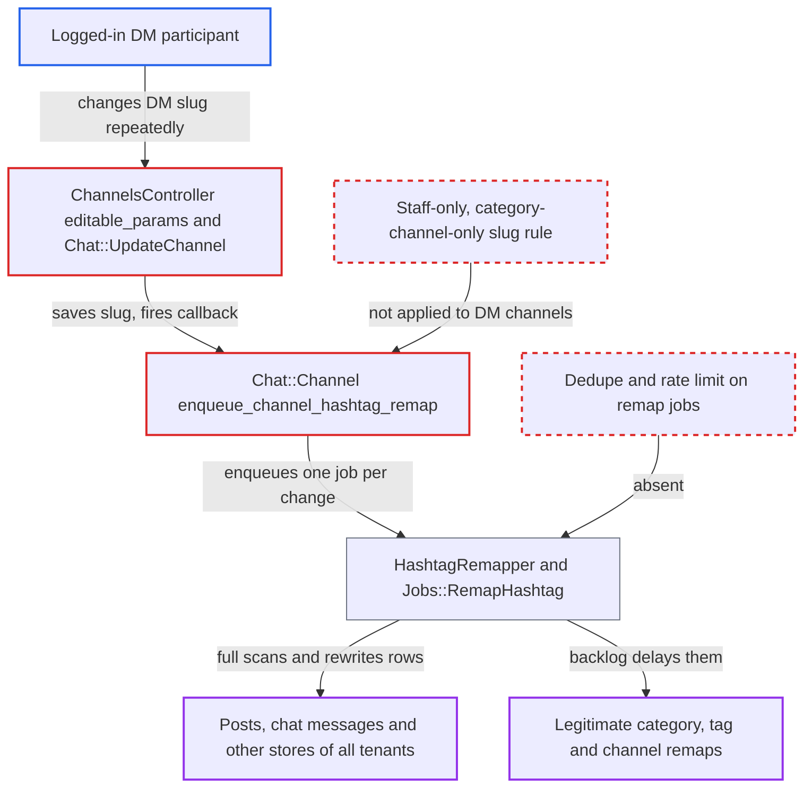

# DM participants can trigger unbounded site-wide hashtag remap jobs by changing a DM channel slug

| Field | Value |
|---|---|
| ID | `find_01AQ26SA2frrBu5xWt39snNV` |
| Severity | **Medium** |
| Status | open |
| CWE | CWE-400 — Uncontrolled resource consumption |
| Created | 2026-10-27T21:19:45.632773Z |
| Claude Security | https://claude.ai/security/findings/find_01AQ26SA2frrBu5xWt39snNV |

## Description

Any logged-in user who can use chat direct messages can queue unlimited site-wide hashtag rewrite jobs. This slows background processing and the database for every site on the cluster, and it rewrites other users' content. The user needs only a direct-message channel they belong to. The cause is that `Chat::Channel` enqueues a hashtag remap on any slug change, and direct-message participants are allowed to change the slug.

1. **Attacker (a logged-in user)** creates a self or group direct-message channel. The user must be in `chat_allowed_groups` and `direct_message_enabled_groups` (default TL1), and the channel is created with `POST /chat/api/direct-message-channels`.
2. **Attacker** sends `PUT /chat/api/channels/<id>` with a new `slug`. `editable_params` permits `slug` for every channel type, including direct-message channels. ([`plugins/chat/app/controllers/chat/api/channels_controller.rb:168-172`](https://github.com/cx-benchmark/discourse/blob/e08ed05b4b1ef773b2de7948a8f88a7c182a3520/plugins/chat/app/controllers/chat/api/channels_controller.rb#L168-L172))
3. **the guardian check `can_edit_chat_channel?`** accepts the request because the caller is a participant. For a direct-message channel any participant passes, and `Chat::UpdateChannel` then saves the slug with `channel.update!(**params)`. ([`plugins/chat/lib/chat/guardian_extensions.rb:85-91`](https://github.com/cx-benchmark/discourse/blob/e08ed05b4b1ef773b2de7948a8f88a7c182a3520/plugins/chat/lib/chat/guardian_extensions.rb#L85-L91))
4. **the model callback `enqueue_channel_hashtag_remap`** runs after the slug change and enqueues a remap with the previous slug. The callback is registered for all channel types, and nothing limits it to category channels or to staff. ([`plugins/chat/app/models/chat/channel.rb:118-123`](https://github.com/cx-benchmark/discourse/blob/e08ed05b4b1ef773b2de7948a8f88a7c182a3520/plugins/chat/app/models/chat/channel.rb#L118-L123))
5. **`HashtagRemapper.enqueue`** queues a `Jobs::RemapHashtag` for every request. `ref_for` returns the slug of DM channels too, and there is no dedupe and no rate limit on the queueing. ([`plugins/chat/lib/chat/channel_hashtag_data_source.rb:17-19`](https://github.com/cx-benchmark/discourse/blob/e08ed05b4b1ef773b2de7948a8f88a7c182a3520/plugins/chat/lib/chat/channel_hashtag_data_source.rb#L17-L19))
6. **`HashtagRemapper.remap!`** scans every store for rows containing the old slug. Each store runs an unindexed `ILIKE '%#<old_ref>%'` filter, and every matching row costs a V8 `scan_hashtags` call and a Nokogiri parse. The attacker picks the old slug, for example `a`, to make the scan match more rows. ([`app/services/hashtag_remapper/store.rb:13-22`](https://github.com/cx-benchmark/discourse/blob/e08ed05b4b1ef773b2de7948a8f88a7c182a3520/app/services/hashtag_remapper/store.rb#L13-L22))
7. **the job `Jobs::RemapHashtag`** piles up as a backlog that holds a worker and the database busy. `cluster_concurrency 1` lets one job run at a time. The others re-enqueue themselves every 10 seconds, and the cluster lock key is outside the multisite namespace. ([`app/jobs/regular/remap_hashtag.rb:3-8`](https://github.com/cx-benchmark/discourse/blob/e08ed05b4b1ef773b2de7948a8f88a7c182a3520/app/jobs/regular/remap_hashtag.rb#L3-L8))

## Assessment

The attacker is any logged-in user in `chat_allowed_groups` and `direct_message_enabled_groups` (default TL1). No victim action and no non-default setting is needed. They create a DM (a self-DM or a group DM through `POST /chat/api/direct-message-channels`). They then send `PUT /chat/api/channels/<id>` with rotating slugs such as `a`, `b`, `c`. Every change after the first enqueues `Jobs::RemapHashtag`. The group-DM settings UI also shows the slug field to members. The only limit is the generic per-user request rate.

Impact: One user can keep a Sidekiq worker, the shared V8 context and the database busy with whole-site scans. This starves legitimate hashtag remaps, but it is a degradation of background processing, not an outage. Other users' posts and chat messages, including private DMs, that hold dangling `#<old>::channel` references are rewritten to the attacker's slug without a revision. This only affects references to slugs no live channel holds, such as the former slug of a trashed channel, because slugs are unique across chat channels. Nothing is disclosed.

## Recommendation

(1) `Chat::Channel#enqueue_channel_hashtag_remap` enqueues a site-wide content rewrite for any channel's slug change, including direct-message channels. Ordinary participants can edit those slugs, and the slugs can never be resolved as hashtags.

Fix criteria: Slug changes made by non-staff, or on direct-message channels, no longer enqueue `HashtagRemapper`. Remaps run only for public (category) channels, which only staff can rename. Updating a DM channel's slug twice via `PUT /chat/api/channels/:id` enqueues no `Jobs::RemapHashtag` and modifies no post or chat message. Renaming a category channel as staff still remaps references.

(2) `Chat::Api::ChannelsController::CHANNEL_EDITABLE_PARAMS` and `can_edit_chat_channel?` let DM participants set `slug`, although DM channels are addressed by id and have no hashtag use for a slug. This also lets a DM slug collide with a category slug in `Chat::Channel.find_by_id_or_slug`.

Fix criteria: Only staff can edit `slug`, and only on category channels. `slug` is rejected or ignored for DM channels. A non-staff DM participant sending `channel[slug]` receives 403/400, and the slug is unchanged.

## Evidence

**https://github.com/cx-benchmark/discourse**

- [`plugins/chat/app/models/chat/channel.rb:118-123`](https://github.com/cx-benchmark/discourse/blob/e08ed05b4b1ef773b2de7948a8f88a7c182a3520/plugins/chat/app/models/chat/channel.rb#L118-L123)
- [`plugins/chat/app/controllers/chat/api/channels_controller.rb:168-172`](https://github.com/cx-benchmark/discourse/blob/e08ed05b4b1ef773b2de7948a8f88a7c182a3520/plugins/chat/app/controllers/chat/api/channels_controller.rb#L168-L172)
- [`plugins/chat/lib/chat/guardian_extensions.rb:85-91`](https://github.com/cx-benchmark/discourse/blob/e08ed05b4b1ef773b2de7948a8f88a7c182a3520/plugins/chat/lib/chat/guardian_extensions.rb#L85-L91)
- [`plugins/chat/app/services/chat/update_channel.rb:70-76`](https://github.com/cx-benchmark/discourse/blob/e08ed05b4b1ef773b2de7948a8f88a7c182a3520/plugins/chat/app/services/chat/update_channel.rb#L70-L76)
- [`plugins/chat/lib/chat/channel_hashtag_data_source.rb:17-19`](https://github.com/cx-benchmark/discourse/blob/e08ed05b4b1ef773b2de7948a8f88a7c182a3520/plugins/chat/lib/chat/channel_hashtag_data_source.rb#L17-L19)
- [`app/services/hashtag_remapper.rb:19-99`](https://github.com/cx-benchmark/discourse/blob/e08ed05b4b1ef773b2de7948a8f88a7c182a3520/app/services/hashtag_remapper.rb#L19-L99)
- [`app/services/hashtag_remapper/store.rb:13-22`](https://github.com/cx-benchmark/discourse/blob/e08ed05b4b1ef773b2de7948a8f88a7c182a3520/app/services/hashtag_remapper/store.rb#L13-L22)
- [`app/jobs/regular/remap_hashtag.rb:3-8`](https://github.com/cx-benchmark/discourse/blob/e08ed05b4b1ef773b2de7948a8f88a7c182a3520/app/jobs/regular/remap_hashtag.rb#L3-L8)
- [`app/jobs/base.rb:253-263`](https://github.com/cx-benchmark/discourse/blob/e08ed05b4b1ef773b2de7948a8f88a7c182a3520/app/jobs/base.rb#L253-L263)
- [`plugins/chat/lib/chat/message_hashtag_store.rb:4-20`](https://github.com/cx-benchmark/discourse/blob/e08ed05b4b1ef773b2de7948a8f88a7c182a3520/plugins/chat/lib/chat/message_hashtag_store.rb#L4-L20)

