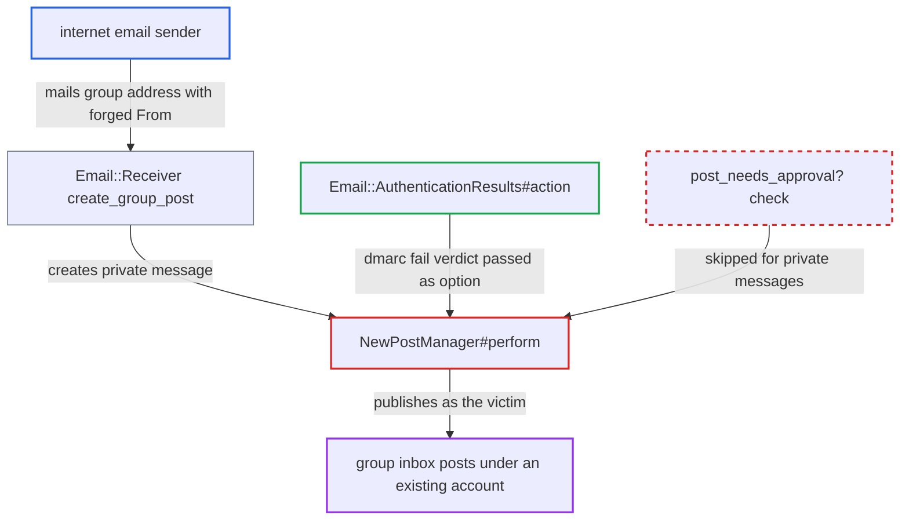

# DMARC-fail and spam verdicts on inbound email skipped for group-inbox private messages

| Field | Value |
|---|---|
| ID | `find_01DzpSFjnEYxBgsMoyCZXrZa` |
| Severity | **Medium** |
| Status | open |
| CWE | CWE-290 — Authentication bypass by spoofing |
| Created | 2026-10-27T22:06:20.969567Z |
| Claude Security | https://claude.ai/security/findings/find_01DzpSFjnEYxBgsMoyCZXrZa |

## Description

Anyone on the internet can send email that appears to come from an existing forum account, staff included, and have it published as that account in a group inbox. This works only when the operator has set `email_in_authserv_id`, a group incoming address exists, and the sender's domain publishes DMARC. `NewPostManager#perform` returns early for private messages, so the DMARC-fail and spam verdicts are never applied to them. The attacker cannot read the inbox or take over the account.

1. **the attacker** emails the group incoming address with a forged `From:`. The trusted MTA stamps the message `dmarc=fail` because the victim's domain publishes DMARC.
2. **the receiver `Email::Receiver`** takes the author from the `From:` address. The only checks on that user are that the account is active and not silenced. ([`lib/email/receiver.rb:139-140`](https://github.com/cx-benchmark/discourse/blob/e08ed05b4b1ef773b2de7948a8f88a7c182a3520/lib/email/receiver.rb#L139-L140))
3. **the method `create_group_post`** builds a private message for the group, or a reply in a matching group private message. The post is created with `skip_validations: true`, and mail to a group address always becomes a private message. ([`lib/email/receiver.rb:983-1008`](https://github.com/cx-benchmark/discourse/blob/e08ed05b4b1ef773b2de7948a8f88a7c182a3520/lib/email/receiver.rb#L983-L1008))
4. **the method `create_post`** passes the verdicts to `NewPostManager` as `email_auth_res_action` and `email_spam`. `Email::AuthenticationResults#action` returns `:enqueue` for `dmarc=fail`, and no other receiver code acts on the verdicts. ([`lib/email/receiver.rb:1521-1545`](https://github.com/cx-benchmark/discourse/blob/e08ed05b4b1ef773b2de7948a8f88a7c182a3520/lib/email/receiver.rb#L1521-L1545))
5. **the method `NewPostManager#perform`** returns `perform_create_post` for any private message before `default_handler` runs. This happens before the review decision is reached. ([`lib/new_post_manager.rb:254-263`](https://github.com/cx-benchmark/discourse/blob/e08ed05b4b1ef773b2de7948a8f88a7c182a3520/lib/new_post_manager.rb#L254-L263))
6. **the method `post_needs_approval?`** never sees the verdicts, so the message is published as the victim instead of being held for review. This is the only code that reads `email_auth_res_action` and `email_spam`, and it runs only from `default_handler`. ([`lib/new_post_manager.rb:82-90`](https://github.com/cx-benchmark/discourse/blob/e08ed05b4b1ef773b2de7948a8f88a7c182a3520/lib/new_post_manager.rb#L82-L90))

## Assessment

The attacker is any internet email sender and needs no account. The site must have `email_in` enabled, a group incoming address, and `email_in_authserv_id` set. The victim's domain must publish DMARC, so the trusted MTA stamps `dmarc=fail`. The attacker mails the group address with `From:` set to an existing active, non-silenced account. Mail flagged by the `email_in_spam_header` verdict is skipped the same way. Forwarded mail to a group is also a private message and takes the same path. Nobody else has to act.

Impact: The attacker can publish new group-inbox private messages, or replies in matched group threads, under any active, non-silenced account, staff included. This defeats the DMARC control the operator configured. Impact is limited to forged authorship of new messages, because the attacker cannot read the inbox, edit existing content or take over the account. Reply-key replies are not affected in practice, because they need the per-user secret.

## Recommendation

`NewPostManager#perform` returns early for private messages before `post_needs_approval?` runs. The verdicts `email_auth_res_action` and `email_spam` are read only there, so they are never applied to private messages created from inbound email, including every group-inbox message.

Fix criteria: When the trusted authserv-id reports `dmarc=fail`, or the configured spam header matches, inbound mail is not published as an existing account in any archetype. It is held for review, or rejected or staged, for group-inbox private messages and private message replies too. To verify, send a `dmarc=fail` message to a group incoming address with `From:` set to an existing staff user's address, and check that no post is created as that user.

## Evidence

**https://github.com/cx-benchmark/discourse**

- [`lib/new_post_manager.rb:254-263`](https://github.com/cx-benchmark/discourse/blob/e08ed05b4b1ef773b2de7948a8f88a7c182a3520/lib/new_post_manager.rb#L254-L263)
- [`lib/new_post_manager.rb:82-90`](https://github.com/cx-benchmark/discourse/blob/e08ed05b4b1ef773b2de7948a8f88a7c182a3520/lib/new_post_manager.rb#L82-L90)
- [`lib/email/receiver.rb:1521-1545`](https://github.com/cx-benchmark/discourse/blob/e08ed05b4b1ef773b2de7948a8f88a7c182a3520/lib/email/receiver.rb#L1521-L1545)
- [`lib/email/receiver.rb:983-1008`](https://github.com/cx-benchmark/discourse/blob/e08ed05b4b1ef773b2de7948a8f88a7c182a3520/lib/email/receiver.rb#L983-L1008)
- [`lib/email/receiver.rb:139-140`](https://github.com/cx-benchmark/discourse/blob/e08ed05b4b1ef773b2de7948a8f88a7c182a3520/lib/email/receiver.rb#L139-L140)
- [`lib/email/authentication_results.rb:47-49`](https://github.com/cx-benchmark/discourse/blob/e08ed05b4b1ef773b2de7948a8f88a7c182a3520/lib/email/authentication_results.rb#L47-L49)
- [`spec/lib/new_post_manager_spec.rb:966-994`](https://github.com/cx-benchmark/discourse/blob/e08ed05b4b1ef773b2de7948a8f88a7c182a3520/spec/lib/new_post_manager_spec.rb#L966-L994)

