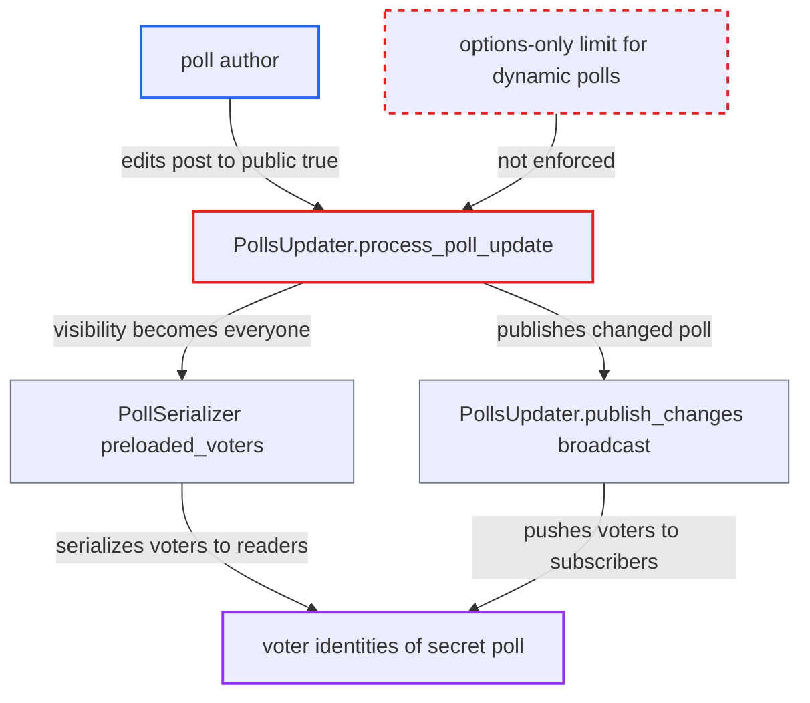

# Dynamic poll edit can retroactively expose secret-poll voters

| Field | Value |
|---|---|
| ID | `find_016ARYBUwqrt6U7FCvVf4DC4` |
| Severity | **Medium** |
| Status | open |
| CWE | CWE-285 — Improper Authorization |
| Created | 2026-10-27T21:44:45.227800Z |
| Claude Security | https://claude.ai/security/findings/find_016ARYBUwqrt6U7FCvVf4DC4 |

## Description

A poll author can reveal who voted for what in a secret poll that promised anonymity. The voter names, ids and avatars then become visible to everyone who can read the post. The author needs only a dynamic poll on their own post and ordinary rights to edit it. `PollsUpdater.process_poll_update` treats `dynamic` as lifting the whole post-vote edit lock, so `visibility` and `results` can be changed after votes exist.

1. **poll author** posts a secret dynamic poll. The post uses `[poll dynamic=true public=false]`, so voters are told their choices are anonymous, and other users then vote.
2. **poll author** edits the post to add `public=true`. The edit needs only normal edit rights on the author's own post, and it works at any time.
3. **`process_poll_update`** skips the post-vote edit lock. `votes_present_and_restricted?` returns `false` for any dynamic poll, so the `edit_window_expired` guard never fires even though votes exist. ([`plugins/poll/lib/polls_updater.rb:100-111`](https://github.com/cx-benchmark/discourse/blob/e08ed05b4b1ef773b2de7948a8f88a7c182a3520/plugins/poll/lib/polls_updater.rb#L100-L111))
4. **`apply_poll_attribute_updates`** overwrites every attribute in `POLL_ATTRIBUTES` on the stored poll. The list includes `visibility` and `results`, so `visibility` becomes `everyone` and the exemption is not limited to the options. ([`plugins/poll/lib/polls_updater.rb:138-141`](https://github.com/cx-benchmark/discourse/blob/e08ed05b4b1ef773b2de7948a8f88a7c182a3520/plugins/poll/lib/polls_updater.rb#L138-L141))
5. **`Poll#can_see_voters?`** starts returning true. The method is `everyone? && can_see_results?(user)`, so every existing vote's user identity becomes visible. ([`plugins/poll/app/models/poll.rb:49-51`](https://github.com/cx-benchmark/discourse/blob/e08ed05b4b1ef773b2de7948a8f88a7c182a3520/plugins/poll/app/models/poll.rb#L49-L51))
6. **`PollSerializer`** includes `preloaded_voters` for all readers of the post. Each option's voter list is serialized whenever `can_see_voters?` is true. ([`plugins/poll/app/serializers/poll_serializer.rb:73-79`](https://github.com/cx-benchmark/discourse/blob/e08ed05b4b1ef773b2de7948a8f88a7c182a3520/plugins/poll/app/serializers/poll_serializer.rb#L73-L79))
7. **`PollsUpdater.publish_changes`** broadcasts the re-serialized poll with voters on `/polls/<topic_id>`. Every topic subscriber receives the voter lists immediately. ([`plugins/poll/lib/polls_updater.rb:222-232`](https://github.com/cx-benchmark/discourse/blob/e08ed05b4b1ef773b2de7948a8f88a7c182a3520/plugins/poll/lib/polls_updater.rb#L222-L232))

## Assessment

The attacker is any user allowed to create polls (`poll_create_allowed_groups`, default TL1) who can edit their own post. They create a secret dynamic poll and wait for others to vote. They then edit the post raw to add `public=true`. No action from the victims is needed beyond having voted earlier. The same path lets the author change `results` from `staff_only` or `on_close` to `always`, and also change `groups` and `type`.

Impact: The attacker learns which users voted for which option on a poll that promised anonymity. They can also unhide results of `staff_only` or `on_close` polls on their own post. The loss is limited to the vote choices on that one poll and to the poll's own metadata, with no availability impact.

## Recommendation

`PollsUpdater.process_poll_update` uses the `dynamic` flag to lift the entire post-vote edit lock. Attributes that voters relied on (`visibility`, `results`, `groups`, `type`) can therefore change after votes exist, which breaks the anonymity promise of a secret poll.

Fix criteria: For a poll that already has votes, the dynamic exemption allows only option additions and removals. Any change to `visibility`, `results`, `type` or `groups` (ideally also `min`, `max` and `step`) is still rejected with the `edit_window_expired` error, or a secret to public switch is always rejected. To check, create a dynamic secret poll and cast a vote with a second user. After the edit window, edit the post to `public=true`. The edit must be refused, and `/polls/voters` must still return an error.

## Evidence

**https://github.com/cx-benchmark/discourse**

- [`plugins/poll/lib/polls_updater.rb:100-111`](https://github.com/cx-benchmark/discourse/blob/e08ed05b4b1ef773b2de7948a8f88a7c182a3520/plugins/poll/lib/polls_updater.rb#L100-L111)
- [`plugins/poll/lib/polls_updater.rb:138-141`](https://github.com/cx-benchmark/discourse/blob/e08ed05b4b1ef773b2de7948a8f88a7c182a3520/plugins/poll/lib/polls_updater.rb#L138-L141)
- [`plugins/poll/lib/polls_updater.rb:5`](https://github.com/cx-benchmark/discourse/blob/e08ed05b4b1ef773b2de7948a8f88a7c182a3520/plugins/poll/lib/polls_updater.rb#L5)
- [`plugins/poll/app/models/poll.rb:49-51`](https://github.com/cx-benchmark/discourse/blob/e08ed05b4b1ef773b2de7948a8f88a7c182a3520/plugins/poll/app/models/poll.rb#L49-L51)
- [`plugins/poll/app/serializers/poll_serializer.rb:73-79`](https://github.com/cx-benchmark/discourse/blob/e08ed05b4b1ef773b2de7948a8f88a7c182a3520/plugins/poll/app/serializers/poll_serializer.rb#L73-L79)
- [`plugins/poll/lib/polls_updater.rb:222-232`](https://github.com/cx-benchmark/discourse/blob/e08ed05b4b1ef773b2de7948a8f88a7c182a3520/plugins/poll/lib/polls_updater.rb#L222-L232)
- [`plugins/poll/config/locales/client.en.yml:16-17`](https://github.com/cx-benchmark/discourse/blob/e08ed05b4b1ef773b2de7948a8f88a7c182a3520/plugins/poll/config/locales/client.en.yml#L16-L17)

