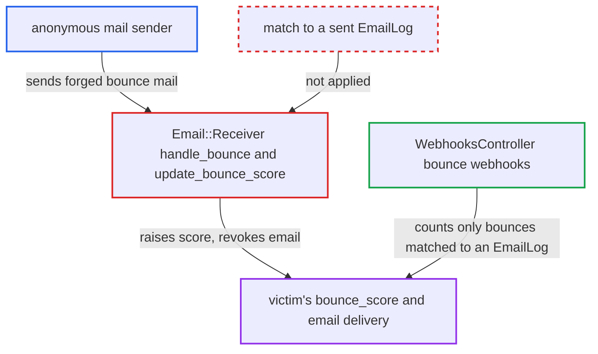

# Forged bounce reports let anyone raise a user's bounce score and revoke their email

| Field | Value |
|---|---|
| ID | `find_01U1zqwT4KLxCaWVbccd6FaU` |
| Severity | **Medium** |
| Status | open |
| CWE | CWE-345 — Insufficient verification of data authenticity |
| Created | 2026-10-27T21:22:08.277709Z |
| Claude Security | https://claude.ai/security/findings/find_01U1zqwT4KLxCaWVbccd6FaU |

## Description

An anonymous sender can stop a chosen user from receiving notification, PM, digest and mailing-list email for 30 days by sending forged bounce reports. The attacker needs the forum to accept inbound mail and needs to know the victim's email address. Critical emails such as password reset and signup still go out. The cause is `Email::Receiver`, which raises the bounce score of whoever the mail names without tying the bounce to mail Discourse sent.

1. **attacker** sends forged bounce mail to an address the forum receives on. The mail is either a delivery-status report with `Action: failed` and `Final-Recipient` set to the victim, or a plain mail with `From` set to the victim and a Cc to an address with a random `+verp-` key; nothing filters mail at SMTP time. ([`app/controllers/admin/email_controller.rb:77-97`](https://github.com/cx-benchmark/discourse/blob/e08ed05b4b1ef773b2de7948a8f88a7c182a3520/app/controllers/admin/email_controller.rb#L77-L97))
2. **`process_internal`** calls `handle_bounce` before the other checks. Earlier checks in `process!` are only `ignore_by_title`, a duplicate Message-ID check and `Email::Validator`, and none of them looks at who sent the mail. ([`lib/email/receiver.rb:183-185`](https://github.com/cx-benchmark/discourse/blob/e08ed05b4b1ef773b2de7948a8f88a7c182a3520/lib/email/receiver.rb#L183-L185))
3. **`is_bounce?`** returns true for the forged mail. `@mail.bounced?` depends only on the body structure, and any `+verp-` destination address also counts, even when it matches no `EmailLog`, so `email_log` is nil. ([`lib/email/receiver.rb:315-317`](https://github.com/cx-benchmark/discourse/blob/e08ed05b4b1ef773b2de7948a8f88a7c182a3520/lib/email/receiver.rb#L315-L317))
4. **`parse_from_field`** takes the victim's address from attacker-written fields. Without a matching `EmailLog`, it uses the `Final-Recipient` field for a delivery-status report, and otherwise the `From` header. ([`lib/email/receiver.rb:709-718`](https://github.com/cx-benchmark/discourse/blob/e08ed05b4b1ef773b2de7948a8f88a7c182a3520/lib/email/receiver.rb#L709-L718))
5. **`handle_bounce`** calls `Email::Receiver.update_bounce_score` with the victim's address. The call has no condition, so nothing ties the report to mail Discourse actually sent. ([`lib/email/receiver.rb:319-335`](https://github.com/cx-benchmark/discourse/blob/e08ed05b4b1ef773b2de7948a8f88a7c182a3520/lib/email/receiver.rb#L319-L335))
6. **`update_bounce_score`** adds the hard bounce score and revokes the email at the threshold. Two forged reports reach `bounce_score_threshold` (default 4, with `hard_bounce_score` default 2). The method then writes a 'revoke email' staff log entry and sends the victim an `email_revoked` system PM. ([`lib/email/receiver.rb:376-401`](https://github.com/cx-benchmark/discourse/blob/e08ed05b4b1ef773b2de7948a8f88a7c182a3520/lib/email/receiver.rb#L376-L401))
7. **`Jobs::UserEmail`** skips non-critical email to the victim. `message_for_email` and the digest check skip users at or above `bounce_score_threshold`, and the score only falls when mail is sent. ([`app/jobs/regular/user_email.rb:229-232`](https://github.com/cx-benchmark/discourse/blob/e08ed05b4b1ef773b2de7948a8f88a7c182a3520/app/jobs/regular/user_email.rb#L229-L232))

## Assessment

The attacker is an anonymous internet mail sender with no account. The forum must have inbound mail set up (mail-receiver/handle_mail or POP3), and the attacker must know the victim's email address. There are two ways in. The first is two delivery-status reports, each with a unique Message-ID and a Date, saying `Action: failed`, `Status: 5.1.1` and `Final-Recipient: rfc822; victim@...`. The second is a plain mail with `From` set to the victim and a Cc to `x+verp-<random hex>@...`. Each one adds 2 to the score, which reaches the default threshold of 4.

Impact: The chosen user stops getting notification, PM, digest and mailing-list email for `reset_bounce_score_after_days` (30 days), and the attacker can repeat this at will. Their `user_stat` is changed, a false 'revoke email' staff log entry is written and a misleading system PM is sent. Critical account emails still go out, and nothing is disclosed.

## Recommendation

Bounce reports that cannot be tied to an `EmailLog` are trusted. The `Final-Recipient` or `From` of an unauthenticated message picks which user's bounce score goes up, and an unknown `+verp-` key still counts as a bounce.

Fix criteria: A user's bounce score changes only when the bounce matches an `EmailLog` Discourse actually sent to that address, through a valid VERP `bounce_key` or a recorded Message-ID plus recipient. Other bounce-looking mail is logged and dropped without touching `user_stat`. To verify, send a forged DSN naming a user. Then send a mail with a random `+verp-` key and a spoofed From. Check that the `bounce_score` stays the same in both cases.

## Evidence

**https://github.com/cx-benchmark/discourse**

- [`lib/email/receiver.rb:319-335`](https://github.com/cx-benchmark/discourse/blob/e08ed05b4b1ef773b2de7948a8f88a7c182a3520/lib/email/receiver.rb#L319-L335)
- [`lib/email/receiver.rb:709-718`](https://github.com/cx-benchmark/discourse/blob/e08ed05b4b1ef773b2de7948a8f88a7c182a3520/lib/email/receiver.rb#L709-L718)
- [`lib/email/receiver.rb:315-317`](https://github.com/cx-benchmark/discourse/blob/e08ed05b4b1ef773b2de7948a8f88a7c182a3520/lib/email/receiver.rb#L315-L317)
- [`lib/email/receiver.rb:363-374`](https://github.com/cx-benchmark/discourse/blob/e08ed05b4b1ef773b2de7948a8f88a7c182a3520/lib/email/receiver.rb#L363-L374)
- [`lib/email/receiver.rb:183-185`](https://github.com/cx-benchmark/discourse/blob/e08ed05b4b1ef773b2de7948a8f88a7c182a3520/lib/email/receiver.rb#L183-L185)
- [`lib/email/receiver.rb:376-401`](https://github.com/cx-benchmark/discourse/blob/e08ed05b4b1ef773b2de7948a8f88a7c182a3520/lib/email/receiver.rb#L376-L401)
- [`app/jobs/regular/user_email.rb:229-232`](https://github.com/cx-benchmark/discourse/blob/e08ed05b4b1ef773b2de7948a8f88a7c182a3520/app/jobs/regular/user_email.rb#L229-L232)
- [`app/controllers/admin/email_controller.rb:77-97`](https://github.com/cx-benchmark/discourse/blob/e08ed05b4b1ef773b2de7948a8f88a7c182a3520/app/controllers/admin/email_controller.rb#L77-L97)
- [`app/controllers/webhooks_controller.rb:341-350`](https://github.com/cx-benchmark/discourse/blob/e08ed05b4b1ef773b2de7948a8f88a7c182a3520/app/controllers/webhooks_controller.rb#L341-L350)

