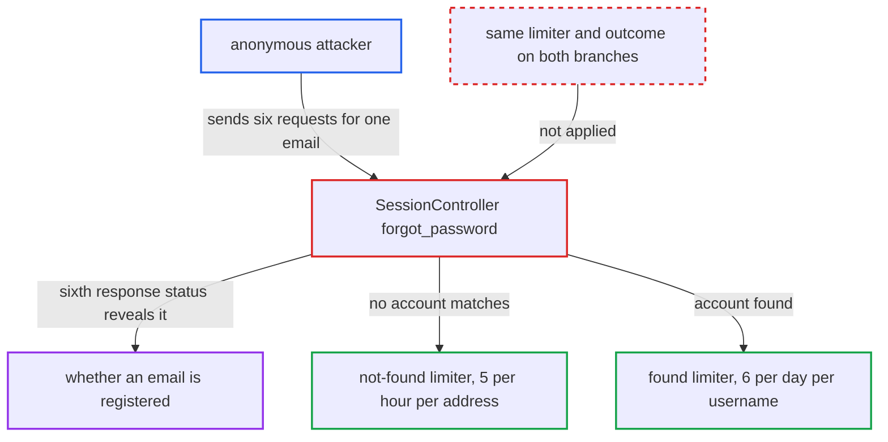

# forgot_password rate-limit asymmetry reveals account existence despite hide_email_address_taken

| Field | Value |
|---|---|
| ID | `find_012DMRaGfcUAmTUut38dkU8e` |
| Severity | **Medium** |
| Status | open |
| CWE | CWE-204 — Observable Response Discrepancy |
| Created | 2026-10-27T21:21:29.255560Z |
| Claude Security | https://claude.ai/security/findings/find_012DMRaGfcUAmTUut38dkU8e |

## Description

An anonymous visitor can find out whether any email address is registered on the forum, even though `hide_email_address_taken` is meant to hide this (it is on by default). The attacker sends six password-reset requests for the address within an hour and compares the sixth response. The cause is `SessionController#forgot_password`, whose found and not-found branches use different rate limiters, and only one of them fails visibly at that point.

1. **attacker** sends six `POST /session/forgot_password.json` requests with the same email as `login`. The per-IP limits of 6 per hour and 3 per minute allow all six requests from one client if they are spaced out, and more IPs can be added to probe more addresses. ([`app/controllers/session_controller.rb:714-715`](https://github.com/cx-benchmark/discourse/blob/e08ed05b4b1ef773b2de7948a8f88a7c182a3520/app/controllers/session_controller.rb#L714-L715))
2. **the action `forgot_password`** returns the same `success_json` for any email-shaped login and leaves out `user_found`. This is the intended hiding behaviour while `hide_email_address_taken` is on, so the response body gives nothing away. ([`app/controllers/session_controller.rb:717-725`](https://github.com/cx-benchmark/discourse/blob/e08ed05b4b1ef773b2de7948a8f88a7c182a3520/app/controllers/session_controller.rb#L717-L725))
3. **the not-found branch of `forgot_password`** counts each request against `forgot-password-login-hour-#{normalized_login_param}`, which allows 5 per hour. This limiter exists only when no account matches, and it is keyed on the probed address rather than on the client. ([`app/controllers/session_controller.rb:730-738`](https://github.com/cx-benchmark/discourse/blob/e08ed05b4b1ef773b2de7948a8f88a7c182a3520/app/controllers/session_controller.rb#L730-L738))
4. **`enqueue_password_reset_for_user`** counts each request against `forgot-password-login-day-#{user.username}`, which allows 6 per day. For a registered address the sixth request is still allowed, because `FORGOT_PASSWORD_EMAIL_LIMIT_PER_DAY` is 6. ([`app/controllers/session_controller.rb:1595-1601`](https://github.com/cx-benchmark/discourse/blob/e08ed05b4b1ef773b2de7948a8f88a7c182a3520/app/controllers/session_controller.rb#L1595-L1601))
5. **the `rescue RateLimiter::LimitExceeded` clause** turns a rejected hit into a `slow_down` error with the default status 422. The rejection reaches the client, so the sixth request fails for an unregistered address and returns 200 `success` for a registered one. ([`app/controllers/session_controller.rb:740-746`](https://github.com/cx-benchmark/discourse/blob/e08ed05b4b1ef773b2de7948a8f88a7c182a3520/app/controllers/session_controller.rb#L740-L746))
6. **attacker** reads the status of the sixth response. A 422 `slow_down` means no account has that email, and a 200 `success` means an account exists.

## Assessment

The attacker is an anonymous internet user with no login. They need a CSRF token from `/session/csrf` and the XHR header. They send six `POST /session/forgot_password.json` requests with `login=<email>` within an hour, spaced to stay under 3 per minute per IP. No victim action is needed. It works with the default `hide_email_address_taken=true`. Both limiters are keyed on the probed identity, not the client, so requests from several IPs add to the same counter. Earlier reset requests by the real user on the same day can make a registered address trip at an earlier request, and the attacker can see this.

Impact: The attacker learns whether an arbitrary email address is registered on the forum. This is what `hide_email_address_taken` exists to hide. There is no account access and no data change. Throughput is about one address per source IP per hour. Probing a registered address sends that user up to six reset emails or codes, so the probe is noticeable.

## Recommendation

The found and not-found branches of `forgot_password` apply different identity-keyed rate limiters, and a limiter failure is shown to the client. The sixth request therefore fails for an unregistered address and succeeds for a registered one.

Fix criteria: When `hide_email_address_taken` is enabled, status, body and rate-limit outcome are identical for registered and unregistered addresses. This is done either by applying the same limiter with the same threshold on both branches, or by no longer surfacing the identity-keyed limiter as an error and silently skipping the send instead. Six or more requests for an unregistered and a registered address from the same client give identical statuses and bodies.

## Evidence

**https://github.com/cx-benchmark/discourse**

- [`app/controllers/session_controller.rb:730-738`](https://github.com/cx-benchmark/discourse/blob/e08ed05b4b1ef773b2de7948a8f88a7c182a3520/app/controllers/session_controller.rb#L730-L738)
- [`app/controllers/session_controller.rb:1595-1601`](https://github.com/cx-benchmark/discourse/blob/e08ed05b4b1ef773b2de7948a8f88a7c182a3520/app/controllers/session_controller.rb#L1595-L1601)
- [`app/controllers/session_controller.rb:714-715`](https://github.com/cx-benchmark/discourse/blob/e08ed05b4b1ef773b2de7948a8f88a7c182a3520/app/controllers/session_controller.rb#L714-L715)
- [`app/controllers/session_controller.rb:717-725`](https://github.com/cx-benchmark/discourse/blob/e08ed05b4b1ef773b2de7948a8f88a7c182a3520/app/controllers/session_controller.rb#L717-L725)
- [`app/controllers/session_controller.rb:740-746`](https://github.com/cx-benchmark/discourse/blob/e08ed05b4b1ef773b2de7948a8f88a7c182a3520/app/controllers/session_controller.rb#L740-L746)

