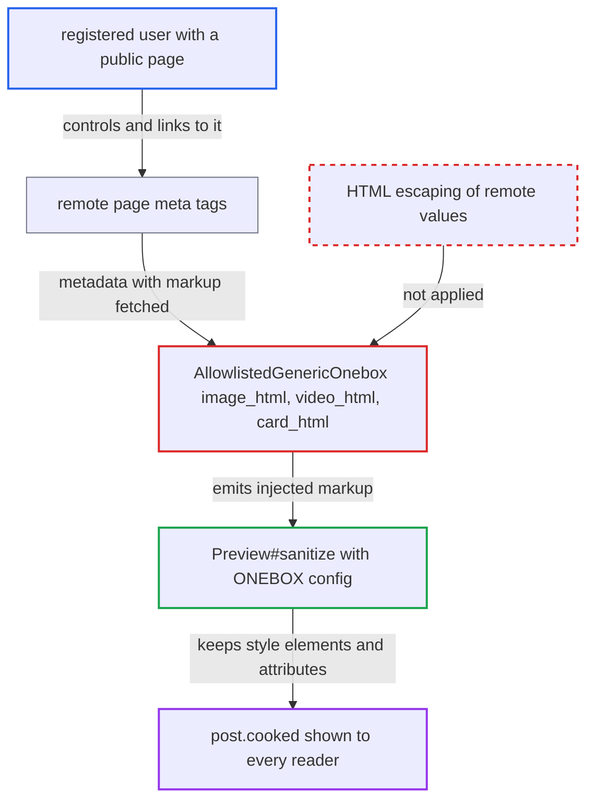

# Generic onebox interpolates remote metadata unescaped, enabling stored HTML/CSS injection in posts

| Field | Value |
|---|---|
| ID | `find_01CiUUTg5FQrKFcSMge3n8we` |
| Severity | **Medium** |
| Status | open |
| CWE | CWE-79 — HTML injection |
| Created | 2026-10-27T21:23:31.362118Z |
| Claude Security | https://claude.ai/security/findings/find_01CiUUTg5FQrKFcSMge3n8we |

## Description

A registered user who controls a public web page can inject page-wide HTML and CSS into a forum post. Every reader of the topic gets it. The impact is limited because script execution is blocked. The attack needs only a link to the attacker's page on its own line in a post. The cause is `AllowlistedGenericOnebox`, which puts unescaped page metadata into HTML attributes, and a sanitizer that keeps `` in an `og:*` value become raw characters. This is a second source of raw markup. ([`lib/onebox/normalizer.rb:35-41`](https://github.com/cx-benchmark/discourse/blob/e08ed05b4b1ef773b2de7948a8f88a7c182a3520/lib/onebox/normalizer.rb#L35-L41))
5. **`image_html`** interpolates the value into `alt='...'` without escaping. A value containing `'>` closes the `` tag and adds new elements. `video_html` does the same with `title`, and `card_html` with `player_width` and `player_height`. ([`lib/onebox/engine/allowlisted_generic_onebox.rb:273-283`](https://github.com/cx-benchmark/discourse/blob/e08ed05b4b1ef773b2de7948a8f88a7c182a3520/lib/onebox/engine/allowlisted_generic_onebox.rb#L273-L283))
6. **`Onebox::Preview#sanitize`** keeps the injected markup. `SanitizeConfig::DISCOURSE_ONEBOX` is built on Sanitize `RELAXED`, which allows `` in `og:description` or `og:title`. The attacker posts the URL on its own line and no victim action is needed. The result is stored and applies to every reader who opens the topic.

Impact: The attacker can deface or blank the topic for all readers and hide parts of the interface. They can lay an invisible full-page `position:fixed` link over the page for phishing. They can use attribute-selector `url()` beacons to learn limited facts about a viewer, such as staff status or username. The impact is limited because CSP `script-src` and Sanitize block script, and `@import` is stripped.

## Recommendation

(1) `image_html`, `video_html` and `card_html` in `AllowlistedGenericOnebox` build HTML attributes by string interpolation of remote metadata without HTML escaping.

Fix criteria: All remote-derived values placed into onebox HTML, in attributes or text, are HTML-escaped (for example with `ERB::Util.html_escape` or `CGI.escapeHTML`) or emitted through the Mustache `{{ }}` templates. A page whose `twitter:description` or `og:description` contains `'><style>` must yield an `` whose `alt` attribute contains that literal text and no additional elements.

(2) `StandardEmbed#get_twitter` stores `twitter:*` meta values raw, and `Normalizer#sanitize_value` decodes entities after sanitizing. So sanitized metadata can still contain `<`, `>` and quotes.

Fix criteria: Twitter-card values go through the same normalization as OpenGraph values. Normalization does not bring markup characters back after sanitization: there is no entity decode after `Sanitize.fragment`, or the value is escaped on output. A test with triple-encoded `&amp;amp;lt;` in `og:description` shows that the rendered onebox contains no raw `<`.

(3) The onebox sanitizer config (`SanitizeConfig::ONEBOX`, built on Sanitize `RELAXED`) permits `<style>` elements, `style` and `id` attributes on all elements, and `<embed src>`. Any markup that reaches it can restyle the whole page.

Fix criteria: The onebox sanitizer removes `<style>` elements, `<embed>` and the `id` attribute. It either drops the `style` attribute or limits it to the few layout properties the templates need (`--aspect-ratio`, `float`, `clear`, `max-width`). A sanitized onebox then cannot contain rules that affect elements outside the onebox, or `position:fixed` and `z-index` overlays.

## Evidence

**https://github.com/cx-benchmark/discourse**

- [`lib/onebox/engine/allowlisted_generic_onebox.rb:273-283`](https://github.com/cx-benchmark/discourse/blob/e08ed05b4b1ef773b2de7948a8f88a7c182a3520/lib/onebox/engine/allowlisted_generic_onebox.rb#L273-L283)
- [`lib/onebox/engine/allowlisted_generic_onebox.rb:285-300`](https://github.com/cx-benchmark/discourse/blob/e08ed05b4b1ef773b2de7948a8f88a7c182a3520/lib/onebox/engine/allowlisted_generic_onebox.rb#L285-L300)
- [`lib/onebox/engine/allowlisted_generic_onebox.rb:251-261`](https://github.com/cx-benchmark/discourse/blob/e08ed05b4b1ef773b2de7948a8f88a7c182a3520/lib/onebox/engine/allowlisted_generic_onebox.rb#L251-L261)
- [`lib/onebox/engine/standard_embed.rb:78-94`](https://github.com/cx-benchmark/discourse/blob/e08ed05b4b1ef773b2de7948a8f88a7c182a3520/lib/onebox/engine/standard_embed.rb#L78-L94)
- [`lib/onebox/normalizer.rb:35-41`](https://github.com/cx-benchmark/discourse/blob/e08ed05b4b1ef773b2de7948a8f88a7c182a3520/lib/onebox/normalizer.rb#L35-L41)
- [`lib/onebox/sanitize_config.rb:9-45`](https://github.com/cx-benchmark/discourse/blob/e08ed05b4b1ef773b2de7948a8f88a7c182a3520/lib/onebox/sanitize_config.rb#L9-L45)
- [`lib/onebox/preview.rb:26-29`](https://github.com/cx-benchmark/discourse/blob/e08ed05b4b1ef773b2de7948a8f88a7c182a3520/lib/onebox/preview.rb#L26-L29)
- [`lib/cooked_processor_mixin.rb:13-45`](https://github.com/cx-benchmark/discourse/blob/e08ed05b4b1ef773b2de7948a8f88a7c182a3520/lib/cooked_processor_mixin.rb#L13-L45)
- [`lib/content_security_policy/default.rb:9-23`](https://github.com/cx-benchmark/discourse/blob/e08ed05b4b1ef773b2de7948a8f88a7c182a3520/lib/content_security_policy/default.rb#L9-L23)

