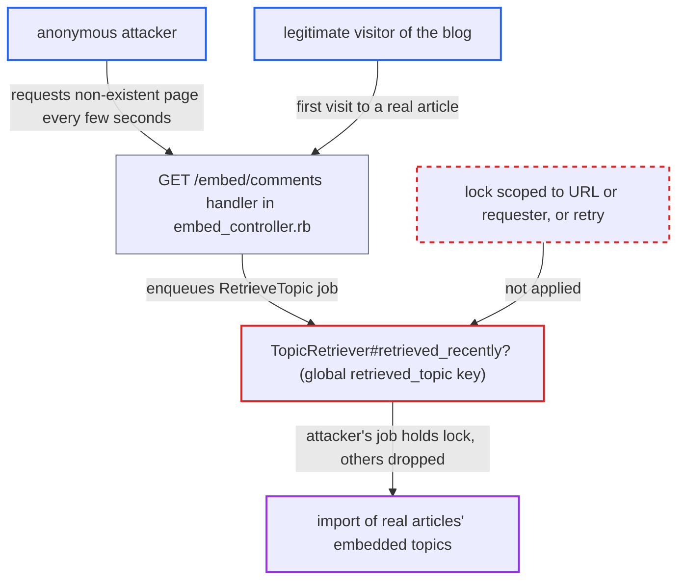

# Global unkeyed embed-import throttle lock lets anonymous requests starve legitimate imports

| Field | Value |
|---|---|
| ID | `find_0128XV93nrAc82Rrd2wUjh2i` |
| Severity | **Medium** |
| Status | open |
| CWE | CWE-412 — Externally Accessible Lock |
| Created | 2026-10-27T22:12:06.251275Z |
| Claude Security | https://claude.ai/security/findings/find_0128XV93nrAc82Rrd2wUjh2i |

## Description

An anonymous internet user can stop new embedded-comment topics from being created, so a blog's comment widgets stay stuck on the loading view. Only the embed-import feature is affected. The attacker needs one allowlisted host and a request every few seconds. The cause is `TopicRetriever#retrieved_recently?`, which uses one site-wide lock that any requester can take and that drops the other jobs.

1. **anonymous attacker** sends a request for a page that does not exist on an allowlisted host. The request is `GET /embed/comments?embed_url=https://<allowlisted-host>/<nonexistent-slug>`. It needs no login and no CSRF token, and only the generic request limiter applies. ([`app/controllers/embed_controller.rb:125-133`](https://github.com/cx-benchmark/discourse/blob/e08ed05b4b1ef773b2de7948a8f88a7c182a3520/app/controllers/embed_controller.rb#L125-L133))
2. **the embed controller** enqueues `Jobs::RetrieveTopic` for that URL. The requester is anonymous, so `user_id` is nil and `no_throttle` is false. The job therefore competes for the shared lock. ([`app/controllers/embed_controller.rb:125-133`](https://github.com/cx-benchmark/discourse/blob/e08ed05b4b1ef773b2de7948a8f88a7c182a3520/app/controllers/embed_controller.rb#L125-L133))
3. **`TopicRetriever#retrieved_recently?`** takes the Redis key `retrieved_topic` with `setnx` for 60 seconds. The key is not scoped to the URL, the requester or the IP. It is taken before the remote fetch, so the later 404 and the absence of a topic do not release it. ([`lib/topic_retriever.rb:19-31`](https://github.com/cx-benchmark/discourse/blob/e08ed05b4b1ef773b2de7948a8f88a7c182a3520/lib/topic_retriever.rb#L19-L31))
4. **legitimate visitor's import job** is skipped silently because the lock is held. `retrieve` runs `perform_retrieve` only unless `invalid_url?` or `retrieved_recently?` is true. A job that loses the lock is dropped and never retried. ([`lib/topic_retriever.rb:19-31`](https://github.com/cx-benchmark/discourse/blob/e08ed05b4b1ef773b2de7948a8f88a7c182a3520/lib/topic_retriever.rb#L19-L31))
5. **embed widget on the real article** stays on the `loading` view and retries only every 30 seconds. The view uses a meta refresh of 30 seconds. If the attacker retakes the lock as soon as it expires, no retry finds it free. ([`app/views/embed/loading.html.erb:1-3`](https://github.com/cx-benchmark/discourse/blob/e08ed05b4b1ef773b2de7948a8f88a7c182a3520/app/views/embed/loading.html.erb#L1-L3))

## Assessment

The attacker is an anonymous internet user with no privileges and no victim interaction. They need to know one allowlisted `EmbeddableHost`. It is visible in the embedding JavaScript the blog ships, or can be found by probing `/embed/comments`. They send one cheap request every 5 to 10 seconds, well below any generic rate limit. Only staff requesters bypass the lock, through `no_throttle: user.try(:staff?)` in `app/jobs/regular/retrieve_topic.rb`. This is not volume-based exhaustion, because a few requests per minute are enough.

Impact: While the attack runs, no new embedded-comment topics are created, and the blog's comment widgets for new articles stay on the loading view. The impact is limited to the availability of the embed-import feature. Existing topics and the rest of the forum are unaffected, and no data is disclosed or changed.

## Recommendation

The import throttle is one site-wide lock that any anonymous requester can take by enqueuing a retrieval for an allowlisted host. Jobs that lose the lock are discarded instead of retried, so one actor decides whether anyone else's import runs.

Fix criteria: A legitimate import is not prevented by other requesters' retrievals. The throttle is scoped to the requester (IP or user) and/or the URL, or imports that hit the throttle are retried or queued instead of dropped. To confirm, have an attacker enqueue retrievals for arbitrary non-existent paths on the allowlisted host every few seconds. A first visit to a real article must still create its topic within the normal time.

## Evidence

**https://github.com/cx-benchmark/discourse**

- [`lib/topic_retriever.rb:19-31`](https://github.com/cx-benchmark/discourse/blob/e08ed05b4b1ef773b2de7948a8f88a7c182a3520/lib/topic_retriever.rb#L19-L31)
- [`app/controllers/embed_controller.rb:125-133`](https://github.com/cx-benchmark/discourse/blob/e08ed05b4b1ef773b2de7948a8f88a7c182a3520/app/controllers/embed_controller.rb#L125-L133)
- [`app/views/embed/loading.html.erb:1-3`](https://github.com/cx-benchmark/discourse/blob/e08ed05b4b1ef773b2de7948a8f88a7c182a3520/app/views/embed/loading.html.erb#L1-L3)

