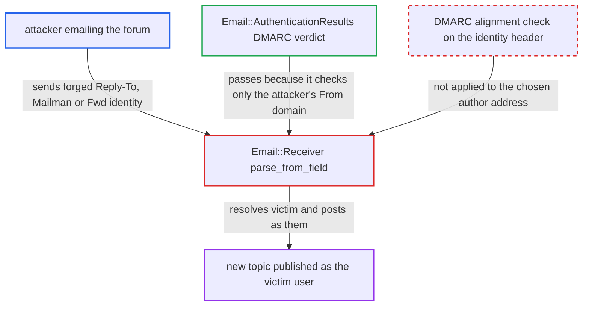

# Inbound email author taken from unauthenticated Reply-To/Mailman/forward headers, bypassing DMARC check

| Field | Value |
|---|---|
| ID | `find_016EoTefLSD53sEN8JDhFue9` |
| Severity | **Medium** |
| Status | open |
| CWE | CWE-290 — Authentication bypass by spoofing |
| Created | 2026-10-27T21:22:32.807497Z |
| Claude Security | https://claude.ai/security/findings/find_016EoTefLSD53sEN8JDhFue9 |

## Description

Anyone who can email the forum can publish a new topic as another registered user, including staff, with no review. This works only when `email_in_authserv_id` is set, an `email_in` category exists, and the victim's domain publishes DMARC. `parse_from_field` picks the author from sender-written headers that the DMARC result does not cover.

1. **attacker** emails the `email_in` category address from their own domain. The mail sets `Reply-To` and `X-Original-From` to the victim's address. The other routes are an `X-Mailman-Version` header with `List-Post` equal to the attacker's `From`, or a `Fwd:` subject with an embedded message from the victim.
2. **trusted mail server** computes a DMARC result for the attacker's own `From` domain. `Email::AuthenticationResults` reads that result, which is `pass` or `none`, so the post is not sent to review. ([`lib/email/authentication_results.rb:53-65`](https://github.com/cx-benchmark/discourse/blob/e08ed05b4b1ef773b2de7948a8f88a7c182a3520/lib/email/authentication_results.rb#L53-L65))
3. **`parse_from_field`** returns the victim's address as the sender. It prefers `Reply-To` when `X-Original-From` names the same address. It also reads Mailman headers or the embedded `Fwd:` sender before it falls back to `From`. ([`lib/email/receiver.rb:745-751`](https://github.com/cx-benchmark/discourse/blob/e08ed05b4b1ef773b2de7948a8f88a7c182a3520/lib/email/receiver.rb#L745-L751))
4. **`parse_from_field`** takes the Mailman route when the mail carries an `X-Mailman-Version` header. `extract_email_address_and_name_from_mailman` returns the first of `From`, `Reply-To`, `X-Mailfrom` or `X-Original-From` that differs from `List-Post`, so the attacker's `Reply-To` wins. ([`lib/email/receiver.rb:758-774`](https://github.com/cx-benchmark/discourse/blob/e08ed05b4b1ef773b2de7948a8f88a7c182a3520/lib/email/receiver.rb#L758-L774))
5. **`parse_from_field`** takes the forwarded-message route for a `Fwd:` or `Tr:` subject. The outer `From` string, display name included, only has to contain a group's incoming address, because the match is an unanchored `Regexp.union`. For example, `"support@forum" <attacker@evil>` matches. ([`lib/email/receiver.rb:1245-1252`](https://github.com/cx-benchmark/discourse/blob/e08ed05b4b1ef773b2de7948a8f88a7c182a3520/lib/email/receiver.rb#L1245-L1252))
6. **`Email::Receiver`** resolves the address with `User.find_by_email` and makes that user the author. The victim becomes the author for all later processing. ([`lib/email/receiver.rb:139-140`](https://github.com/cx-benchmark/discourse/blob/e08ed05b4b1ef773b2de7948a8f88a7c182a3520/lib/email/receiver.rb#L139-L140))
7. **`Email::Receiver`** creates a topic in the `email_in` category as the victim. This happens if the victim is in `email_in_allowed_groups` (admins, moderators and TL2 by default). `auth_res_action` is `:accept`, so the post is published at once, and a staff victim is not reviewed. ([`lib/email/receiver.rb:903-922`](https://github.com/cx-benchmark/discourse/blob/e08ed05b4b1ef773b2de7948a8f88a7c182a3520/lib/email/receiver.rb#L903-L922))

## Assessment

The attacker is anyone on the internet who can mail the forum. No login is needed. The site must have `email_in` enabled, a category with an `email_in` address, and `email_in_authserv_id` set. The victim's domain must publish DMARC, and the victim must be in `email_in_allowed_groups` and able to post to that category. The attacker mails the category address from their own domain with `Reply-To` and `X-Original-From` set to the victim's address. Two other ways in exist: Mailman headers, where `From` equals `List-Post`, and a `Fwd:` subject whose outer `From` string contains a group incoming address. With the default blank `email_in_authserv_id`, `From` is trusted without verification by design, so this flaw adds nothing there. It adds nothing on group-inbox private messages or mailing-list mirror categories, which never get the DMARC check. It also adds nothing on reply-key replies, which are bound to the key's owner.

Impact: The attacker can publish new topics falsely attributed to any registered user in `email_in_allowed_groups`, including staff, without review. The attacker cannot edit existing data, read private content or take over the account, so the harm is limited to forged authorship of new posts.

## Recommendation

When `email_in_authserv_id` is set, the DMARC verdict covers only the `From` domain. `parse_from_field` still takes the author from `Reply-To`, `X-Original-From`, Mailman headers or an embedded forwarded message, which that verdict does not cover.

Fix criteria: With a trusted authserv-id configured, the address that selects the author is the DMARC-authenticated `From`. An alternative header is used only if its domain aligns with the authenticated `From`. Otherwise the post is queued as on `dmarc=fail`. Test: a DMARC-passing mail from an attacker domain to an `email_in` category, with the victim's identity set through `Reply-To`/`X-Original-From`, Mailman headers or a `Fwd:` subject, must not publish a topic as the victim.

## Evidence

**https://github.com/cx-benchmark/discourse**

- [`lib/email/receiver.rb:745-751`](https://github.com/cx-benchmark/discourse/blob/e08ed05b4b1ef773b2de7948a8f88a7c182a3520/lib/email/receiver.rb#L745-L751)
- [`lib/email/receiver.rb:758-774`](https://github.com/cx-benchmark/discourse/blob/e08ed05b4b1ef773b2de7948a8f88a7c182a3520/lib/email/receiver.rb#L758-L774)
- [`lib/email/receiver.rb:722-733`](https://github.com/cx-benchmark/discourse/blob/e08ed05b4b1ef773b2de7948a8f88a7c182a3520/lib/email/receiver.rb#L722-L733)
- [`lib/email/receiver.rb:1245-1252`](https://github.com/cx-benchmark/discourse/blob/e08ed05b4b1ef773b2de7948a8f88a7c182a3520/lib/email/receiver.rb#L1245-L1252)
- [`lib/email/receiver.rb:139-140`](https://github.com/cx-benchmark/discourse/blob/e08ed05b4b1ef773b2de7948a8f88a7c182a3520/lib/email/receiver.rb#L139-L140)
- [`lib/email/receiver.rb:903-922`](https://github.com/cx-benchmark/discourse/blob/e08ed05b4b1ef773b2de7948a8f88a7c182a3520/lib/email/receiver.rb#L903-L922)
- [`lib/email/receiver.rb:1525-1532`](https://github.com/cx-benchmark/discourse/blob/e08ed05b4b1ef773b2de7948a8f88a7c182a3520/lib/email/receiver.rb#L1525-L1532)
- [`lib/email/authentication_results.rb:53-65`](https://github.com/cx-benchmark/discourse/blob/e08ed05b4b1ef773b2de7948a8f88a7c182a3520/lib/email/authentication_results.rb#L53-L65)
- [`lib/new_post_manager.rb:85`](https://github.com/cx-benchmark/discourse/blob/e08ed05b4b1ef773b2de7948a8f88a7c182a3520/lib/new_post_manager.rb#L85)
- [`lib/new_post_manager.rb:254-261`](https://github.com/cx-benchmark/discourse/blob/e08ed05b4b1ef773b2de7948a8f88a7c182a3520/lib/new_post_manager.rb#L254-L261)

