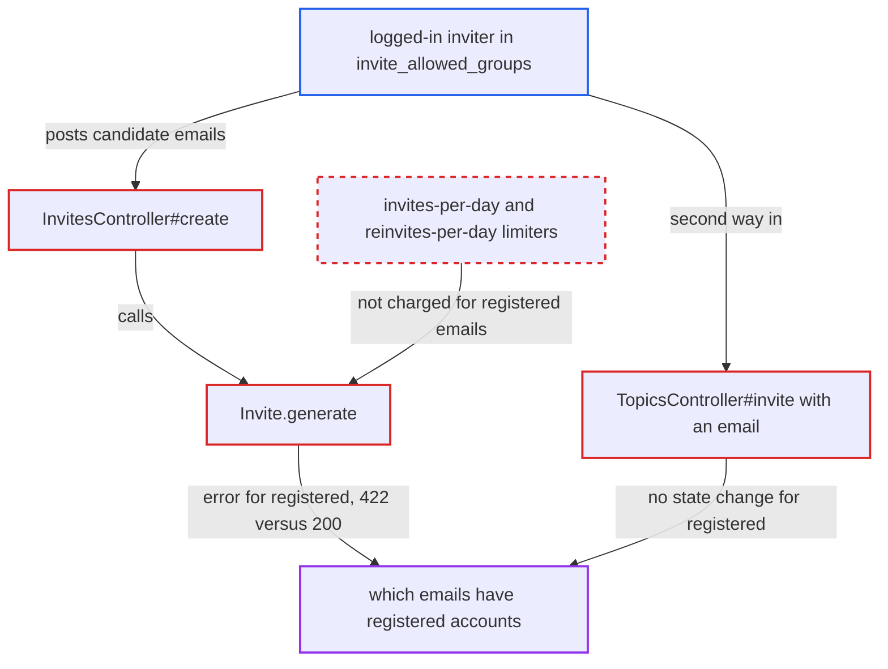

# Invite creation distinguishes registered emails despite hide_email_address_taken

| Field | Value |
|---|---|
| ID | `find_01UpUKXssrrUAiY9GyEbSJ7D` |
| Severity | **Medium** |
| Status | open |
| CWE | CWE-204 — Observable Discrepancy |
| Created | 2026-10-27T22:06:09.375948Z |
| Claude Security | https://claude.ai/security/findings/find_01UpUKXssrrUAiY9GyEbSJ7D |

## Description

A logged-in member of `invite_allowed_groups` (default TL2) can find out which email addresses have accounts on the forum, even with `hide_email_address_taken` on (the default). Registered addresses can be tested without limit and at no cost. The invite code answers registered and unregistered emails differently, and it checks for an existing account before any rate limiter runs.

1. **inviter** posts a candidate email to `/invites.json`. The inviter must be in `invite_allowed_groups`, which is the only privilege check for this action. ([`lib/guardian/invite_guardian.rb:16-21`](https://github.com/cx-benchmark/discourse/blob/e08ed05b4b1ef773b2de7948a8f88a7c182a3520/lib/guardian/invite_guardian.rb#L16-L21))
2. **`Invite.generate`** raises `Invite::UserExists` when the email belongs to a non-staged account. The raise happens before `Invite.create!`, so no invite is created and no limiter is charged. ([`app/models/invite.rb:150`](https://github.com/cx-benchmark/discourse/blob/e08ed05b4b1ef773b2de7948a8f88a7c182a3520/app/models/invite.rb#L150))
3. **`InvitesController#create`** rescues the error and returns HTTP 422 through `render_json_error`. An unregistered email instead returns HTTP 200 with the serialized invite, so the status code reveals whether the account exists. ([`app/controllers/invites_controller.rb:166-197`](https://github.com/cx-benchmark/discourse/blob/e08ed05b4b1ef773b2de7948a8f88a7c182a3520/app/controllers/invites_controller.rb#L166-L197))
4. **`Invite#user_exists_error_msg`** swaps in the generic text `invite.generic_error_response` when `hide_email_address_taken` is on. Only the message text is hidden. The status code and body shape still differ, so the setting hides nothing. ([`app/models/invite.rb:410-414`](https://github.com/cx-benchmark/discourse/blob/e08ed05b4b1ef773b2de7948a8f88a7c182a3520/app/models/invite.rb#L410-L414))
5. **inviter** repeats the request for every address on a list. A 422 means registered and costs nothing. A 200 means unregistered, and it uses one invite from `max_invites_per_day` (default 10) and sends an email to that address. ([`app/models/invite.rb:330-332`](https://github.com/cx-benchmark/discourse/blob/e08ed05b4b1ef773b2de7948a8f88a7c182a3520/app/models/invite.rb#L330-L332))
6. **inviter** may probe through `TopicsController#invite` with an email instead. A registered address returns success with no state change. An unregistered one creates a pending invite under `/u/<me>/invited/pending`, sends mail, and returns 429 after three repeats from the `reinvites-per-day` limiter. ([`app/controllers/topics_controller.rb:903-917`](https://github.com/cx-benchmark/discourse/blob/e08ed05b4b1ef773b2de7948a8f88a7c182a3520/app/controllers/topics_controller.rb#L903-L917))

## Assessment

The attacker is a logged-in member of `invite_allowed_groups` (default TL2) on a site where `hide_email_address_taken` is on (the default). They POST `/invites.json` with `email=<candidate>` for each address in a list. A second route is `POST /t/:id/invite`, where they watch their pending-invites list or the 429 behaviour. No victim interaction is needed.

Impact: The attacker learns which email addresses hold accounts on the forum. This is the fact `hide_email_address_taken` is meant to protect, and positive hits can be tested at unlimited rate. The only other effect is unsolicited invite emails sent to unregistered addresses.

## Recommendation

The invite flow answers registered and unregistered emails with different HTTP outcomes and side effects. It also checks whether the account exists before any rate limiting. `hide_email_address_taken` is meant to make the two cases indistinguishable.

Fix criteria: With `hide_email_address_taken` on, creating an invite through `/invites` or `/t/:id/invite` for a registered email gives the same status code, body shape, visible pending-invite state and rate-limit accounting as for an unregistered email. Probes of existing addresses are charged against the per-user invite limiters. To verify, submit one registered and one unregistered address, then diff the responses and the inviter's pending invite list.

## Evidence

**https://github.com/cx-benchmark/discourse**

- [`app/controllers/invites_controller.rb:166-197`](https://github.com/cx-benchmark/discourse/blob/e08ed05b4b1ef773b2de7948a8f88a7c182a3520/app/controllers/invites_controller.rb#L166-L197)
- [`app/models/invite.rb:150`](https://github.com/cx-benchmark/discourse/blob/e08ed05b4b1ef773b2de7948a8f88a7c182a3520/app/models/invite.rb#L150)
- [`app/models/invite.rb:410-414`](https://github.com/cx-benchmark/discourse/blob/e08ed05b4b1ef773b2de7948a8f88a7c182a3520/app/models/invite.rb#L410-L414)
- [`app/models/invite.rb:330-332`](https://github.com/cx-benchmark/discourse/blob/e08ed05b4b1ef773b2de7948a8f88a7c182a3520/app/models/invite.rb#L330-L332)
- [`app/controllers/topics_controller.rb:903-917`](https://github.com/cx-benchmark/discourse/blob/e08ed05b4b1ef773b2de7948a8f88a7c182a3520/app/controllers/topics_controller.rb#L903-L917)
- [`lib/guardian/invite_guardian.rb:16-21`](https://github.com/cx-benchmark/discourse/blob/e08ed05b4b1ef773b2de7948a8f88a7c182a3520/lib/guardian/invite_guardian.rb#L16-L21)

