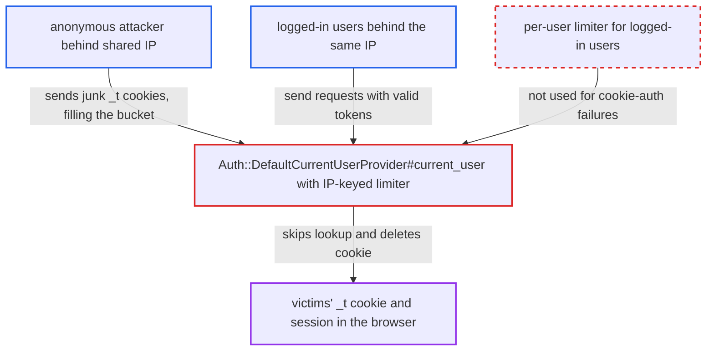

# IP-keyed cookie-auth limiter lets one client log out every user sharing its IP

| Field | Value |
|---|---|
| ID | `find_01X6g76H72KH9FMFG2Dayqu1` |
| Severity | **Medium** |
| Status | open |
| CWE | CWE-645 — Overly restrictive account lockout |
| Created | 2026-10-27T21:22:13.309564Z |
| Claude Security | https://claude.ai/security/findings/find_01X6g76H72KH9FMFG2Dayqu1 |

## Description

An anonymous attacker can log out every user who shares their public IP, such as users behind a carrier, office, campus or VPN address, and can keep them logged out. Anonymous browsing still works, and users on other IPs are unaffected. The cause is in `Auth::DefaultCurrentUserProvider#current_user`. Its bad-cookie limiter is keyed only on `request.ip`. Once the bucket is full, valid tokens are not looked up and the victim's `_t` cookie is deleted.

1. **attacker** sends requests with a junk 32-character `_t` cookie. Any 32-character string is accepted as a v0 token, and a revoked v1 cookie also works, so the failed lookups cost nothing. ([`lib/auth/default_current_user_provider.rb:79-83`](https://github.com/cx-benchmark/discourse/blob/e08ed05b4b1ef773b2de7948a8f88a7c182a3520/lib/auth/default_current_user_provider.rb#L79-L83))
2. **the handler `current_user`** counts each failed lookup against the bucket `cookie_auth_#{request.ip}`. The limiter allows `COOKIE_ATTEMPTS_PER_MIN` (10) per minute and is keyed only on the client IP. The attacker's few requests per second stay under the separate 200-per-minute per-IP limit. ([`lib/auth/default_current_user_provider.rb:138-164`](https://github.com/cx-benchmark/discourse/blob/e08ed05b4b1ef773b2de7948a8f88a7c182a3520/lib/auth/default_current_user_provider.rb#L138-L164))
3. **the handler `current_user`** skips `UserAuthToken.lookup` for every cookie-bearing request from that IP. `limiter.can_perform?` is false once the bucket is full. The limiter is built with `user = nil`, so no per-user or staff bypass applies, and a valid token is skipped as well. ([`lib/rate_limiter.rb:71-73`](https://github.com/cx-benchmark/discourse/blob/e08ed05b4b1ef773b2de7948a8f88a7c182a3520/lib/rate_limiter.rb#L71-L73))
4. **the handler `current_user`** sets `BAD_TOKEN` and raises `Discourse::InvalidAccess` with `delete_cookie: TOKEN_COOKIE`. `limiter.performed!` raises, and the code turns that into the exception for the victim's request, which carries a valid token. ([`lib/auth/default_current_user_provider.rb:138-164`](https://github.com/cx-benchmark/discourse/blob/e08ed05b4b1ef773b2de7948a8f88a7c182a3520/lib/auth/default_current_user_provider.rb#L138-L164))
5. **`ApplicationController` and the MessageBus setup** delete the victim's `_t` cookie. `rescue_from Discourse::InvalidAccess` deletes `_t` and returns 403. The message-bus long-poll path sends `Set-Cookie: _t=del`, so idle tabs are logged out too. ([`app/controllers/application_controller.rb:249-259`](https://github.com/cx-benchmark/discourse/blob/e08ed05b4b1ef773b2de7948a8f88a7c182a3520/app/controllers/application_controller.rb#L249-L259))
6. **`Middleware::RequestTracker`** adds the header `Discourse-Logged-Out: 1`. `handleLogoff` in `frontend/discourse/app/lib/ajax.js` then shows the logged-out state in the Ember client. If the victim logs in again, the new cookie is deleted on the next request while the bucket stays full. ([`lib/middleware/request_tracker.rb:410-412`](https://github.com/cx-benchmark/discourse/blob/e08ed05b4b1ef773b2de7948a8f88a7c182a3520/lib/middleware/request_tracker.rb#L410-L412))

## Assessment

The attacker is an anonymous internet user who shares a public egress IP with the victims, for example behind CGNAT, a corporate or campus NAT, or a VPN exit. No login is needed. The attacker keeps sending requests with a junk 32-character `_t` cookie, a few per second, so the 10-per-minute bucket stays full. The victims only browse as usual. The behaviour is asserted by `spec/lib/auth/default_current_user_provider_spec.rb:545-584`, so it is a deliberate brute-force control. It contradicts the project's choice to rate-limit logged-in TL1+ users per user rather than per IP (`lib/request_tracker/rate_limiters/user.rb`, `skip_per_ip_rate_limit_trust_level = 1`).

Impact: Logged-in users behind the shared IP lose their browser session and cannot stay logged in while the attack runs. The server-side `UserAuthToken` stays valid, but the browser loses the cookie. Nothing is disclosed and no session is taken over. Anonymous browsing still works, and users on other IPs are unaffected, so the loss of availability is partial.

## Recommendation

The bad-cookie limiter is keyed only on client IP. When it is exhausted, it refuses lookups of valid tokens and destroys their cookies, so one client's failed guesses lock out and log out every other client at that address.

Fix criteria: A valid auth token keeps authenticating however many invalid cookies other clients at the same IP presented, while guessing tokens stays rate-limited. A request that was only rate-limited never causes its cookie to be deleted or a logged-out signal to be sent. To verify, exhaust the per-IP bucket with junk `_t` values. Then check that a valid `_t` from the same IP still authenticates and keeps its cookie on both normal and message-bus requests.

## Evidence

**https://github.com/cx-benchmark/discourse**

- [`lib/auth/default_current_user_provider.rb:138-164`](https://github.com/cx-benchmark/discourse/blob/e08ed05b4b1ef773b2de7948a8f88a7c182a3520/lib/auth/default_current_user_provider.rb#L138-L164)
- [`lib/auth/default_current_user_provider.rb:79-83`](https://github.com/cx-benchmark/discourse/blob/e08ed05b4b1ef773b2de7948a8f88a7c182a3520/lib/auth/default_current_user_provider.rb#L79-L83)
- [`app/controllers/application_controller.rb:249-259`](https://github.com/cx-benchmark/discourse/blob/e08ed05b4b1ef773b2de7948a8f88a7c182a3520/app/controllers/application_controller.rb#L249-L259)
- [`config/initializers/004-message_bus.rb:45-51`](https://github.com/cx-benchmark/discourse/blob/e08ed05b4b1ef773b2de7948a8f88a7c182a3520/config/initializers/004-message_bus.rb#L45-L51)
- [`lib/middleware/request_tracker.rb:410-412`](https://github.com/cx-benchmark/discourse/blob/e08ed05b4b1ef773b2de7948a8f88a7c182a3520/lib/middleware/request_tracker.rb#L410-L412)
- [`lib/rate_limiter.rb:71-73`](https://github.com/cx-benchmark/discourse/blob/e08ed05b4b1ef773b2de7948a8f88a7c182a3520/lib/rate_limiter.rb#L71-L73)
- [`lib/request_tracker/rate_limiters/user.rb:1-20`](https://github.com/cx-benchmark/discourse/blob/e08ed05b4b1ef773b2de7948a8f88a7c182a3520/lib/request_tracker/rate_limiters/user.rb#L1-L20)

