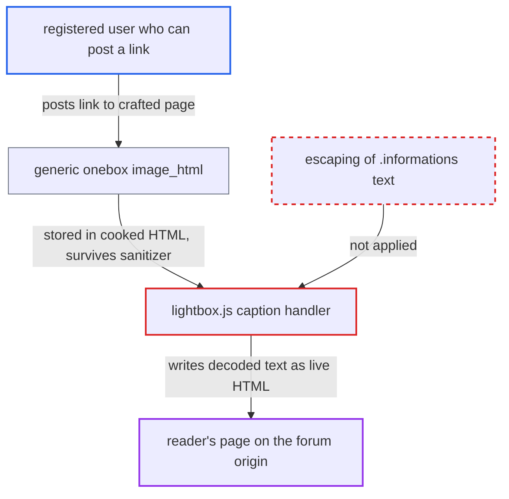

# Lightbox caption re-parses .informations text as HTML, bypassing the onebox sanitizer

| Field | Value |
|---|---|
| ID | `find_01PZrk2UWXcxbxa234S96FxT` |
| Severity | **Medium** |
| Status | open |
| CWE | CWE-79 — HTML injection |
| Created | 2026-10-27T22:09:34.459908Z |
| Claude Security | https://claude.ai/security/findings/find_01PZrk2UWXcxbxa234S96FxT |

## Description

A registered user who can post a link can get unsanitized HTML, such as a credential-phishing form, an iframe or a redirect, to appear on the forum origin in another reader's browser. It needs a reader to click the image to open the lightbox. The lightbox caption code in `lightbox.js` writes the decoded `.informations` text into `caption.innerHTML` without escaping it. With the default CSP this is HTML injection, not script execution.

1. **attacker** hosts a web page with crafted meta tags. The page sets `og:type=photo` and `og:image`, plus a `twitter:image:width` value that closes the attribute and appends a `.lightbox` div holding a `.informations` span with entity-encoded markup. ([`lib/onebox/engine/standard_embed.rb:78-94`](https://github.com/cx-benchmark/discourse/blob/e08ed05b4b1ef773b2de7948a8f88a7c182a3520/lib/onebox/engine/standard_embed.rb#L78-L94))
2. **generic onebox `image_html`** inserts the raw width into the onebox HTML. The width goes into `width='…'` unescaped, so a `'>` closes the tag and the appended `div` and `span` become real elements. ([`lib/onebox/engine/allowlisted_generic_onebox.rb:273-283`](https://github.com/cx-benchmark/discourse/blob/e08ed05b4b1ef773b2de7948a8f88a7c182a3520/lib/onebox/engine/allowlisted_generic_onebox.rb#L273-L283))
3. **onebox sanitizer** keeps the injected elements and their encoded text. The sanitizer keeps `class` on every element and keeps entity text, so `.lightbox`, `.informations` and the encoded markup survive. ([`lib/onebox/sanitize_config.rb:7-45`](https://github.com/cx-benchmark/discourse/blob/e08ed05b4b1ef773b2de7948a8f88a7c182a3520/lib/onebox/sanitize_config.rb#L7-L45))
4. **`post_process_oneboxes`** stores the sanitized onebox in `post.cooked`. `Oneboxer.apply` puts the fragment into the post with no further filtering. ([`lib/cooked_processor_mixin.rb:8-45`](https://github.com/cx-benchmark/discourse/blob/e08ed05b4b1ef773b2de7948a8f88a7c182a3520/lib/cooked_processor_mixin.rb#L8-L45))
5. **reader's browser** turns the injected `.lightbox` element into a slide. The selector is class-only, so any element with `class="lightbox"` matches, and a click handler opens PhotoSwipe on it. ([`frontend/discourse/app/lib/lightbox/constants.js:1-3`](https://github.com/cx-benchmark/discourse/blob/e08ed05b4b1ef773b2de7948a8f88a7c182a3520/frontend/discourse/app/lib/lightbox/constants.js#L1-L3))
6. **caption handler in `lightbox.js`** writes the `.informations` text into `caption.innerHTML`. `textContent` decodes the entities, so the inert `&lt;form&gt;` text becomes a live `form` element, while `title` and `aiDescription` are escaped. ([`frontend/discourse/app/lib/lightbox.js:140-154`](https://github.com/cx-benchmark/discourse/blob/e08ed05b4b1ef773b2de7948a8f88a7c182a3520/frontend/discourse/app/lib/lightbox.js#L140-L154))

## Assessment

The attacker is a registered user who may post a link (TL0) and controls a web page. They post the URL, the generic onebox embeds it, and the harmful markup is stored in `post.cooked`. A reader must then click the slide to open the lightbox. The same sink is reached by any onebox route that passes remote markup, for example the Threads onebox and `title_attr`. The lightbox also runs on chat messages, as well as on cooked posts. Fixing the onebox engines alone leaves this sink open to any later route.

Impact: The attacker can render unsanitized HTML in the reader's session on the forum origin: a `form` posting to an outside site, an unsandboxed `iframe` to any origin, or a `meta` refresh redirect. The default CSP blocks event handlers and `javascript:` URLs, so the attacker cannot read data or act as the viewer. Disclosure depends on the victim submitting the form. A site that sets `content_security_policy` to false (default `true`) gets stored XSS.

## Recommendation

The caption handler in `lightbox.js` (lines 140-154) puts the `textContent` of a `.informations` element from the cooked DOM into `caption.innerHTML` without escaping. Text that the sanitizer left inert is parsed again as HTML.

Fix criteria: Caption details are inserted as text, either escaped like `title` and `aiDescription` or set through `textContent` on a created element. A `.lightbox` whose `.informations` text is `100x100 <form><input>` shows that string literally in the caption. The caption DOM then contains no `form`, `input` or `img` element.

## Evidence

**https://github.com/cx-benchmark/discourse**

- [`frontend/discourse/app/lib/lightbox.js:140-154`](https://github.com/cx-benchmark/discourse/blob/e08ed05b4b1ef773b2de7948a8f88a7c182a3520/frontend/discourse/app/lib/lightbox.js#L140-L154)
- [`frontend/discourse/app/lib/lightbox/constants.js:1-3`](https://github.com/cx-benchmark/discourse/blob/e08ed05b4b1ef773b2de7948a8f88a7c182a3520/frontend/discourse/app/lib/lightbox/constants.js#L1-L3)
- [`frontend/discourse/app/lib/lightbox.js:80-101`](https://github.com/cx-benchmark/discourse/blob/e08ed05b4b1ef773b2de7948a8f88a7c182a3520/frontend/discourse/app/lib/lightbox.js#L80-L101)
- [`lib/cooked_processor_mixin.rb:600-612`](https://github.com/cx-benchmark/discourse/blob/e08ed05b4b1ef773b2de7948a8f88a7c182a3520/lib/cooked_processor_mixin.rb#L600-L612)
- [`lib/onebox/sanitize_config.rb:7-45`](https://github.com/cx-benchmark/discourse/blob/e08ed05b4b1ef773b2de7948a8f88a7c182a3520/lib/onebox/sanitize_config.rb#L7-L45)
- [`lib/onebox/engine/standard_embed.rb:78-94`](https://github.com/cx-benchmark/discourse/blob/e08ed05b4b1ef773b2de7948a8f88a7c182a3520/lib/onebox/engine/standard_embed.rb#L78-L94)
- [`lib/onebox/engine/allowlisted_generic_onebox.rb:273-283`](https://github.com/cx-benchmark/discourse/blob/e08ed05b4b1ef773b2de7948a8f88a7c182a3520/lib/onebox/engine/allowlisted_generic_onebox.rb#L273-L283)
- [`lib/cooked_processor_mixin.rb:8-45`](https://github.com/cx-benchmark/discourse/blob/e08ed05b4b1ef773b2de7948a8f88a7c182a3520/lib/cooked_processor_mixin.rb#L8-L45)
- [`frontend/discourse/app/instance-initializers/post-decorations.js:26-52`](https://github.com/cx-benchmark/discourse/blob/e08ed05b4b1ef773b2de7948a8f88a7c182a3520/frontend/discourse/app/instance-initializers/post-decorations.js#L26-L52)
- [`lib/content_security_policy/default.rb:9-31`](https://github.com/cx-benchmark/discourse/blob/e08ed05b4b1ef773b2de7948a8f88a7c182a3520/lib/content_security_policy/default.rb#L9-L31)

