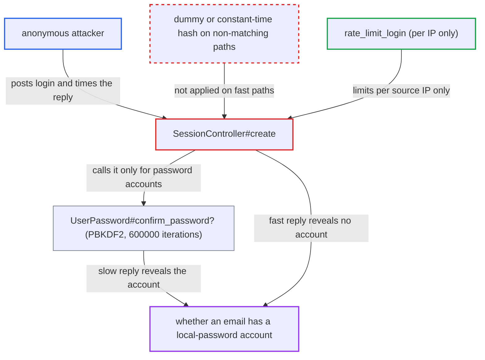

# Login response time reveals whether an email has a password-bearing account

| Field | Value |
|---|---|
| ID | `find_01ApcGCdg3N6ZoGNqyReeym4` |
| Severity | **Medium** |
| Status | open |
| CWE | CWE-208 — Observable timing discrepancy |
| Created | 2026-10-27T22:16:51.490148Z |
| Claude Security | https://claude.ai/security/findings/find_01ApcGCdg3N6ZoGNqyReeym4 |

## Description

An anonymous attacker can find out whether an email address belongs to an account with a local password by timing the login response. This defeats `hide_email_address_taken`, which is on by default. It needs only `POST /session` and one request per address. `SessionController#create` does the slow PBKDF2 hashing only when an account with a password exists, so the response time gives the answer away.

1. **Attacker** fetches a CSRF token from `GET /session/csrf`. The login endpoint is open to anonymous users, so no account or prior access is needed.
2. **Attacker** sends `POST /session` with `login` set to the target email and any password. The `login` field accepts a username or an email, and `User.find_by_username_or_email` also matches secondary emails. ([`app/controllers/session_controller.rb:364-397`](https://github.com/cx-benchmark/discourse/blob/e08ed05b4b1ef773b2de7948a8f88a7c182a3520/app/controllers/session_controller.rb#L364-L397))
3. **the action `SessionController#create`** looks up the account and takes one of two paths. Both paths end in a byte-identical `invalid_credentials` response with HTTP 200, so the body gives nothing away. ([`app/controllers/session_controller.rb:1458-1460`](https://github.com/cx-benchmark/discourse/blob/e08ed05b4b1ef773b2de7948a8f88a7c182a3520/app/controllers/session_controller.rb#L1458-L1460))
4. **the method `UserPassword#confirm_password?`** recomputes the password hash when the account has a password. This runs `OpenSSL::KDF.pbkdf2_hmac` with 600000 iterations, which takes roughly 0.3 to 0.6 seconds on common server CPUs. ([`app/models/user_password.rb:32-39`](https://github.com/cx-benchmark/discourse/blob/e08ed05b4b1ef773b2de7948a8f88a7c182a3520/app/models/user_password.rb#L32-L39))
5. **the method `User#confirm_password?`** returns `false` at once when there is no account or the account has no `user_password`. Unknown logins and passwordless accounts, such as SSO-only or OAuth-only ones, therefore answer in a few milliseconds. ([`app/models/user.rb:1070-1073`](https://github.com/cx-benchmark/discourse/blob/e08ed05b4b1ef773b2de7948a8f88a7c182a3520/app/models/user.rb#L1070-L1073))
6. **Attacker** reads the response time to learn whether the email has a password-bearing account. A delay of hundreds of milliseconds against a few milliseconds is far above network jitter, so one request is enough. ([`config/application.rb:159-160`](https://github.com/cx-benchmark/discourse/blob/e08ed05b4b1ef773b2de7948a8f88a7c182a3520/config/application.rb#L159-L160))
7. **Attacker** repeats the probe for many addresses, spreading requests over many source IPs. `rate_limit_login` counts attempts per raw `request.remote_ip` only, so each IP gets 30 probes an hour and a pool of addresses scales this up. ([`app/controllers/session_controller.rb:1508-1522`](https://github.com/cx-benchmark/discourse/blob/e08ed05b4b1ef773b2de7948a8f88a7c182a3520/app/controllers/session_controller.rb#L1508-L1522))

## Assessment

The attacker is anonymous and needs only network access to the site. They fetch a CSRF token and then send `POST /session` with the target email as `login` and any password. No victim action is needed. The only throttle is `rate_limit_login`, which allows 6 a minute and 30 an hour per source IP (`max_logins_per_ip_per_minute` and `max_logins_per_ip_per_hour`). It has no limit per login identifier and no IPv6 prefix bucketing. An attacker with a modest address pool, or an IPv6 /64 with many distinct addresses, can test large email lists. The report checked other login-like flows and found they do not share this flaw: `email_login`, `email_login_info`, password reset, API keys, MCP OAuth tokens and DiscourseConnect. It notes that `UsersController#update_activation_email` and `UsersController#create` have a similar timing problem, filed separately.

Impact: The attacker learns, for any email address, whether it belongs to a registered account that holds a local password. This is one bit per address. The answer does not cover accounts without a local password, and nothing is modified or degraded.

## Recommendation

(1) `SessionController#create` runs the expensive PBKDF2 derivation only when an account with a password exists. The unknown-user and passwordless-user paths return at once with the same error body, so response time shows whether an account exists despite `hide_email_address_taken`.

Fix criteria: The time to answer `POST /session` with invalid credentials is statistically indistinguishable for a login matching a password-bearing account, one matching a passwordless account, and one matching nothing. One way is to run an equivalent-cost derivation against a fixed dummy salt and hash on the non-matching paths. Measure both cases from a client and confirm the time distributions overlap. A request spec asserting the dummy derivation runs on the unknown-user path guards against regression.

(2) `rate_limit_login` throttles logins only per exact source IP. No limit is keyed on the submitted login identifier, so the leak scales with the size of the attacker's address pool.

Fix criteria: Repeated failed logins against one identifier are limited independently of source address, and for IPv6 also per /64 prefix. Bulk probing of an email list is then slowed even if the timing channel is not fully closed. A test shows that N failed attempts for the same `login` from different IPs trigger `RateLimiter::LimitExceeded`.

## Evidence

**https://github.com/cx-benchmark/discourse**

- [`app/controllers/session_controller.rb:364-397`](https://github.com/cx-benchmark/discourse/blob/e08ed05b4b1ef773b2de7948a8f88a7c182a3520/app/controllers/session_controller.rb#L364-L397)
- [`app/models/user_password.rb:32-39`](https://github.com/cx-benchmark/discourse/blob/e08ed05b4b1ef773b2de7948a8f88a7c182a3520/app/models/user_password.rb#L32-L39)
- [`lib/password_hasher.rb:37-49`](https://github.com/cx-benchmark/discourse/blob/e08ed05b4b1ef773b2de7948a8f88a7c182a3520/lib/password_hasher.rb#L37-L49)
- [`config/application.rb:159-160`](https://github.com/cx-benchmark/discourse/blob/e08ed05b4b1ef773b2de7948a8f88a7c182a3520/config/application.rb#L159-L160)
- [`app/models/user.rb:1070-1073`](https://github.com/cx-benchmark/discourse/blob/e08ed05b4b1ef773b2de7948a8f88a7c182a3520/app/models/user.rb#L1070-L1073)
- [`app/controllers/session_controller.rb:1508-1522`](https://github.com/cx-benchmark/discourse/blob/e08ed05b4b1ef773b2de7948a8f88a7c182a3520/app/controllers/session_controller.rb#L1508-L1522)
- [`app/controllers/session_controller.rb:1458-1460`](https://github.com/cx-benchmark/discourse/blob/e08ed05b4b1ef773b2de7948a8f88a7c182a3520/app/controllers/session_controller.rb#L1458-L1460)
- [`config/site_settings.yml:995-998`](https://github.com/cx-benchmark/discourse/blob/e08ed05b4b1ef773b2de7948a8f88a7c182a3520/config/site_settings.yml#L995-L998)

