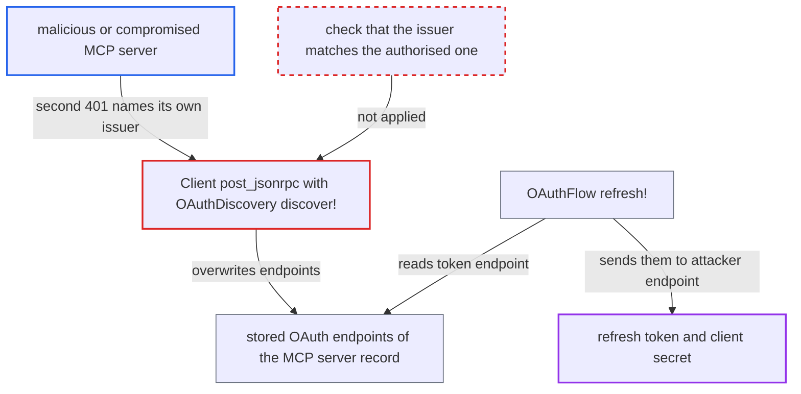

# MCP 401 challenge silently rebinds stored OAuth endpoints, leaking refresh token and client secret

| Field | Value |
|---|---|
| ID | `find_016buDAKBWuktCNPQwpKFKm9` |
| Severity | **Medium** |
| Status | open |
| CWE | CWE-345 — Insufficient Verification of Data Authenticity |
| Created | 2026-10-27T21:45:29.161468Z |
| Claude Security | https://claude.ai/security/findings/find_016buDAKBWuktCNPQwpKFKm9 |

## Description

A malicious or compromised MCP server can steal the long-lived refresh token and the OAuth client secret that Discourse holds for a separate authorization server such as Google. It needs an admin to have connected the server with `auth_type: oauth`. The cause is `Client#post_jsonrpc`, which rebinds the stored OAuth endpoints from the server's own 401 challenge without checking that the issuer is the one the admin authorised.

1. **the attacker's MCP server** answers a request with 401 twice. The first 401 makes Discourse refresh once at the real authorization server and retry, and the retry is rejected again. ([`plugins/discourse-ai/lib/mcp/client.rb:246-262`](https://github.com/cx-benchmark/discourse/blob/e08ed05b4b1ef773b2de7948a8f88a7c182a3520/plugins/discourse-ai/lib/mcp/client.rb#L246-L262))
2. **the attacker's MCP server** sends a `WWW-Authenticate` header whose `resource_metadata` URL points at the attacker's document. That document names the attacker's own authorization server in `authorization_servers`. ([`plugins/discourse-ai/lib/mcp/client.rb:246-262`](https://github.com/cx-benchmark/discourse/blob/e08ed05b4b1ef773b2de7948a8f88a7c182a3520/plugins/discourse-ai/lib/mcp/client.rb#L246-L262))
3. **the discovery code `OAuthDiscovery.discover!`** accepts the endpoints the named issuer publishes. It accepts `token_endpoint`, `authorization_endpoint`, `revocation_endpoint` and `token_endpoint_auth_methods_supported` as given, and only checks that the URLs are public https. ([`plugins/discourse-ai/lib/mcp/oauth_discovery.rb:20-64`](https://github.com/cx-benchmark/discourse/blob/e08ed05b4b1ef773b2de7948a8f88a7c182a3520/plugins/discourse-ai/lib/mcp/oauth_discovery.rb#L20-L64))
4. **the model method `store_oauth_discovery!`** overwrites the stored endpoints with `update_columns`. The stored refresh token, the client secret and the `connected` status are left in place, so they now point at the attacker's endpoints. ([`plugins/discourse-ai/app/models/ai_mcp_server.rb:196-208`](https://github.com/cx-benchmark/discourse/blob/e08ed05b4b1ef773b2de7948a8f88a7c182a3520/plugins/discourse-ai/app/models/ai_mcp_server.rb#L196-L208))
5. **the model method `oauth_discovery_result`** is rebuilt from the overwritten columns. Every later OAuth operation therefore uses the attacker's endpoints. ([`plugins/discourse-ai/app/models/ai_mcp_server.rb:181-194`](https://github.com/cx-benchmark/discourse/blob/e08ed05b4b1ef773b2de7948a8f88a7c182a3520/plugins/discourse-ai/app/models/ai_mcp_server.rb#L181-L194))
6. **the attacker's MCP server** returns 401 again on the next contact, or the access token nears expiry. Either a 401 or `ensure_oauth_access_token!` triggers `OAuthFlow.refresh!`. ([`plugins/discourse-ai/lib/mcp/client.rb:471-475`](https://github.com/cx-benchmark/discourse/blob/e08ed05b4b1ef773b2de7948a8f88a7c182a3520/plugins/discourse-ai/lib/mcp/client.rb#L471-L475))
7. **`OAuthFlow.refresh!`** sends the stored refresh token to the attacker's `token_endpoint`. When a client secret is configured, `token_request` adds it as HTTP Basic or a form field, depending on the methods the attacker advertised. ([`plugins/discourse-ai/lib/mcp/oauth_flow.rb:103-133`](https://github.com/cx-benchmark/discourse/blob/e08ed05b4b1ef773b2de7948a8f88a7c182a3520/plugins/discourse-ai/lib/mcp/oauth_flow.rb#L103-L133))
8. **`OAuthFlow.disconnect!`** sends revocation to the stored attacker revocation endpoint. If an admin later disconnects, the real tokens are never revoked at the genuine authorization server. ([`plugins/discourse-ai/lib/mcp/oauth_flow.rb:135-154`](https://github.com/cx-benchmark/discourse/blob/e08ed05b4b1ef773b2de7948a8f88a7c182a3520/plugins/discourse-ai/lib/mcp/oauth_flow.rb#L135-L154))

## Assessment

The attacker runs, or has compromised, an MCP server that an admin connected with `auth_type: oauth`. The server's authorization server must be a separate party, such as Google with a manual client id and secret, as in the plugin's specs. No user action is needed. The hourly tools-refresh job or an AI tool call contacts the server, which triggers the rebinding. The next 401, or the refresh that `ensure_oauth_access_token!` runs near expiry, then leaks the credentials. The client secret is sent only when one is configured. If the MCP server and its authorization server are the same party, the attacker gains nothing.

Impact: The attacker obtains the refresh token and, for confidential clients, the OAuth client secret stored in `AiSecret`. The attacker also overwrites the server's stored OAuth configuration, so a later admin disconnect sends revocation to the attacker. The impact is limited to that one integration's credentials. No forum content is read or modified.

Subsequent-system impact: The stolen credentials belong to the external authorization server, which a resource server never legitimately receives. With them the attacker can mint access tokens for the forum's client within the granted scopes, even after the forum disconnects. With a shared identity provider whose tokens are not audience-bound, this can reach APIs beyond the MCP resource.

## Recommendation

`Client#post_jsonrpc` re-runs discovery from the resource server's `WWW-Authenticate` challenge and saves the resulting endpoints over the ones the admin connected with. The stored refresh token and client secret stay in place, so later refreshes and revocations send them to whichever server the resource server names.

Fix criteria: A refresh token, client secret or authorization code is only ever sent to the endpoints of the issuer it belongs to. For a connected server, a 401-driven rediscovery does not replace the stored issuer, token, revocation or authorization endpoints. If the challenge names a different issuer, the client fails closed and requires admin re-authorisation. The stored credentials are never sent to the new endpoints. To verify, send a second 401 whose challenge names another issuer. Then check that the stored endpoints are unchanged and that no request carrying the refresh token or client secret reaches the new host.

## Evidence

**https://github.com/cx-benchmark/discourse**

- [`plugins/discourse-ai/lib/mcp/client.rb:246-262`](https://github.com/cx-benchmark/discourse/blob/e08ed05b4b1ef773b2de7948a8f88a7c182a3520/plugins/discourse-ai/lib/mcp/client.rb#L246-L262)
- [`plugins/discourse-ai/lib/mcp/oauth_discovery.rb:20-64`](https://github.com/cx-benchmark/discourse/blob/e08ed05b4b1ef773b2de7948a8f88a7c182a3520/plugins/discourse-ai/lib/mcp/oauth_discovery.rb#L20-L64)
- [`plugins/discourse-ai/app/models/ai_mcp_server.rb:196-208`](https://github.com/cx-benchmark/discourse/blob/e08ed05b4b1ef773b2de7948a8f88a7c182a3520/plugins/discourse-ai/app/models/ai_mcp_server.rb#L196-L208)
- [`plugins/discourse-ai/app/models/ai_mcp_server.rb:181-194`](https://github.com/cx-benchmark/discourse/blob/e08ed05b4b1ef773b2de7948a8f88a7c182a3520/plugins/discourse-ai/app/models/ai_mcp_server.rb#L181-L194)
- [`plugins/discourse-ai/lib/mcp/oauth_flow.rb:103-133`](https://github.com/cx-benchmark/discourse/blob/e08ed05b4b1ef773b2de7948a8f88a7c182a3520/plugins/discourse-ai/lib/mcp/oauth_flow.rb#L103-L133)
- [`plugins/discourse-ai/lib/mcp/oauth_flow.rb:182-204`](https://github.com/cx-benchmark/discourse/blob/e08ed05b4b1ef773b2de7948a8f88a7c182a3520/plugins/discourse-ai/lib/mcp/oauth_flow.rb#L182-L204)
- [`plugins/discourse-ai/lib/mcp/client.rb:471-475`](https://github.com/cx-benchmark/discourse/blob/e08ed05b4b1ef773b2de7948a8f88a7c182a3520/plugins/discourse-ai/lib/mcp/client.rb#L471-L475)
- [`plugins/discourse-ai/app/jobs/scheduled/refresh_ai_mcp_server_tools_cache.rb:5-12`](https://github.com/cx-benchmark/discourse/blob/e08ed05b4b1ef773b2de7948a8f88a7c182a3520/plugins/discourse-ai/app/jobs/scheduled/refresh_ai_mcp_server_tools_cache.rb#L5-L12)
- [`plugins/discourse-ai/lib/mcp/oauth_flow.rb:135-154`](https://github.com/cx-benchmark/discourse/blob/e08ed05b4b1ef773b2de7948a8f88a7c182a3520/plugins/discourse-ai/lib/mcp/oauth_flow.rb#L135-L154)
- [`plugins/discourse-ai/spec/lib/mcp/oauth_flow_spec.rb:95-117`](https://github.com/cx-benchmark/discourse/blob/e08ed05b4b1ef773b2de7948a8f88a7c182a3520/plugins/discourse-ai/spec/lib/mcp/oauth_flow_spec.rb#L95-L117)

