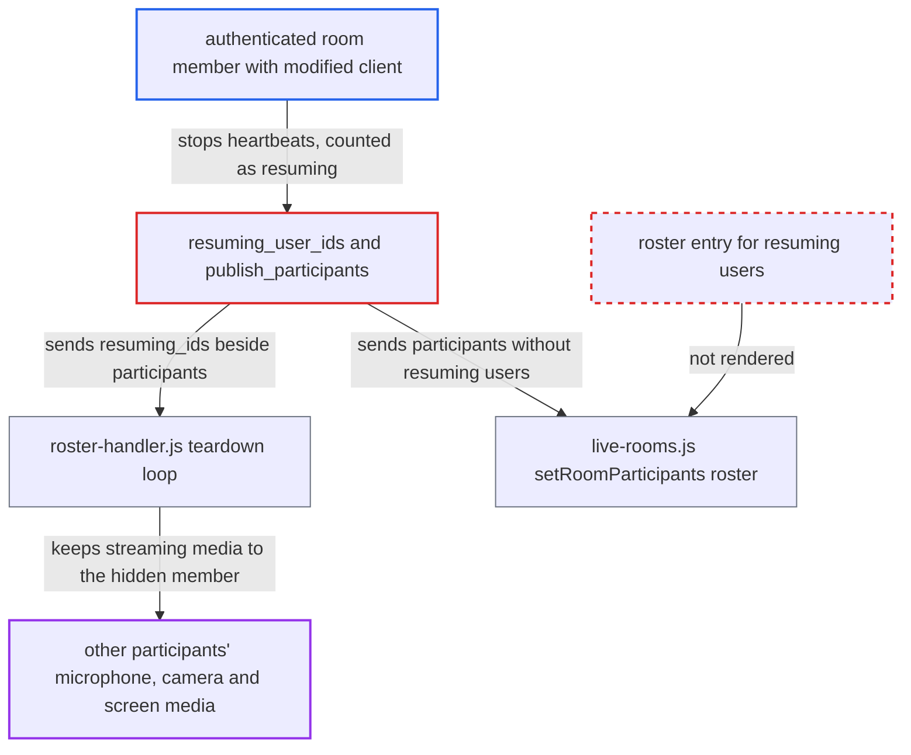

# Mesh resuming_ids keeps media flowing to participants hidden from the roster

| Field | Value |
|---|---|
| ID | `find_01TD3F4KZBRq3SZyykgTvLvM` |
| Severity | **Medium** |
| Status | open |
| CWE | CWE-285 — Improper Authorization |
| Created | 2026-10-27T21:46:53.656964Z |
| Claude Security | https://claude.ai/security/findings/find_01TD3F4KZBRq3SZyykgTvLvM |

## Description

A logged-in user admitted to a mesh live room can keep hearing, and seeing, the room after they vanish from everyone's participant list. The other participants are given a false picture of who can hear them. It needs only a modified client that stops sending `/heartbeat`. The cause is that the roster sends `resuming_ids` apart from `participants`, and clients keep media peers for those ids without showing them.

1. **attacker with a modified client** joins a mesh live room and sets up peer connections. Any logged-in user can join a public room by default, and mesh is the default transport (`live_livekit_room_policy: disabled`).
2. **attacker** stops sending `/heartbeat`. Presence lapses `live_participant_ttl_seconds` (30 s) after the last heartbeat, while the participant session lasts `participant_session_ttl` (at least 10 minutes). ([`plugins/live/app/services/live/participant_tracker.rb:196-211`](https://github.com/cx-benchmark/discourse/blob/e08ed05b4b1ef773b2de7948a8f88a7c182a3520/plugins/live/app/services/live/participant_tracker.rb#L196-L211))
3. **the method `resuming_user_ids`** classifies the attacker as resuming. It returns every user whose presence has lapsed but whose participant session key still exists. ([`plugins/live/app/services/live/participant_tracker.rb:196-211`](https://github.com/cx-benchmark/discourse/blob/e08ed05b4b1ef773b2de7948a8f88a7c182a3520/plugins/live/app/services/live/participant_tracker.rb#L196-L211))
4. **the method `publish_participants`** broadcasts `resuming_ids` as a list separate from `participants`. The attacker is no longer in `participants`, so clients get no roster entry for them. ([`plugins/live/app/services/live/room_broadcaster.rb:55-74`](https://github.com/cx-benchmark/discourse/blob/e08ed05b4b1ef773b2de7948a8f88a7c182a3520/plugins/live/app/services/live/room_broadcaster.rb#L55-L74))
5. **the roster handler in `roster-handler.js`** skips tearing down peers whose id is in `resuming_ids`. The teardown loop returns early when `resumingIds.has(remoteUserId)`, so other participants keep streaming microphone, camera and screen to the attacker. ([`plugins/live/assets/javascripts/discourse/lib/live/roster-handler.js:105-141`](https://github.com/cx-benchmark/discourse/blob/e08ed05b4b1ef773b2de7948a8f88a7c182a3520/plugins/live/assets/javascripts/discourse/lib/live/roster-handler.js#L105-L141))
6. **the client method `#setRoomParticipants`** rebuilds the visible roster from `participants` only. The attacker is removed from the list and the 'user left' sound plays, yet media still flows to them. ([`plugins/live/assets/javascripts/discourse/app/services/live-rooms.js:537-588`](https://github.com/cx-benchmark/discourse/blob/e08ed05b4b1ef773b2de7948a8f88a7c182a3520/plugins/live/assets/javascripts/discourse/app/services/live-rooms.js#L537-L588))
7. **attacker** sends a single heartbeat to stay hidden indefinitely. The heartbeat re-admits them for about 30 s and refreshes the session for another 10 minutes, so they can cycle between brief visibility and long hidden periods. ([`plugins/live/app/controllers/live/rooms_controller.rb:385-406`](https://github.com/cx-benchmark/discourse/blob/e08ed05b4b1ef773b2de7948a8f88a7c182a3520/plugins/live/app/controllers/live/rooms_controller.rb#L385-L406))

## Assessment

The attacker is any authenticated user admitted to a mesh live room. By default, public rooms admit logged-in users through `live_allowed_groups`. They need a modified client that joins normally, builds peer connections, then stops calling `/heartbeat` or calls it only about every 9 minutes. No action by any victim is needed. Mesh is the default transport. The report says the companion LiveKit case (no SFU eviction at all) and the private-room revocation case are filed separately.

Impact: The attacker can covertly keep receiving, and sending, the room's audio and video while appearing to have left. This lasts up to about 10 minutes per cycle, and indefinitely with periodic heartbeats. They were already authorized for the room, so no new data is exposed. The loss is the covert continuation and the false roster, and there is no availability impact.

## Recommendation

The roster payload separates `resuming_ids` from `participants`. The client renders only `participants` but keeps media connections to the `resuming_ids` users, so media access is no longer tied to visible participation.

Fix criteria: Every user to whom clients keep a media connection is shown in the roster, for example as a 'reconnecting' entry derived from `resuming_ids` or as a participant with a flag. Otherwise peers to lapsed members are torn down at presence expiry and re-established on resume. To verify, stop one participant's heartbeats in a two-user mesh room. Either the other user still sees them listed (marked reconnecting) while media continues, or the peer connection is closed within the presence TTL.

## Evidence

**https://github.com/cx-benchmark/discourse**

- [`plugins/live/assets/javascripts/discourse/app/services/live-rooms.js:537-588`](https://github.com/cx-benchmark/discourse/blob/e08ed05b4b1ef773b2de7948a8f88a7c182a3520/plugins/live/assets/javascripts/discourse/app/services/live-rooms.js#L537-L588)
- [`plugins/live/assets/javascripts/discourse/lib/live/roster-handler.js:105-141`](https://github.com/cx-benchmark/discourse/blob/e08ed05b4b1ef773b2de7948a8f88a7c182a3520/plugins/live/assets/javascripts/discourse/lib/live/roster-handler.js#L105-L141)
- [`plugins/live/app/services/live/room_broadcaster.rb:55-74`](https://github.com/cx-benchmark/discourse/blob/e08ed05b4b1ef773b2de7948a8f88a7c182a3520/plugins/live/app/services/live/room_broadcaster.rb#L55-L74)
- [`plugins/live/app/services/live/participant_tracker.rb:196-211`](https://github.com/cx-benchmark/discourse/blob/e08ed05b4b1ef773b2de7948a8f88a7c182a3520/plugins/live/app/services/live/participant_tracker.rb#L196-L211)
- [`plugins/live/app/controllers/live/rooms_controller.rb:385-406`](https://github.com/cx-benchmark/discourse/blob/e08ed05b4b1ef773b2de7948a8f88a7c182a3520/plugins/live/app/controllers/live/rooms_controller.rb#L385-L406)
- [`plugins/live/docs/security-review-2026-08-26.md:45-110`](https://github.com/cx-benchmark/discourse/blob/e08ed05b4b1ef773b2de7948a8f88a7c182a3520/plugins/live/docs/security-review-2026-08-26.md#L45-L110)

