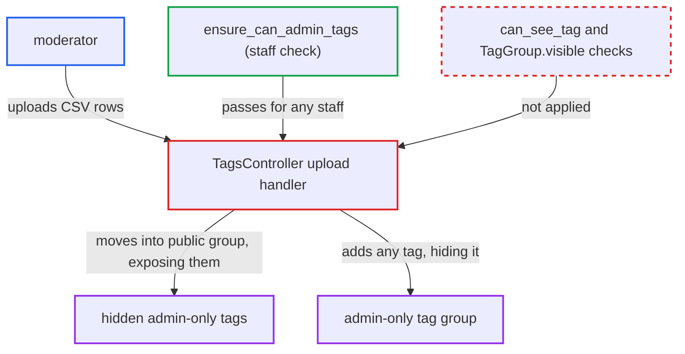

# Moderator CSV tag upload modifies admin-only tag groups and un-hides hidden tags

| Field | Value |
|---|---|
| ID | `find_01LWY5E75LfjzBwFF1pHVhvU` |
| Severity | **Medium** |
| Status | open |
| CWE | CWE-862 — Missing authorization |
| Created | 2026-10-27T22:25:26.343502Z |
| Claude Security | https://claude.ai/security/findings/find_01LWY5E75LfjzBwFF1pHVhvU |

## Description

A moderator can change which tags every non-admin user sees, including tags that were deliberately hidden from moderators, and no audit log entry is written. They can put a hidden admin-only tag into a public or new tag group, which exposes it to everyone. They can also add any tag to an admin-only group, which hides it from non-admins. `TagsController#upload` only checks `ensure_can_admin_tags!`, which any staff member passes. It does not check tag or tag group visibility.

1. **moderator** posts a CSV file to `POST /tags/upload`. Each row has the form `tag_name,tag_group_name`, and the tag name can be a hidden tag that the moderator has only guessed. ([`app/controllers/tags_controller.rb:303-345`](https://github.com/cx-benchmark/discourse/blob/e08ed05b4b1ef773b2de7948a8f88a7c182a3520/app/controllers/tags_controller.rb#L303-L345))
2. **the handler `upload`** checks only that the caller is staff. `ensure_can_admin_tags!` relies on `can_admin_tags?`, which is `is_staff? && SiteSetting.tagging_enabled`, so a moderator passes. ([`lib/guardian/tag_guardian.rb:35-37`](https://github.com/cx-benchmark/discourse/blob/e08ed05b4b1ef773b2de7948a8f88a7c182a3520/lib/guardian/tag_guardian.rb#L35-L37))
3. **the handler `upload`** looks up the tag with `Tag.find_by_name`. The lookup is case-insensitive and unscoped, so it finds tags in admin-only groups that `can_see_tag?` would hide from this moderator. If the name is wrong, a new tag is created, which tells the moderator the guessed name does not exist. ([`app/controllers/tags_controller.rb:303-345`](https://github.com/cx-benchmark/discourse/blob/e08ed05b4b1ef773b2de7948a8f88a7c182a3520/app/controllers/tags_controller.rb#L303-L345))
4. **the handler `upload`** finds the tag group by name, or creates it with `TagGroup.create!(name:)`. `find_by_name_insensitive` searches all tag groups with no visibility scoping, so admin-only groups can be named. ([`app/models/tag_group.rb:75-77`](https://github.com/cx-benchmark/discourse/blob/e08ed05b4b1ef773b2de7948a8f88a7c182a3520/app/models/tag_group.rb#L75-L77))
5. **`TagGroup#init_permissions`** gives a newly created group the `everyone: full` permission. A hidden tag put into such a group becomes usable by everyone. ([`app/models/tag_group.rb:92-99`](https://github.com/cx-benchmark/discourse/blob/e08ed05b4b1ef773b2de7948a8f88a7c182a3520/app/models/tag_group.rb#L92-L99))
6. **the handler `upload`** appends the tag to the group with `tag.tag_groups << tag_group`. No visibility check runs and no `StaffActionLogger` entry is written. ([`app/controllers/tags_controller.rb:303-345`](https://github.com/cx-benchmark/discourse/blob/e08ed05b4b1ef773b2de7948a8f88a7c182a3520/app/controllers/tags_controller.rb#L303-L345))
7. **`DiscourseTagging` visibility logic** treats the tag as visible if any of its groups is permitted for the user. A hidden tag in a public group becomes visible to everyone. A public tag in an admin-only group becomes hidden from non-admins. ([`lib/discourse_tagging.rb:738-755`](https://github.com/cx-benchmark/discourse/blob/e08ed05b4b1ef773b2de7948a8f88a7c182a3520/lib/discourse_tagging.rb#L738-L755))

## Assessment

The attacker is an authenticated moderator (staff, not admin). The site must have tagging enabled, which is the default. An admin must have restricted a tag group to `admins`. The moderator sends a CSV row such as `secret-tag,anygroup` to `/tags/upload`. The group `anygroup` is found or created with `everyone: full`, and `secret-tag` becomes visible and usable for all users, subject to category restrictions. `/tag/secret-tag` then lists its topics. The other route is a row such as `public-tag,AdminOnlyGroup`. It adds a tag to an admin-only group, and a tag in no other permitted group is then hidden from every non-admin. That tag also picks up the group's category, `one_per_topic` and parent-tag rules.

Impact: The moderator can expose hidden admin-only tag names, their topic counts and which otherwise visible topics carry them. Topic content stays behind category permissions, so the data loss is limited. The moderator can also change tag group membership for groups they cannot see or manage, hiding or exposing tags site-wide. No audit log entry is written for these changes.

## Recommendation

(1) `TagsController#upload` looks up tags and tag groups by name across everything. It relies only on the staff-level `can_admin_tags?` check, so it breaks the hidden-tag and admin-only tag group boundary that `can_see_tag?` and `TagGroup.visible` enforce elsewhere.

Fix criteria: A non-admin caller of `upload` can attach tags only to tag groups returned by `TagGroup.visible(guardian)`. They can reference only tags for which `guardian.can_see_tag?` is true. Rows naming a hidden tag or an invisible tag group are rejected, or the whole upload fails, and are not silently applied. To verify, upload `hidden-tag,new-group` and `public-tag,admin-only-group` as a moderator. No `TagGroupMembership` row is created in either case. `DiscourseTagging.visible_tags` for a regular user is unchanged.

(2) `upload` changes tag group memberships without writing a `StaffActionLogger` entry, so moderator changes made through it are not audited.

Fix criteria: Each tag group membership that `upload` creates is recorded in the staff action log with the actor, the tag and the tag group. This is consistent with `destroy`, `update` and `destroy_unused`.

## Evidence

**https://github.com/cx-benchmark/discourse**

- [`app/controllers/tags_controller.rb:303-345`](https://github.com/cx-benchmark/discourse/blob/e08ed05b4b1ef773b2de7948a8f88a7c182a3520/app/controllers/tags_controller.rb#L303-L345)
- [`lib/guardian/tag_guardian.rb:35-37`](https://github.com/cx-benchmark/discourse/blob/e08ed05b4b1ef773b2de7948a8f88a7c182a3520/lib/guardian/tag_guardian.rb#L35-L37)
- [`lib/guardian/tag_guardian.rb:4-9`](https://github.com/cx-benchmark/discourse/blob/e08ed05b4b1ef773b2de7948a8f88a7c182a3520/lib/guardian/tag_guardian.rb#L4-L9)
- [`lib/discourse_tagging.rb:738-755`](https://github.com/cx-benchmark/discourse/blob/e08ed05b4b1ef773b2de7948a8f88a7c182a3520/lib/discourse_tagging.rb#L738-L755)
- [`app/models/tag_group.rb:92-99`](https://github.com/cx-benchmark/discourse/blob/e08ed05b4b1ef773b2de7948a8f88a7c182a3520/app/models/tag_group.rb#L92-L99)
- [`app/models/tag_group.rb:75-77`](https://github.com/cx-benchmark/discourse/blob/e08ed05b4b1ef773b2de7948a8f88a7c182a3520/app/models/tag_group.rb#L75-L77)

