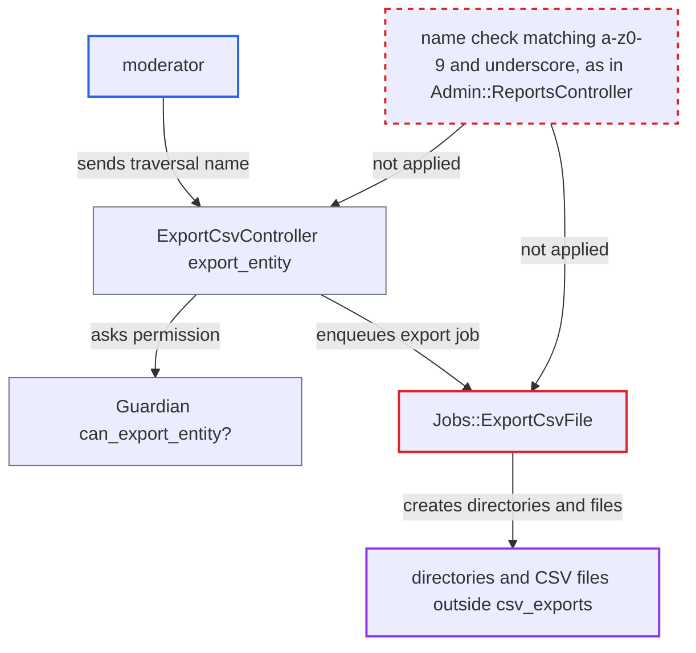

# Moderator report CSV export path traversal via unvalidated report name

| Field | Value |
|---|---|
| ID | `find_01PSEtrZRCsqM83Fz8zM8iFP` |
| Severity | **Medium** |
| Status | open |
| CWE | CWE-22 — Path traversal |
| Created | 2026-10-27T21:16:06.340712Z |
| Claude Security | https://claude.ai/security/findings/find_01PSEtrZRCsqM83Fz8zM8iFP |

## Description

A logged-in moderator can make the server create directories and near-empty CSV files at paths they choose, anywhere the application user can write. This includes other tenants' directories in multisite. The moderator cannot control file contents or overwrite existing files. The cause is that `Jobs::ExportCsvFile` builds file paths from the request's report `name` without validating it.

1. **moderator** sends an export request with a traversal report name. The request is `POST /export_csv/export_entity.json` with `entity=report` and `args[name]=../../../../../../tmp/new/sub/x_reqs`.
2. **`ExportCsvController#export_entity`** accepts `args[name]` and enqueues `:export_csv_file`. `args[name]` is permitted through `Report::FILTERS`, and the only check is that it is a String shorter than 300 characters. ([`app/controllers/export_csv_controller.rb:9-19`](https://github.com/cx-benchmark/discourse/blob/e08ed05b4b1ef773b2de7948a8f88a7c182a3520/app/controllers/export_csv_controller.rb#L9-L19))
3. **`Guardian#can_export_entity?`** lets the moderator export the report. For moderators it only tests whether the name is in the `Report.hidden?` lists, and an unknown name is not in them. ([`lib/guardian.rb:556-574`](https://github.com/cx-benchmark/discourse/blob/e08ed05b4b1ef773b2de7948a8f88a7c182a3520/lib/guardian.rb#L556-L574))
4. **the job `Jobs::ExportCsvFile`** builds the export filename from the unvalidated name. `dasherize` only turns `_` into `-`, so `../` and `/` survive, and the value plus `-#{user_export.id}` becomes the directory name. ([`app/jobs/regular/export_csv_file.rb:72-90`](https://github.com/cx-benchmark/discourse/blob/e08ed05b4b1ef773b2de7948a8f88a7c182a3520/app/jobs/regular/export_csv_file.rb#L72-L90))
5. **the job `Jobs::ExportCsvFile`** creates directories and writes the CSV outside the export directory. `FileUtils.mkdir_p` creates every missing path component, and `CSV.open` writes the file before `Report.find` runs, so the file is written even if the name is not a real report. ([`app/jobs/regular/export_csv_file.rb:430-444`](https://github.com/cx-benchmark/discourse/blob/e08ed05b4b1ef773b2de7948a8f88a7c182a3520/app/jobs/regular/export_csv_file.rb#L430-L444))
6. **the job `Jobs::ExportCsvFile`** finishes the zip and cleans up only the leaf directory. `Compression::Zip#compress` writes a `.zip` beside the traversed directory, and `FileUtils.rm_rf(dirname)` removes only the timestamped leaf, so the attacker-named parent directories and the CSV file stay. ([`app/jobs/regular/export_csv_file.rb:430-444`](https://github.com/cx-benchmark/discourse/blob/e08ed05b4b1ef773b2de7948a8f88a7c182a3520/app/jobs/regular/export_csv_file.rb#L430-L444))
7. **`Report.find`** returns an empty request report for a name ending in `_reqs`. This lets the zip and upload steps complete instead of raising. ([`app/models/report.rb:402-418`](https://github.com/cx-benchmark/discourse/blob/e08ed05b4b1ef773b2de7948a8f88a7c182a3520/app/models/report.rb#L402-L418))

## Assessment

The attacker must be a logged-in moderator. Admins also pass the permission check unconditionally. No victim action or special configuration is needed. The job runs when Sidekiq picks it up. A name ending in `_reqs` lets the zip and upload steps finish. Without that suffix the CSV file is still written, because `CSV.open` runs before `Report.find`. The report display endpoint `Admin::ReportsController#show` already enforces `/\A[a-z0-9\_]+\z/`, but the export path has no such check.

Impact: A moderator can persistently create directories with names they choose, and near-empty CSV files, anywhere the application user can write. This includes other tenants' directories in multisite. The file content is fixed (a UTF-8 BOM and the localized `Day,Count` header), existing files are not overwritten, and every file name gets a `-YYMMDD-HHMMSS` suffix. The report states no disclosure and no availability impact. The same unvalidated name also reaches `I18n.t("reports.#{@extra[:name]}.title")`.

## Recommendation

The report `name` from request parameters is put into filesystem paths (`dirname`, the CSV path, the zip path and the `rm_rf` target) in `Jobs::ExportCsvFile` without being limited to a safe set of characters. The paths can therefore leave `UserExport.base_directory`.

Fix criteria: Every path the export job touches stays under `UserExport.base_directory`. Report names not matching `/\A[a-z0-9_]+\z/` are rejected in `ExportCsvController#export_entity` or `Guardian#can_export_entity?`, and also defensively in the job. Alternatively, the on-disk filename is derived from a sanitized, basename-only value. An export with `args[name]=../../x_reqs` is refused with a 4xx response, and no file or directory is created outside the csv_exports directory.

## Evidence

**https://github.com/cx-benchmark/discourse**

- [`app/jobs/regular/export_csv_file.rb:72-90`](https://github.com/cx-benchmark/discourse/blob/e08ed05b4b1ef773b2de7948a8f88a7c182a3520/app/jobs/regular/export_csv_file.rb#L72-L90)
- [`app/jobs/regular/export_csv_file.rb:430-444`](https://github.com/cx-benchmark/discourse/blob/e08ed05b4b1ef773b2de7948a8f88a7c182a3520/app/jobs/regular/export_csv_file.rb#L430-L444)
- [`app/controllers/export_csv_controller.rb:9-19`](https://github.com/cx-benchmark/discourse/blob/e08ed05b4b1ef773b2de7948a8f88a7c182a3520/app/controllers/export_csv_controller.rb#L9-L19)
- [`lib/guardian.rb:556-574`](https://github.com/cx-benchmark/discourse/blob/e08ed05b4b1ef773b2de7948a8f88a7c182a3520/lib/guardian.rb#L556-L574)
- [`app/models/report.rb:402-418`](https://github.com/cx-benchmark/discourse/blob/e08ed05b4b1ef773b2de7948a8f88a7c182a3520/app/models/report.rb#L402-L418)
- [`app/controllers/admin/reports_controller.rb:48-52`](https://github.com/cx-benchmark/discourse/blob/e08ed05b4b1ef773b2de7948a8f88a7c182a3520/app/controllers/admin/reports_controller.rb#L48-L52)

