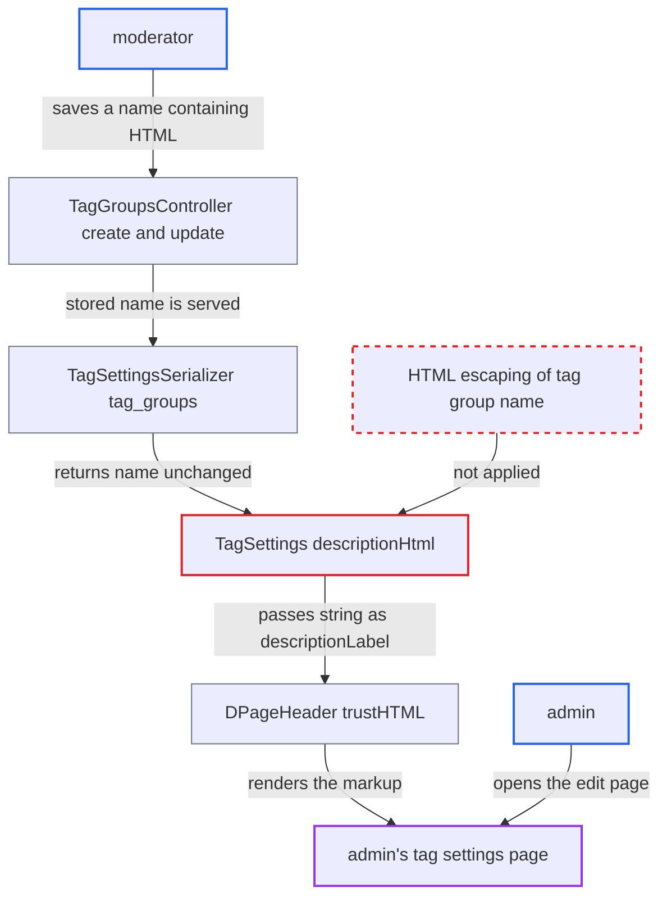

# Moderator-controlled tag group names injected as raw HTML on the tag settings page

| Field | Value |
|---|---|
| ID | `find_01GTrU381889o6bfrZSD5xoG` |
| Severity | **Medium** |
| Status | open |
| CWE | CWE-79 — Cross-site scripting |
| Created | 2026-10-27T22:08:40.773883Z |
| Claude Security | https://claude.ai/security/findings/find_01GTrU381889o6bfrZSD5xoG |

## Description

A moderator can inject HTML and CSS into the tag settings page that an admin opens. By default this allows only deceptive overlays, fake forms and defacement, not script. The attacker needs a moderator account. The cause is `descriptionHtml` in `TagSettings`, which puts the tag group name into an HTML string without escaping. `DPageHeader` then renders that string with `trustHTML`.

1. **moderator** creates or renames a tag group with HTML in its name. `TagGroupsController` create and update accept `name` and `tags` from any staff user, and `TagGroup` checks only length (at most 100) and uniqueness, so markup is stored as-is. ([`app/controllers/tag_groups_controller.rb:52-66`](https://github.com/cx-benchmark/discourse/blob/e08ed05b4b1ef773b2de7948a8f88a7c182a3520/app/controllers/tag_groups_controller.rb#L52-L66))
2. **moderator** lists tags that an admin manages in that tag group. `can_admin_tag_groups?` is `is_staff? && tagging_enabled`, so a moderator may do this. ([`lib/guardian/tag_guardian.rb:39-41`](https://github.com/cx-benchmark/discourse/blob/e08ed05b4b1ef773b2de7948a8f88a7c182a3520/lib/guardian/tag_guardian.rb#L39-L41))
3. **admin** opens `/tag/<slug>/<id>/edit` during routine administration. The page fetches `GET /tag/:tag_id/settings.json`, which is served to any user who `can_edit_tag?`. ([`app/controllers/tags_controller.rb:226-233`](https://github.com/cx-benchmark/discourse/blob/e08ed05b4b1ef773b2de7948a8f88a7c182a3520/app/controllers/tags_controller.rb#L226-L233))
4. **`TagSettingsSerializer`** returns each tag group as `{id, name}` with the name unchanged. Admins always receive all tag groups. Other tag editors receive them when `tags_listed_by_group` is enabled. ([`app/serializers/tag_settings_serializer.rb:52-70`](https://github.com/cx-benchmark/discourse/blob/e08ed05b4b1ef773b2de7948a8f88a7c182a3520/app/serializers/tag_settings_serializer.rb#L52-L70))
5. **`descriptionHtml` in `TagSettings`** concatenates `tg.name` into an `<a>` string. The code comment justifies this because tag names have `<>` stripped, but tag group names get no such treatment. ([`frontend/discourse/app/components/tag-settings.gjs:90-106`](https://github.com/cx-benchmark/discourse/blob/e08ed05b4b1ef773b2de7948a8f88a7c182a3520/frontend/discourse/app/components/tag-settings.gjs#L90-L106))
6. **`DPageHeader`** renders the string with `trustHTML`. The browser parses the moderator's markup as real HTML inside the admin's page. ([`frontend/discourse/app/ui-kit/d-page-header.gjs:143-146`](https://github.com/cx-benchmark/discourse/blob/e08ed05b4b1ef773b2de7948a8f88a7c182a3520/frontend/discourse/app/ui-kit/d-page-header.gjs#L143-L146))

## Assessment

The attacker is a moderator, since tag group create and update need only staff rights. They create or rename a tag group with HTML in `name` and list tags that an admin manages. The attack fires when an admin opens `/tag/<slug>/<id>/edit`. Admins always receive tag group names. Other tag editors receive them when `tags_listed_by_group` is enabled. The default CSP (`script-src 'strict-dynamic'`, no `unsafe-inline`) blocks inline event handlers and `javascript:` URLs. On sites that disable or relax the CSP, the same markup can run script.

Impact: By default, the moderator controls unsanitized HTML and CSS in the admin interface. Examples are full-page overlay links, fake re-authentication forms that post off-site, external resource loads that reveal the admin's IP, and defacement. No script runs under the default CSP. If the CSP is disabled or relaxed, script runs in the admin's session, which escalates a moderator to admin.

## Recommendation

`TagSettings#descriptionHtml` inserts the tag group name into an HTML string that `DPageHeader` renders with `trustHTML`. A lower-privileged staff role controls that value, and it is not output-encoded.

Fix criteria: Tag group names, and any other non-tag values in that description, are HTML-escaped before concatenation or rendered through template expressions instead of `trustHTML`. A tag group named `` shows as literal text on the tag settings page.

## Evidence

**https://github.com/cx-benchmark/discourse**

- [`frontend/discourse/app/components/tag-settings.gjs:90-106`](https://github.com/cx-benchmark/discourse/blob/e08ed05b4b1ef773b2de7948a8f88a7c182a3520/frontend/discourse/app/components/tag-settings.gjs#L90-L106)
- [`frontend/discourse/app/components/tag-settings.gjs:246-249`](https://github.com/cx-benchmark/discourse/blob/e08ed05b4b1ef773b2de7948a8f88a7c182a3520/frontend/discourse/app/components/tag-settings.gjs#L246-L249)
- [`frontend/discourse/app/ui-kit/d-page-header.gjs:143-146`](https://github.com/cx-benchmark/discourse/blob/e08ed05b4b1ef773b2de7948a8f88a7c182a3520/frontend/discourse/app/ui-kit/d-page-header.gjs#L143-L146)
- [`app/serializers/tag_settings_serializer.rb:52-70`](https://github.com/cx-benchmark/discourse/blob/e08ed05b4b1ef773b2de7948a8f88a7c182a3520/app/serializers/tag_settings_serializer.rb#L52-L70)
- [`app/controllers/tags_controller.rb:226-233`](https://github.com/cx-benchmark/discourse/blob/e08ed05b4b1ef773b2de7948a8f88a7c182a3520/app/controllers/tags_controller.rb#L226-L233)
- [`app/models/tag_group.rb:4-5`](https://github.com/cx-benchmark/discourse/blob/e08ed05b4b1ef773b2de7948a8f88a7c182a3520/app/models/tag_group.rb#L4-L5)
- [`app/controllers/tag_groups_controller.rb:52-66`](https://github.com/cx-benchmark/discourse/blob/e08ed05b4b1ef773b2de7948a8f88a7c182a3520/app/controllers/tag_groups_controller.rb#L52-L66)
- [`lib/guardian/tag_guardian.rb:39-41`](https://github.com/cx-benchmark/discourse/blob/e08ed05b4b1ef773b2de7948a8f88a7c182a3520/lib/guardian/tag_guardian.rb#L39-L41)

