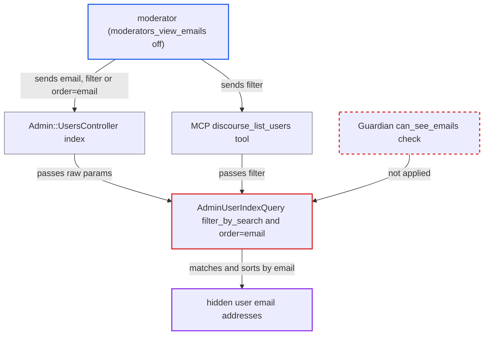

# Moderators can search and reconstruct user emails despite moderators_view_emails disabled

| Field | Value |
|---|---|
| ID | `find_01PpJ1PTnHKY79CbkT73e7dB` |
| Severity | **Medium** |
| Status | open |
| CWE | CWE-863 — Information Disclosure |
| Created | 2026-10-27T21:18:44.439424Z |
| Claude Security | https://claude.ai/security/findings/find_01PpJ1PTnHKY79CbkT73e7dB |

## Description

A moderator can work out the hidden email addresses of users, even though `moderators_view_emails` is off (the default). They search the admin user list by email text and see which accounts match. The cause is `AdminUserIndexQuery#filter_by_search`, which matches email columns for any staff caller without checking `Guardian#can_see_emails?`. Sorting by `order=email` leaks the same data.

1. **moderator** sends an admin user list request with `email` or `filter`. The request goes to `GET /admin/users/list.json` and is allowed because the caller is staff. ([`app/controllers/admin/users_controller.rb:32-50`](https://github.com/cx-benchmark/discourse/blob/e08ed05b4b1ef773b2de7948a8f88a7c182a3520/app/controllers/admin/users_controller.rb#L32-L50))
2. **`AdminUserIndexQuery#filter_by_search`** adds an email match to the query without a guardian check. `email` is matched exactly against `user_emails.email`, while `filter` terms go on to the user model. Only the IP branch checks `can_see_ip?`. ([`lib/admin_user_index_query.rb:126-172`](https://github.com/cx-benchmark/discourse/blob/e08ed05b4b1ef773b2de7948a8f88a7c182a3520/lib/admin_user_index_query.rb#L126-L172))
3. **`User.filter_by_username_or_email`** matches the term against every stored email address. It first looks for an exact email match, secondary addresses included. Otherwise it uses `lower(user_emails.email) ILIKE '%term%'` with the term unescaped. ([`app/models/user.rb:347-369`](https://github.com/cx-benchmark/discourse/blob/e08ed05b4b1ef773b2de7948a8f88a7c182a3520/app/models/user.rb#L347-L369))
4. **moderator** repeats the search with longer substrings and checks whether a known account stays in the results. Starting from for example `@gmail.com`, then `b@gmail.com`, the moderator rebuilds the full address of that account, or of many accounts at once.
5. **moderator** can also sort with `order=email` and `show_emails=true`. `show_emails=true` joins `primary_email` for any staff caller, and `order=email` sorts by that hidden column, so the list order reveals the addresses. ([`lib/admin_user_index_query.rb:19-76`](https://github.com/cx-benchmark/discourse/blob/e08ed05b4b1ef773b2de7948a8f88a7c182a3520/lib/admin_user_index_query.rb#L19-L76))

## Assessment

The attacker is an authenticated moderator on a site where `moderators_view_emails` is `false`, which is the default. They send `GET /admin/users/list.json` with `email=<addr>` or `filter=<addr or fragment>`. A second way in is the staff-only MCP tool `discourse_list_users` with `filter`. The `StaffConstraint` and `ensure_staff` checks pass for moderators. No victim action and no non-default configuration is needed.

Impact: A moderator can learn which account owns a given address, whether an address is registered, and which accounts sit under a domain. By trying substrings they can rebuild users' full email addresses. Only email addresses are exposed. The report names no effect on content, credentials, integrity or availability.

## Recommendation

(1) `AdminUserIndexQuery#filter_by_search`, `filter_by_multiple_terms` and `User.filter_by_username_or_email` match on `user_emails.email` for every staff caller. This breaks the `moderators_view_emails` and `Guardian#can_see_emails?` boundary used elsewhere for email-to-account resolution.

Fix criteria: When the acting guardian cannot see emails, the `email` param matches nothing or is rejected. `filter` terms match usernames only, including the exact secondary-email lookup, on both the HTTP endpoint and the MCP `discourse_list_users` tool. Test: as a moderator with `moderators_view_emails=false`, `?email=<exact>`, `?filter=<exact>` and `?filter=<substring of email>` do not return a user whose username lacks the term. The same requests still work for an admin or once the setting is enabled.

(2) `show_emails=true` joins `primary_email` and `order=email` sorts on it for any staff caller, so the result order reveals hidden addresses to moderators.

Fix criteria: Sorting by email is available only to callers for whom `can_check_emails?` is true. Test: as a moderator with the setting off, `order=email` (with or without `show_emails=true`) does not order results by email address.

## Evidence

**https://github.com/cx-benchmark/discourse**

- [`lib/admin_user_index_query.rb:126-172`](https://github.com/cx-benchmark/discourse/blob/e08ed05b4b1ef773b2de7948a8f88a7c182a3520/lib/admin_user_index_query.rb#L126-L172)
- [`app/models/user.rb:347-369`](https://github.com/cx-benchmark/discourse/blob/e08ed05b4b1ef773b2de7948a8f88a7c182a3520/app/models/user.rb#L347-L369)
- [`lib/admin_user_index_query.rb:19-76`](https://github.com/cx-benchmark/discourse/blob/e08ed05b4b1ef773b2de7948a8f88a7c182a3520/lib/admin_user_index_query.rb#L19-L76)
- [`app/controllers/admin/users_controller.rb:32-50`](https://github.com/cx-benchmark/discourse/blob/e08ed05b4b1ef773b2de7948a8f88a7c182a3520/app/controllers/admin/users_controller.rb#L32-L50)
- [`lib/discourse_mcp/tools/users.rb:45-62`](https://github.com/cx-benchmark/discourse/blob/e08ed05b4b1ef773b2de7948a8f88a7c182a3520/lib/discourse_mcp/tools/users.rb#L45-L62)
- [`lib/group_mutations.rb:32-34`](https://github.com/cx-benchmark/discourse/blob/e08ed05b4b1ef773b2de7948a8f88a7c182a3520/lib/group_mutations.rb#L32-L34)
- [`app/controllers/groups_controller.rb:270-276`](https://github.com/cx-benchmark/discourse/blob/e08ed05b4b1ef773b2de7948a8f88a7c182a3520/app/controllers/groups_controller.rb#L270-L276)

