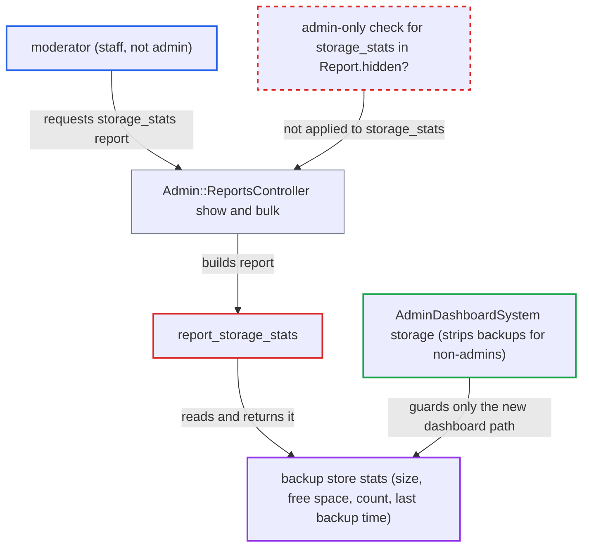

# Moderators read admin-only backup storage stats via storage_stats report

| Field | Value |
|---|---|
| ID | `find_01GzrMn9ZWT9CUDtguPDQK6N` |
| Severity | **Medium** |
| Status | open |
| CWE | CWE-863 — Incorrect Authorization |
| Created | 2026-10-27T21:35:28.997537Z |
| Claude Security | https://claude.ai/security/findings/find_01GzrMn9ZWT9CUDtguPDQK6N |

## Description

A moderator can read backup metadata that Discourse treats as admin-only: the number of backups, their total size, free space on the backup volume and the time of the last backup. No filenames, paths, bucket names or backup contents are exposed. The moderator only needs to request the `storage_stats` report. The report builder `report_storage_stats` always includes `backups`, and `Report.hidden?` does not restrict this report.

1. **moderator** requests the `storage_stats` report over HTTP. The request is `GET /admin/reports/storage_stats.json`, or the `bulk` endpoint with `storage_stats`; no special setting or user interaction is needed. ([`app/controllers/admin/reports_controller.rb:9-68`](https://github.com/cx-benchmark/discourse/blob/e08ed05b4b1ef773b2de7948a8f88a7c182a3520/app/controllers/admin/reports_controller.rb#L9-L68))
2. **`Admin::ReportsController`** lets the moderator through. It extends `Admin::StaffController`, which admits moderators, and its only extra gate is `Report.hidden?`. ([`app/controllers/admin/reports_controller.rb:9-68`](https://github.com/cx-benchmark/discourse/blob/e08ed05b4b1ef773b2de7948a8f88a7c182a3520/app/controllers/admin/reports_controller.rb#L9-L68))
3. **`Report.hidden?`** returns false for `storage_stats`. `ADMIN_ONLY_REPORTS` does not list `storage_stats`, so the report counts as visible to any staff user. ([`app/models/report.rb:41-58`](https://github.com/cx-benchmark/discourse/blob/e08ed05b4b1ef773b2de7948a8f88a7c182a3520/app/models/report.rb#L41-L58))
4. **`report_storage_stats`** builds the report with backup stats. It always sets `backups` from `BackupRestore::BackupStore.create.stats` and never looks at the guardian. ([`app/models/concerns/reports/storage_stats.rb:7-21`](https://github.com/cx-benchmark/discourse/blob/e08ed05b4b1ef773b2de7948a8f88a7c182a3520/app/models/concerns/reports/storage_stats.rb#L7-L21))
5. **the controller** returns the full report JSON to the moderator. `Report#as_json` emits `data` unfiltered, so the moderator gets `used_bytes`, `free_bytes`, `count` and `last_backup_taken_at`. ([`lib/backup_restore/backup_store.rb:73-80`](https://github.com/cx-benchmark/discourse/blob/e08ed05b4b1ef773b2de7948a8f88a7c182a3520/lib/backup_restore/backup_store.rb#L73-L80))

## Assessment

The attacker is a moderator, meaning an authenticated staff user who is not an admin. No configuration, user interaction or special timing is needed. They send `GET /admin/reports/storage_stats.json`, or request `storage_stats` through the bulk reports endpoint. The legacy dashboard template `general.gjs` already fetches this report for moderators and hides the backup part only in the browser. So moderators' browsers receive the data in normal use.

Impact: A moderator learns backup count, total backup size, free bytes on the backup volume and the last backup time. The report does not disclose filenames, bucket names, paths, backup contents or credentials, and nothing can be modified.

## Recommendation

The admin-only rule for backup storage stats is enforced on the server only in `AdminDashboardSystem`. `report_storage_stats` builds the backup stats without checking the guardian, and `Report.hidden?` does not restrict `storage_stats`. So `Admin::ReportsController#show` and `#bulk` return them to moderators.

Fix criteria: Non-admin staff get no backup storage stats on any server path. Either `storage_stats` is admin-only in `Report.hidden?`, or the report omits `backups` when the guardian is not an admin, while moderators still get upload stats. A moderator's `GET /admin/reports/storage_stats.json` and `GET /admin/reports/bulk.json` with `storage_stats` return no `backups` data. An admin still receives it. Caching cannot serve an admin's copy to a moderator.

## Evidence

**https://github.com/cx-benchmark/discourse**

- [`app/models/report.rb:41-58`](https://github.com/cx-benchmark/discourse/blob/e08ed05b4b1ef773b2de7948a8f88a7c182a3520/app/models/report.rb#L41-L58)
- [`app/models/concerns/reports/storage_stats.rb:7-21`](https://github.com/cx-benchmark/discourse/blob/e08ed05b4b1ef773b2de7948a8f88a7c182a3520/app/models/concerns/reports/storage_stats.rb#L7-L21)
- [`app/controllers/admin/reports_controller.rb:9-68`](https://github.com/cx-benchmark/discourse/blob/e08ed05b4b1ef773b2de7948a8f88a7c182a3520/app/controllers/admin/reports_controller.rb#L9-L68)
- [`app/services/admin_dashboard_system.rb:32-41`](https://github.com/cx-benchmark/discourse/blob/e08ed05b4b1ef773b2de7948a8f88a7c182a3520/app/services/admin_dashboard_system.rb#L32-L41)
- [`lib/backup_restore/backup_store.rb:73-80`](https://github.com/cx-benchmark/discourse/blob/e08ed05b4b1ef773b2de7948a8f88a7c182a3520/lib/backup_restore/backup_store.rb#L73-L80)
- [`frontend/discourse/admin/components/admin-report-storage-stats.gjs:25-27`](https://github.com/cx-benchmark/discourse/blob/e08ed05b4b1ef773b2de7948a8f88a7c182a3520/frontend/discourse/admin/components/admin-report-storage-stats.gjs#L25-L27)
- [`frontend/discourse/admin/templates/admin/dashboard/general.gjs:162-166`](https://github.com/cx-benchmark/discourse/blob/e08ed05b4b1ef773b2de7948a8f88a7c182a3520/frontend/discourse/admin/templates/admin/dashboard/general.gjs#L162-L166)
- [`app/models/user_history.rb:337-414`](https://github.com/cx-benchmark/discourse/blob/e08ed05b4b1ef773b2de7948a8f88a7c182a3520/app/models/user_history.rb#L337-L414)

