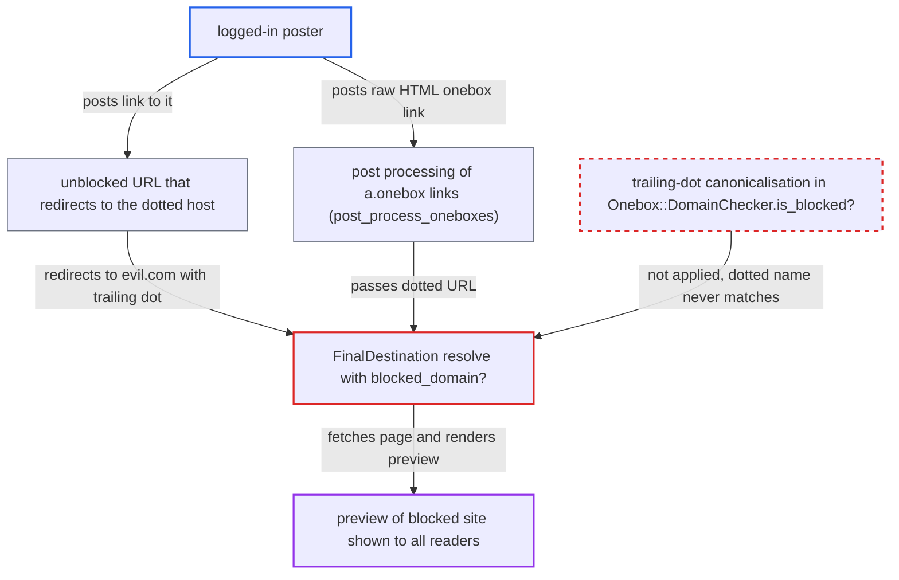

# Onebox domain blocklist bypassed by trailing-dot hostnames

| Field | Value |
|---|---|
| ID | `find_01CEcPMhWwwWzBD4GKWGZiRu` |
| Severity | **Medium** |
| Status | open |
| CWE | CWE-1289 — Improper Equivalence Validation |
| Created | 2026-10-27T21:23:36.269462Z |
| Claude Security | https://claude.ai/security/findings/find_01CEcPMhWwwWzBD4GKWGZiRu |

## Description

A logged-in user who can post can make the server fetch and show a preview of a site the admin has blocked from oneboxing. Every reader of the post sees that preview. It works by writing the blocked host with a trailing dot, such as `evil.com.`. `Onebox::DomainChecker.is_blocked?` compares host names without removing that dot, so the blocklist entry `evil.com` never matches.

1. **the attacker** posts a raw HTML link with the class onebox. The link is `<a class="onebox" href="http://evil.com./page">`. The sanitiser allows `a.onebox`, although linkify would not autolink a URL that ends in a dot. ([`frontend/pretty-text/addon/allow-lister.js:121`](https://github.com/cx-benchmark/discourse/blob/e08ed05b4b1ef773b2de7948a8f88a7c182a3520/frontend/pretty-text/addon/allow-lister.js#L121))
2. **the post processor `CookedProcessorMixin#post_process_oneboxes`** collects the link and calls `Oneboxer.onebox`. Every `a.onebox` link in the post is picked up through `Oneboxer.each_onebox_link`. ([`lib/cooked_processor_mixin.rb:13-38`](https://github.com/cx-benchmark/discourse/blob/e08ed05b4b1ef773b2de7948a8f88a7c182a3520/lib/cooked_processor_mixin.rb#L13-L38))
3. **the helper `UrlHelper.normalized_encode`** passes the URL on with the trailing dot intact. It only downcases the host, so `compute_external_onebox` receives `evil.com.` unchanged. ([`lib/url_helper.rb:182-190`](https://github.com/cx-benchmark/discourse/blob/e08ed05b4b1ef773b2de7948a8f88a7c182a3520/lib/url_helper.rb#L182-L190))
4. **the resolver `FinalDestination#resolve`** checks the initial URL and each redirect target only through `blocked_domain?`. `blocked_domain?` passes `uri.hostname` to the checker unchanged. That value keeps the dot, so the check is false at every hop. A redirect from an unblocked URL to `http://evil.com./…` gets past the per-hop check the same way. ([`lib/final_destination.rb:237-240`](https://github.com/cx-benchmark/discourse/blob/e08ed05b4b1ef773b2de7948a8f88a7c182a3520/lib/final_destination.rb#L237-L240))
5. **the checker `Onebox::DomainChecker.is_blocked?`** fails to match `evil.com.` against the blocked entry `evil.com`. It uses plain equality or `end_with?(".#{blocked}")`, and `evil.com.` satisfies neither. ([`lib/onebox/domain_checker.rb:5-15`](https://github.com/cx-benchmark/discourse/blob/e08ed05b4b1ef773b2de7948a8f88a7c182a3520/lib/onebox/domain_checker.rb#L5-L15))
6. **the method `validate_uri_format`** accepts the hostname with the trailing dot. It only checks the scheme, the port and that the host is not an IP address. ([`lib/final_destination.rb:541-563`](https://github.com/cx-benchmark/discourse/blob/e08ed05b4b1ef773b2de7948a8f88a7c182a3520/lib/final_destination.rb#L541-L563))
7. **the method `compute_external_onebox`** fetches the blocked page and renders its preview into the post. It relies only on `FinalDestination` with `stop_at_blocked_pages: true`, then calls `Onebox.preview` on the dotted URL. ([`lib/oneboxer.rb:538-556`](https://github.com/cx-benchmark/discourse/blob/e08ed05b4b1ef773b2de7948a8f88a7c182a3520/lib/oneboxer.rb#L538-L556))

## Assessment

The attacker is any logged-in user who can post. The admin has put `evil.com` in `blocked_onebox_domains`. There are two ways in. The first is raw HTML `<a class="onebox" href="http://evil.com./page">x</a>`. The second is a link to an unblocked URL that redirects to `http://evil.com./page`. The inline-onebox title crawl is also affected: `InlineOneboxer` uses the same unnormalised `is_blocked?(uri.hostname)` check before `RetrieveTitle.crawl`, and the hop check in `FinalDestination#get` has the same gap. No victim action is needed. The only condition is that the blocked host answers for the dotted name, which common servers do. DNS treats the dotted name as the same name, and the HTTPS certificate check does not reject it.

Impact: The attacker can make the server fetch pages from a domain the admin banned from oneboxing. The preview (title, description, image, site name) is shown to every reader of the post. The impact is limited to bypassing this content policy. Onebox output is still sanitised, so there is no script execution or data disclosure. SSRF protection is not weakened, because a dotted name never matches `allowed_internal_hosts`, so private IPs are still filtered.

## Recommendation

`Onebox::DomainChecker.is_blocked?` compares hostnames without canonicalising equivalent spellings. A trailing-dot hostname is therefore treated as a different domain from the blocked entry. Every caller inherits the gap, including `FinalDestination#blocked_domain?` and `InlineOneboxer.lookup`.

Fix criteria: Blocklist matching treats every spelling of a hostname that resolves to a blocked name as blocked. Trailing dots and IDNA/Unicode forms are canonicalised before comparison, or such hosts are refused in `FinalDestination#validate_uri_format`. With `evil.com` blocked, `http://evil.com./x` and `http://sub.evil.com./x` produce no onebox or inline onebox. A redirect from an allowed URL to `http://evil.com./x` also produces none. The same holds for links given as raw `<a class="onebox">` HTML.

## Evidence

**https://github.com/cx-benchmark/discourse**

- [`lib/onebox/domain_checker.rb:5-15`](https://github.com/cx-benchmark/discourse/blob/e08ed05b4b1ef773b2de7948a8f88a7c182a3520/lib/onebox/domain_checker.rb#L5-L15)
- [`lib/final_destination.rb:592-594`](https://github.com/cx-benchmark/discourse/blob/e08ed05b4b1ef773b2de7948a8f88a7c182a3520/lib/final_destination.rb#L592-L594)
- [`lib/final_destination.rb:237-240`](https://github.com/cx-benchmark/discourse/blob/e08ed05b4b1ef773b2de7948a8f88a7c182a3520/lib/final_destination.rb#L237-L240)
- [`lib/final_destination.rb:541-563`](https://github.com/cx-benchmark/discourse/blob/e08ed05b4b1ef773b2de7948a8f88a7c182a3520/lib/final_destination.rb#L541-L563)
- [`lib/url_helper.rb:182-190`](https://github.com/cx-benchmark/discourse/blob/e08ed05b4b1ef773b2de7948a8f88a7c182a3520/lib/url_helper.rb#L182-L190)
- [`lib/oneboxer.rb:538-556`](https://github.com/cx-benchmark/discourse/blob/e08ed05b4b1ef773b2de7948a8f88a7c182a3520/lib/oneboxer.rb#L538-L556)
- [`frontend/pretty-text/addon/allow-lister.js:121`](https://github.com/cx-benchmark/discourse/blob/e08ed05b4b1ef773b2de7948a8f88a7c182a3520/frontend/pretty-text/addon/allow-lister.js#L121)
- [`lib/cooked_processor_mixin.rb:13-38`](https://github.com/cx-benchmark/discourse/blob/e08ed05b4b1ef773b2de7948a8f88a7c182a3520/lib/cooked_processor_mixin.rb#L13-L38)
- [`lib/inline_oneboxer.rb:73-75`](https://github.com/cx-benchmark/discourse/blob/e08ed05b4b1ef773b2de7948a8f88a7c182a3520/lib/inline_oneboxer.rb#L73-L75)

