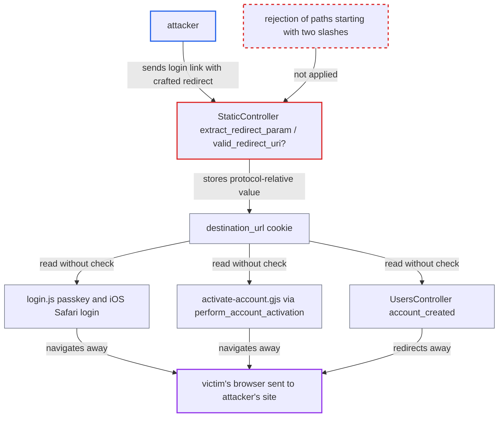

# Open redirect after login via protocol-relative path accepted by /login?redirect validation

| Field | Value |
|---|---|
| ID | `find_019fbAbMtzbLNf1yNx6jJ697` |
| Severity | **Medium** |
| Status | open |
| CWE | CWE-601 — Open redirect |
| Created | 2026-10-27T21:12:45.428241Z |
| Claude Security | https://claude.ai/security/findings/find_019fbAbMtzbLNf1yNx6jJ697 |

## Description

An attacker can send a victim to a site the attacker controls right after the victim logs in to the forum, which makes phishing look trustworthy. The attacker needs no account. The victim has to open a crafted `/login?redirect=` link and then log in, activate an account or open `/u/account-created`. `StaticController#valid_redirect_uri?` lets a protocol-relative value through because it only checks `uri.host`, and the stored cookie is later trusted.

1. **attacker** sends the victim a link to the real forum login page. The link is `https://forum/login?redirect=////evil%2Ecom`, or `////3232235777` using a decimal IPv4 literal.
2. **`extract_redirect_param` / `valid_redirect_uri?`** accept the four-slash value as a safe local path. Ruby's `URI()` gives `host` nil and path `//evil%2Ecom`, so the host comparison is skipped and the dot filter misses the percent-encoded dot. ([`app/controllers/static_controller.rb:35-52`](https://github.com/cx-benchmark/discourse/blob/e08ed05b4b1ef773b2de7948a8f88a7c182a3520/app/controllers/static_controller.rb#L35-L52))
3. **the `show` action for `/login`** stores `//evil%2Ecom` in the `destination_url` cookie. This happens whenever the visitor is anonymous, and the cookie holds exactly the protocol-relative string. ([`app/controllers/static_controller.rb:54-62`](https://github.com/cx-benchmark/discourse/blob/e08ed05b4b1ef773b2de7948a8f88a7c182a3520/app/controllers/static_controller.rb#L54-L62))
4. **`login.js`** navigates to the cookie value after a passkey login. It calls `window.location.assign(destinationUrl)` with no origin check, and iOS Safari password logins do the same through `window.location.href`; the browser resolves the value to `https://evil.com/`. ([`frontend/discourse/app/controllers/login.js:166-170`](https://github.com/cx-benchmark/discourse/blob/e08ed05b4b1ef773b2de7948a8f88a7c182a3520/frontend/discourse/app/controllers/login.js#L166-L170))
5. **`activate-account.gjs`** sends the browser to the cookie value after account activation. It sets `window.location.href` to `response.redirect_to`, which `UsersController#perform_account_activation` echoes from the cookie without validation. ([`frontend/discourse/app/templates/activate-account.gjs:70-72`](https://github.com/cx-benchmark/discourse/blob/e08ed05b4b1ef773b2de7948a8f88a7c182a3520/frontend/discourse/app/templates/activate-account.gjs#L70-L72))
6. **`UsersController#account_created`** redirects server-side to the cookie value. It calls `redirect_to(destination_url, allow_other_host: true)`, and a string starting with `//` is sent as the location `//evil%2Ecom`. ([`app/controllers/users_controller.rb:1150-1151`](https://github.com/cx-benchmark/discourse/blob/e08ed05b4b1ef773b2de7948a8f88a7c182a3520/app/controllers/users_controller.rb#L1150-L1151))

## Assessment

Any anonymous attacker on the internet can do this, and no forum privileges are needed. The attacker sends a link to the real forum, `https://forum/login?redirect=////evil%2Ecom`. The victim must open it and then authenticate. There are three ways to trigger the redirect. The first is logging in with a passkey, or with a password on iOS Safari. The second is activating a new account from the email link. The third is visiting `/u/account-created` while logged in. Consumers that go through `StaticController#enter` are safe. Rails' `allow_other_host: false` protection and a second `URI()` parse, which finds a host in `//evil%2Ecom`, reject the value there.

Impact: The attacker controls where the victim's browser lands right after a genuine forum login. That lends the forum's trust to a phishing page, for example one that says the session expired and asks for the password again. The report says no forum data is read or changed directly, and the effect on the user's navigation and trust is limited.

## Recommendation

(1) `StaticController#valid_redirect_uri?` decides by `uri.host`, which is nil for `////host`, and by a literal-dot filter that percent-encoding and numeric IP literals bypass. A cross-origin destination therefore reaches the `destination_url` cookie.

Fix criteria: `extract_redirect_param` returns `/` for any `redirect` whose path starts with `//` or `/\\`. More generally, it returns `/` for anything that is not a single-slash-rooted same-origin path, for example a destination rebuilt from a parsed path that must match `\A/[^/\\]`. `GET /login?redirect=////evil%2Ecom` and `////3232235777` no longer set a `destination_url` cookie with a `//` prefix.

(2) The consumers of the `destination_url` cookie treat an attacker-writable cookie as a trusted same-origin path. They are the passkey and iOS paths in `login.js`, `activate-account.gjs`, `UsersController#account_created` and `perform_account_activation`.

Fix criteria: Every consumer navigates only to a same-origin path. On the client, the destination is resolved with `new URL(dest, location.origin)` and `origin === location.origin` is required. On the server, `allow_other_host: true` is dropped or the host is validated. With `destination_url=//evil%2Ecom` set manually, passkey login, account activation and `/u/account-created` all stay on the forum.

## Evidence

**https://github.com/cx-benchmark/discourse**

- [`app/controllers/static_controller.rb:35-52`](https://github.com/cx-benchmark/discourse/blob/e08ed05b4b1ef773b2de7948a8f88a7c182a3520/app/controllers/static_controller.rb#L35-L52)
- [`app/controllers/static_controller.rb:54-62`](https://github.com/cx-benchmark/discourse/blob/e08ed05b4b1ef773b2de7948a8f88a7c182a3520/app/controllers/static_controller.rb#L54-L62)
- [`frontend/discourse/app/controllers/login.js:166-170`](https://github.com/cx-benchmark/discourse/blob/e08ed05b4b1ef773b2de7948a8f88a7c182a3520/frontend/discourse/app/controllers/login.js#L166-L170)
- [`frontend/discourse/app/templates/activate-account.gjs:70-72`](https://github.com/cx-benchmark/discourse/blob/e08ed05b4b1ef773b2de7948a8f88a7c182a3520/frontend/discourse/app/templates/activate-account.gjs#L70-L72)
- [`app/controllers/users_controller.rb:1150-1151`](https://github.com/cx-benchmark/discourse/blob/e08ed05b4b1ef773b2de7948a8f88a7c182a3520/app/controllers/users_controller.rb#L1150-L1151)

