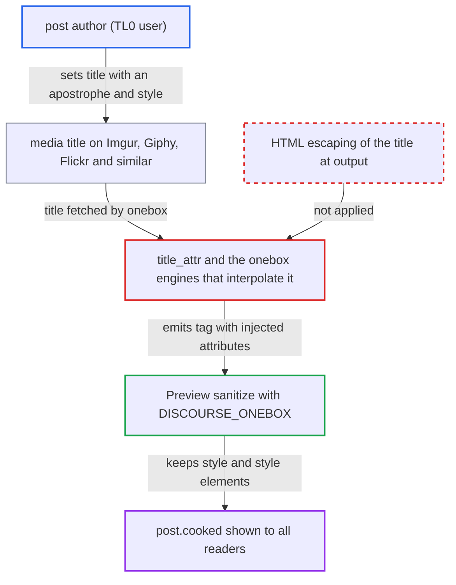

# OpenGraph title_attr interpolates third-party media titles unescaped into host-specific onebox HTML

| Field | Value |
|---|---|
| ID | `find_016XAd1f9eNSoCqCm7QG7mvi` |
| Severity | **Medium** |
| Status | open |
| CWE | CWE-79 — HTML injection |
| Created | 2026-10-27T21:27:09.230662Z |
| Claude Security | https://claude.ai/security/findings/find_016XAd1f9eNSoCqCm7QG7mvi |

## Description

A registered user who can post a link can inject their own `style` attributes and `` encoded once in this way. The report assumes Sanitize 7.0.0 `RELAXED` allows `style` with properties such as `position`, `top`, `left`, `width`, `height` and `z-index`, and allows the `style` element.

Impact: The attacker stores HTML and CSS in posts that post authors cannot otherwise produce. They can cover the page with a clickable overlay (the Imgur image sits inside a link), hide or restyle UI and moderation controls, and deface or blank the topic for all readers. An injected `<style>` element can add selector-based `url()` beacons that leak limited facts about the viewer. The CSP `script-src` and Sanitize block script, so the impact stays limited.

## Recommendation

(1) `OpenGraph#title_attr` and the engines that interpolate `og.title` or `oembed.title` build HTML attributes and text by string interpolation without escaping. A remote title can therefore break out of the `title='…'` attribute.

Fix criteria: Every remote title placed in onebox HTML is HTML-escaped for its context, quotes included, or is emitted through Mustache `{{ }}`. A giphy, Imgur or Flickr page whose `og:title` is `a' style='position:fixed` yields one ``. Its `title` attribute holds that literal text and it has no `style` attribute.

(2) `Normalizer#sanitize_value` entity-decodes after `Sanitize.fragment`. This re-creates the `<` and `>` that the sanitizer had encoded, so values described as sanitized can carry markup.

Fix criteria: Normalized values contain no markup characters re-introduced after sanitization, or every consumer treats them as plain text and escapes them. An `og:title` whose page source is `&amp;amp;lt;style&amp;amp;gt;` yields no literal `<style>` in any onebox output.

## Evidence

**https://github.com/cx-benchmark/discourse**

- [`lib/onebox/open_graph.rb:13-15`](https://github.com/cx-benchmark/discourse/blob/e08ed05b4b1ef773b2de7948a8f88a7c182a3520/lib/onebox/open_graph.rb#L13-L15)
- [`lib/onebox/normalizer.rb:35-41`](https://github.com/cx-benchmark/discourse/blob/e08ed05b4b1ef773b2de7948a8f88a7c182a3520/lib/onebox/normalizer.rb#L35-L41)
- [`lib/onebox/engine/imgur_onebox.rb:61-69`](https://github.com/cx-benchmark/discourse/blob/e08ed05b4b1ef773b2de7948a8f88a7c182a3520/lib/onebox/engine/imgur_onebox.rb#L61-L69)
- [`lib/onebox/engine/animated_image_onebox.rb:12-20`](https://github.com/cx-benchmark/discourse/blob/e08ed05b4b1ef773b2de7948a8f88a7c182a3520/lib/onebox/engine/animated_image_onebox.rb#L12-L20)
- [`lib/onebox/engine/flickr_onebox.rb:27-53`](https://github.com/cx-benchmark/discourse/blob/e08ed05b4b1ef773b2de7948a8f88a7c182a3520/lib/onebox/engine/flickr_onebox.rb#L27-L53)
- [`lib/onebox/engine/five_hundred_px_onebox.rb:16-19`](https://github.com/cx-benchmark/discourse/blob/e08ed05b4b1ef773b2de7948a8f88a7c182a3520/lib/onebox/engine/five_hundred_px_onebox.rb#L16-L19)
- [`lib/onebox/engine/google_photos_onebox.rb:48-74`](https://github.com/cx-benchmark/discourse/blob/e08ed05b4b1ef773b2de7948a8f88a7c182a3520/lib/onebox/engine/google_photos_onebox.rb#L48-L74)
- [`lib/onebox/preview.rb:210-215`](https://github.com/cx-benchmark/discourse/blob/e08ed05b4b1ef773b2de7948a8f88a7c182a3520/lib/onebox/preview.rb#L210-L215)
- [`lib/oneboxer.rb:578-592`](https://github.com/cx-benchmark/discourse/blob/e08ed05b4b1ef773b2de7948a8f88a7c182a3520/lib/oneboxer.rb#L578-L592)
- [`lib/onebox/sanitize_config.rb:7-45`](https://github.com/cx-benchmark/discourse/blob/e08ed05b4b1ef773b2de7948a8f88a7c182a3520/lib/onebox/sanitize_config.rb#L7-L45)
- [`lib/cooked_processor_mixin.rb:13-47`](https://github.com/cx-benchmark/discourse/blob/e08ed05b4b1ef773b2de7948a8f88a7c182a3520/lib/cooked_processor_mixin.rb#L13-L47)
- [`spec/fixtures/onebox/imgur.response:66`](https://github.com/cx-benchmark/discourse/blob/e08ed05b4b1ef773b2de7948a8f88a7c182a3520/spec/fixtures/onebox/imgur.response#L66)

