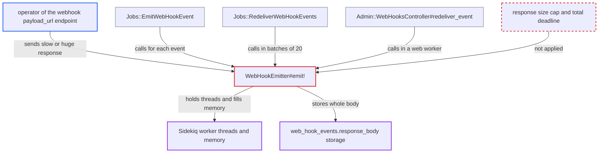

# Outgoing webhook response body read and stored without size or total-time limit

| Field | Value |
|---|---|
| ID | `find_01Fb7Li9BmFoZppbKXr5rFzq` |
| Severity | **Medium** |
| Status | open |
| CWE | CWE-400 — Resource exhaustion |
| Created | 2026-10-27T21:12:45.500184Z |
| Claude Security | https://claude.ai/security/findings/find_01Fb7Li9BmFoZppbKXr5rFzq |

## Description

Whoever controls a webhook's `payload_url` endpoint can slow down Discourse background jobs, and can bloat its memory and database. The attack needs an admin to have registered that URL. `WebHookEmitter#emit!` reads the whole response with no size cap and no total time limit, then stores it unchanged. No data is exposed or changed.

1. **the job `Jobs::EmitWebHookEvent`** calls `WebHookEmitter#emit!` for each webhook event. Routine forum activity produces these events, and the job runs in the Sidekiq `low` queue. ([`app/jobs/regular/emit_web_hook_event.rb:42-54`](https://github.com/cx-benchmark/discourse/blob/e08ed05b4b1ef773b2de7948a8f88a7c182a3520/app/jobs/regular/emit_web_hook_event.rb#L42-L54))
2. **`WebHookEmitter#emit!`** POSTs the payload to the `payload_url` through Faraday. The only time limits are `open_timeout`, `read_timeout` and `write_timeout`, all set to `REQUEST_TIMEOUT = 20`, and Net::HTTP applies each one to a single socket operation, not to the whole request. ([`app/services/web_hook_emitter.rb:11-55`](https://github.com/cx-benchmark/discourse/blob/e08ed05b4b1ef773b2de7948a8f88a7c182a3520/app/services/web_hook_emitter.rb#L11-L55))
3. **the attacker's endpoint** answers with a slow-drip body or a multi-GB body. One byte every less than 20 seconds never trips a per-read timeout, so the delivery never ends.
4. **`FinalDestination::FaradayAdapter`** buffers the full response body in a Ruby String. The adapter only adds SSRF IP filtering to `Faraday::Adapter::NetHttp`, so it sets no size or wall-clock limit. ([`lib/final_destination/faraday_adapter.rb:3-21`](https://github.com/cx-benchmark/discourse/blob/e08ed05b4b1ef773b2de7948a8f88a7c182a3520/lib/final_destination/faraday_adapter.rb#L3-L21))
5. **`WebHookEmitter#emit!`** writes `response.body` unmodified into `web_hook_events.response_body`. The column is a Postgres `text` column and the application checks no length before the write. ([`app/services/web_hook_emitter.rb:11-55`](https://github.com/cx-benchmark/discourse/blob/e08ed05b4b1ef773b2de7948a8f88a7c182a3520/app/services/web_hook_emitter.rb#L11-L55))
6. **`Jobs::RedeliverWebHookEvents`** runs the same `emit!` call for up to 20 events one after another. A single stalled response blocks the rest of the batch. ([`app/jobs/scheduled/redeliver_web_hook_events.rb:24-46`](https://github.com/cx-benchmark/discourse/blob/e08ed05b4b1ef773b2de7948a8f88a7c182a3520/app/jobs/scheduled/redeliver_web_hook_events.rb#L24-L46))
7. **`list_events` in `Admin::WebHooksController`** loads stored oversized bodies back into web workers. It serializes `response_body` for up to 50 stored events per page. ([`app/controllers/admin/web_hooks_controller.rb:141-149`](https://github.com/cx-benchmark/discourse/blob/e08ed05b4b1ef773b2de7948a8f88a7c182a3520/app/controllers/admin/web_hooks_controller.rb#L141-L149))

## Assessment

The attacker runs or has compromised the HTTP server behind a webhook `payload_url`, for example a malicious integration host or a lapsed domain. They need no Discourse login. An admin must have registered that URL first, and the attacker cannot influence that. After that, ordinary forum activity queues `Jobs::EmitWebHookEvent`, and the server answers with a slow-drip body or a multi-GB body. The same unbounded call also runs in the scheduled `Jobs::RedeliverWebHookEvents` and in `Admin::WebHooksController#redeliver_event`. The `redeliver_event` path is admin-triggered and runs in a web worker, where the Pitchfork 30 s timeout caps it.

Impact: Each Sidekiq thread that picks up a delivery to the hostile endpoint can be held indefinitely. Under sustained forum activity the shared worker threads fill with stalled deliveries, which delays other background jobs such as emails and notifications. Huge bodies can grow Sidekiq memory until it restarts or is OOM-killed, and they bloat `web_hook_events`, which keeps rows for `retain_web_hook_events_period_days`. No data is disclosed or changed, the web front stays up, and an admin can recover by disabling the webhook.

## Recommendation

`WebHookEmitter#emit!` reads the complete remote response into memory and stores it verbatim. A hostile webhook endpoint therefore controls how much memory, time and database space a delivery uses.

Fix criteria: A delivery stops reading once the response body passes a small fixed cap, on the order of `FinalDestination::MAX_REQUEST_SIZE_BYTES` or less (a few KB is enough for admin display). A delivery also aborts when a total wall-clock deadline passes, whatever the per-read timeouts say. `web_hook_events.response_body` only ever receives the truncated body. To verify, point a test webhook at a server that streams an unbounded or slow-drip body. The job must finish within the deadline, memory must stay bounded, and the stored `response_body` must be truncated.

## Evidence

**https://github.com/cx-benchmark/discourse**

- [`app/services/web_hook_emitter.rb:11-55`](https://github.com/cx-benchmark/discourse/blob/e08ed05b4b1ef773b2de7948a8f88a7c182a3520/app/services/web_hook_emitter.rb#L11-L55)
- [`lib/final_destination/faraday_adapter.rb:3-21`](https://github.com/cx-benchmark/discourse/blob/e08ed05b4b1ef773b2de7948a8f88a7c182a3520/lib/final_destination/faraday_adapter.rb#L3-L21)
- [`app/jobs/regular/emit_web_hook_event.rb:42-54`](https://github.com/cx-benchmark/discourse/blob/e08ed05b4b1ef773b2de7948a8f88a7c182a3520/app/jobs/regular/emit_web_hook_event.rb#L42-L54)
- [`app/jobs/scheduled/redeliver_web_hook_events.rb:24-46`](https://github.com/cx-benchmark/discourse/blob/e08ed05b4b1ef773b2de7948a8f88a7c182a3520/app/jobs/scheduled/redeliver_web_hook_events.rb#L24-L46)
- [`app/controllers/admin/web_hooks_controller.rb:141-149`](https://github.com/cx-benchmark/discourse/blob/e08ed05b4b1ef773b2de7948a8f88a7c182a3520/app/controllers/admin/web_hooks_controller.rb#L141-L149)
- [`lib/final_destination.rb:255-264`](https://github.com/cx-benchmark/discourse/blob/e08ed05b4b1ef773b2de7948a8f88a7c182a3520/lib/final_destination.rb#L255-L264)

